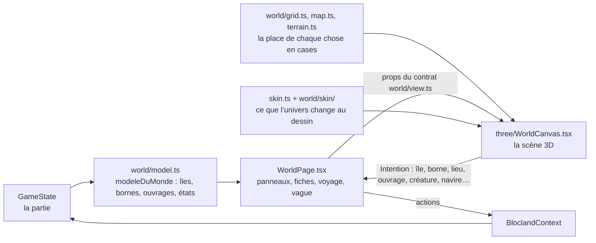
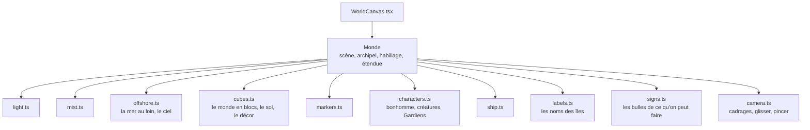
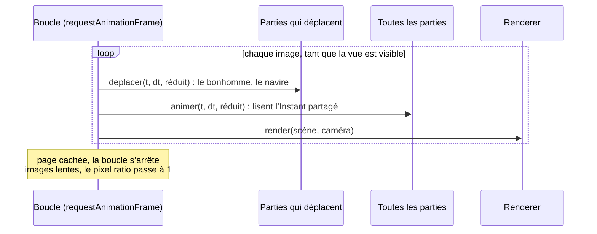
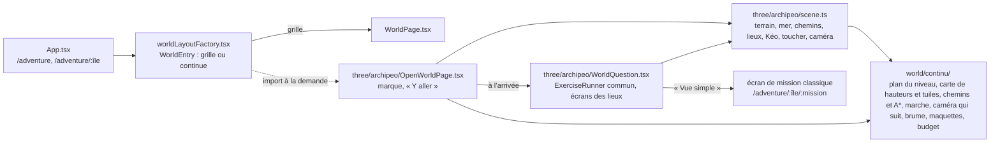

# Le monde

Le monde est la partie la plus lourde du code (`src/game/world/` et `src/game/three/`). Il est rangé pour qu’une même logique serve plusieurs dessins et plusieurs univers : le jeu dit **ce qui existe**, la grille dit **où**, la vue dit **comment le dessiner**. L’histoire de ce rangement est dans [Séparer le jeu du rendu](../conception/separation-jeu-rendu.md) ; le style attendu dans [le rendu](../rendu/style.md).

## Du jeu au dessin

- `world/model.ts` lit la partie et rend le modèle d’un archipel en identifiants, sans une seule case : les îles, leurs bornes et leur état, les ouvrages, le voyage en cours. Il décide aussi ce que fait un toucher (jouer une borne, ouvrir l’île d’un ouvrage, aller vers une île, voyager).
- La grille (`world/map.ts` la forme des îles, depuis GD-12 prise dans le catalogue de `world/formes.ts`, une distance signée par forme, coupée à sa boîte autour du cœur, plus profonde du côté de son trait, `world/terrain.ts` le monde en cubes, un métier par fichier dans `world/terrain/`, `world/paths.ts` la marche, `world/harbor.ts` le quai) place tout en cases du monde ; `world/grid.ts` en est l’entrée (`grilleDe`).
- La place des lieux dans leur région (GD-9) : `world/placement.ts` garde la pose de chaque lieu (son origine dans le monde et un quart de tour, `placeIslands` ; sans pose, la carte de départ de `map.ts`) et la géométrie d’un quart de tour. Chaque lieu tire son dessin (côte, relief, décor, place du Gardien, lacs, cascades, marges, et les amorces de ses ouvrages que le décor laisse libres, `amorcesDuDessin`) une fois pour toutes dans son repère (`IslandDef.repere`, sa place sur la carte de départ) : posé ailleurs, il garde exactement son dessin ; tourné, tout tourne d’un bloc avec lui (cubes, emprise, bornes, portes, Gardien, créature, et la vue du lieu, `viewYaw` + quarts × 90°). `world/footprint.ts` donne le cadre fixe de chaque région, l’emprise d’un lieu (sa terre, ses grandes constructions, le quai) et les écarts ; `world/routing.ts` trace les liaisons (droites ou en L à un seul coude sur l’eau, d’une arrivée sur la côte, au pas de la grille du monde, à une autre ; 96 cases au plus ; une arrivée n’est possible que sur une côte libre d’où le bonhomme gagne le cœur du lieu à pied) et dit si une place est possible (`spotPossible`) ; `world/savedLayout.ts` lit le champ facultatif `world.layout` de la sauvegarde (sa forme ; qu’il tienne sur la grille, `posesOfLayout` ; les places de Gardien d’avant GD-11 ignorées). `world/appliedLayout.ts` pose cette disposition sur le monde (`applyLayout` : les lieux à leur place, les liaisons à reposer hors du dessin, les arrivées choisies données au traceur), appelé par `BloclandContext` à la lecture de la partie et à chaque changement de `world.layout` ; son numéro (`disposition`, `layoutVersion`) refait la scène 3D et les cadrages qui lisent la place des lieux, et chaque cache de la disposition (`layoutCache`) se vide. Les grandes constructions au large suivent leur lieu (`monumentIslet`). Le cœur du mode « Aménager » : `world/arrange.ts` les actions pures sur le monde d’une partie (déplacer un lieu à une place libre, le calage sur la plus proche d’un point touché, la suivante dans une direction, tourner un lieu, sauf ceux qui ne tournent pas, `placeTurns`, une borne dans la bande de devant, une arrivée ; les liaisons qui ne tiennent plus deviennent « à reposer », `relinkBetween` les repose ; `backToStartingMap`), `world/arrangeSession.ts` « Remettre comme avant » et ↶ (un instantané à l’entrée, une pile des poses), `world/placeSentence.ts` la place d’un lieu en signes (`placeSigns` : le voisin, l’une des huit directions et sa flèche, l’écart en cases) et en mots (« au nord de la Forêt des sons, à 2 cases »), comme on la voit sur la Carte : le nord en haut, l’est à droite de l’écran, du côté des x du monde qui descendent (les flèches du mode, `DIRECTION_STEP`, suivent le même sens ; `three/arrangeDirections.test.ts` le vérifie sur la projection de la caméra de la Carte). Les mots du mode et du menu nomment une liaison avec le mot de l’univers (« ouvrage », `world/linkWord.ts`). Les bornes déplacées se dessinent à leur place (`placeStations` de `placement.ts`, `chosenStation`) : la bande réservée suit, le décor qui évite les bornes lit leur vraie place (`questStations` ; la place de départ, `startingStations`). Une île posée sur des écueils les cache, avec une case d’eau de marge (`visibleReefs` de `terrain/sea.ts`), sans changer la mer tirée ni la carte de départ. L’écran du mode : `world/arrangeMode.ts` (le choix et ses gestes, les phrases), `world/arrangeView.ts` (ce que montre le choix, en cases du monde), `world/arrangeHandles.ts` (les poignées, les flèches et « Tourner », sur l’eau autour du choix ; leur dessin, `three/arrangeHandles.ts`), `world/arrangeGesture.ts` (le temps du geste), `three/arrange.ts` (leur dessin ; les types de ce qu’elle reçoit, `ArrangeView` et `ArrangeGesture`, sont dans le contrat des vues, `world/view.ts`), `Arranging.tsx` (l’état du mode), `ArrangeBar.tsx` (l’écran) et `ArrangeList.tsx` (la vue simple, aussi dans le panneau « Aménager la carte » au téléphone en grand texte). Pendant le mode, la vue renvoie deux intentions de plus : `mer` (le point touché sur l’eau) et `ouvrage` avec son point (l’arrivée la plus proche).
- Les liaisons posées (GD-9) : `world/linkGeometry.ts` est la couche de grille qui donne leur géométrie aux règles (`provideLinkGeometry`, inversion de dépendance : `world/archipelago.ts` ne connaît ni la carte ni le traceur). Il tient les liaisons posées de la partie (`poserLesLiaisons`, appelé par `BloclandContext` et par `worldCubes`), trace celles d’une région dans leur ordre (`linkRoute`), dit la nature d’une liaison (`linkKind` : sentier, pont jusqu’à 36 cases, bac au-delà) et les voisins d’un lieu (`neighboursOf`, ce qu’un pont relierait : la vue d’un lieu les cadre avec lui). Le monde (`world/terrain/links.ts`) dessine les liaisons posées, plus le fantôme de celle qui ouvre chaque lieu fermé ; une liaison posée que le traceur ne refait pas prend le tracé qu’elle aurait seule (`traceDeRepli`), à défaut son tracé d’origine. `src/main.tsx` et `src/setupTests.ts` importent ce module au démarrage : sans lui, les règles n’ont pas de géométrie.
- La réunion de deux lieux (GD-9, point 10) : `world/join.ts` calcule, sans Three.js, la forme de la construction qui réunit deux lieux posés au plus près (`joinShape` : le côté commun, au moins 4 cases ; les cases sur l’eau entre leurs côtes, jusqu’à 2 cases dans une baie ; les marches, trois au plus) et son plan (`joinPlan`, une `PlanDef` de zone `join`, `join.<lieu>.<lieu>`, dont les clés restent dans le repère de la paire : la paire bouge et tourne sans rien perdre). `appliedJoins` lit les paires de la disposition appliquée (`placeJoins`, `world/placement.ts`) ; `world/arrange.ts` réunit (`joinIslands`), bouge et tourne la paire d’un bloc (`groupAt`) ; le traceur (`routing.ts`) tient les liaisons au large de la zone de la réunion ; `world/terrain/joins.ts` en tire les cubes (digue d’herbe, ou jetée de pierre dans Archipéo), touchables comme un monument (`place` `monument:join.…`) ; `avatarRoute` passe dessus. À l’écran, `Joins.tsx` (panneau, page, ligne dans le panneau du lieu) et `useJoinBuilder` (`useMonumentBuilder.ts`, la pose case par case partagée avec les monuments).
- `world/view.ts` est le contrat entre `WorldPage` et une vue : les props qu’une vue reçoit, les intentions qu’elle renvoie (`world/layout.ts`). `WorldPage` ne connaît que ce contrat.
- La vue ne décide rien : elle dessine ce qu’on lui passe et dit ce que l’élève a touché, par une `Intention` que `WorldPage` traite dans un seul `switch`.

## La scène 3D

`three/WorldCanvas.tsx` crée une scène par archipel, refaite quand l’archipel ou « Réduire les animations » change. La scène est faite de **parties**, chacune dans son fichier, qui suivent le même contrat (`three/scenePart.ts`) : se construire à partir du `Monde`, s’animer à chaque image, se libérer.

- Les parties partagent un `Instant` (où en sont la marche et le voyage à cette image) et les `Derniers` props de la vue : la scène n’est pas refaite quand les props changent, les parties les relisent.
- Le calcul des formes est pur et testé dans `world/` (`landMesh.ts` le sol en facettes, `construction.ts` les bâtiments, chacun avec ses réglages, ses couleurs et son éclairage rangés à côté, dans `landMesh/` et `construction/`, `decorMesh.ts` le décor, `sea.ts`, `fauna.ts`, `characters/`) ; `three/` ne fait que les donner à Three.js.
- Chaque géométrie, matériau et texture est libéré quand la scène est refaite (`dispose`).

## Les univers

Les deux univers jouent le même jeu. Ce qui change au dessin passe par un objet `Habillage` (`game/skin.ts`, une donnée par univers dans `world/skin/`) : le ciel, la brume, le sol, les personnages, les étiquettes, les bulles. Ce qui change aux mots passe par `src/universes/` (`useTextes()`). Le code ne teste presque jamais le nom de l’univers : il lit une ligne de l’habillage ou un texte.

## Le monde continu (prototype, derrière un drapeau)

Le monde ouvert d’Archipéo, piste B « chemins aimantés » (choix du mainteneur, 14 octobre 2026), se prototype au 6e, à côté du monde en grille, sans le toucher. Il ne vient qu’avec l’adresse `?monde=ouvert` (avant le `#`), dans l’univers Archipéo et à un archipel qui a son plan de niveau (aujourd’hui le 6e seul, voir « Le plan par niveau » plus bas) ; sans elle, rien ne change, et Blocland ne le voit jamais. La progression des missions reste commune ; seul champ propre au monde continu, les Détours trouvés (`world.detours`, `world.detoursLit`, facultatifs, voir plus bas).

- `worldLayoutFactory.tsx` (la fabrique) choisit la disposition de la page du monde : `worldLayoutFor` rend la grille partout sauf avec le drapeau, le rendu d’Archipéo, un archipel qui a son monde ouvert (`OPEN_WORLD_ARCHIPELAGOS`, aujourd’hui le 6e) et une adresse qui est la sienne (le monde, ou une île de cet archipel) ; `WorldEntry` passe alors ce niveau à la page (`<OpenWorldPage level>`) ; la Carte, l’École et les autres panneaux du village restent ceux de la grille. C’est le seul fichier qui mène au monde continu, et seulement par `import()` : la vue et son code pur sont dans un morceau à part, chargé à la première ouverture. `world/continu/isolation.test.ts` le vérifie, avec `world/layers.test.ts` (`world/continu` est une couche pure).
- Le plan par niveau (GD-22, lot 1, choix du mainteneur du 18 octobre 2026) : le monde continu reçoit le plan de son niveau au lieu de lire celui du 6e en dur. `world/continu/levelPlan.ts` (pur) définit `LevelPlan` (le niveau ; les lieux, dans l’ordre du plan ; les terres ; les liaisons du réseau des chemins et la liaison du pont de chaque terre reliée ; la côte et le large, pour la boîte de la Carte ; l’étendue du terrain), le registre `planFor(level)` et `OPEN_WORLD_LEVELS` (un seul plan enregistré, celui du 6e, tiré de `plan6e.ts` sans rien changer ; `levelPlan.test.ts` vérifie que la fabrique connaît les mêmes niveaux), et retrouve un lieu ou une terre par son seul identifiant, unique d’un niveau à l’autre (`placeById`, `placeOfIsland`, `levelOfPlace`, `ALL_LANDS`). `OpenWorldPage.tsx` lit `planFor(level)` et le passe à la scène (`OpenWorldOptions.plan`) et aux fonctions qui parcourent un niveau : les terres (`lands.ts` : `linkedLands`, `startLandOf`, `nodeLands`, `openLands`, `placesOfLands`, `bridgeEdge`), la prochaine mission (`mission.ts` : `nextMission`, `playedPlaces`), le toucher (`toucher.ts`, `nearestPlace`), la Carte (`map.ts` : `islandBox`, `mapStart`, `clampMap`, `panMap`, `zoomMap`, `reframeMap`, `fitDistance`), la liste des lieux (`placesRows`, `MapLabels`), le lieu de l’adresse (`placeFromParam`), les terres vues de la grille (`landLinks.ts`), les commandes et l’entraide (`remiseOf.ts`). Le niveau remplace le « 6e » écrit en dur : le modèle du monde, Kéo, les histoires et les commandes, le lieu de départ (`portState(…, region)`, le passage fait vers l’archipel suivant), le modèle de l’habitant (`habitantModelName`, préfixé du niveau de son lieu), la palette d’un aménagement (la classe de son île). Ce qui dessine le 6e reste celui du 6e et lit `plan6e.ts` ou `planFor('6e')` : le relief et ses tuiles (`terrain.ts`, `tiles.ts`), la mer, la flore, les chemins et leurs rubans (`paths.ts`), la marche libre (`freeWalk.ts`), les ponts (`bridges.ts`, `bridgeLay.ts`), la brume (`veil.ts`), les lieux et leurs scénettes, l’Escale, la Nef et le budget du monde ouvert du 6e (`budget.ts`).
- Le plan du 5e et ses deux étages (GD-22, lot 2, première moitié, 19 octobre 2026) : `plan5e.ts` (pur) relève le plan des lieux validé en pixels (`fromPlan5e`) : la côte, le plateau du nord (`PLATEAU_5E`, `PLATEAU` : 13 unités de haut, sa falaise en 4), les deux chenaux (`CHANNELS_5E`), les aiguilles (`NEEDLES_5E`), les quatorze lieux (`PLACES_5E`, un par île du 5e ; ceux du haut, `UPPER_PLACES_5E`), la Lisière (`DEPARTURE_5E`, son nœud `port-quai`), le réseau des chemins, les trois passages (`LINKS_5E` : deux ponts et la cabine de la Montée) et les quatre terres (`LANDS_5E`) ; `levelPlan.ts` l’enregistre (`planFor('5e')`, `OPEN_WORLD_LEVELS`), avec `pricePerPlace` (le prix d’une liaison du niveau) et `upper` (le triangle « en haut » de la Carte). Les identifiants des lieux et des terres restent uniques : `PlaceId` et `LandId` réunissent les deux niveaux ; ce qui n’existe qu’au 6e (scénettes, questions dans le lieu, aménagements, remises) prend un lieu du 6e par `sixthPlace` (une erreur dite tout de suite pour un lieu du 5e), et `placeRecord(plan, of)` range une valeur par lieu du plan. Les deux étages sont faits par la seule hauteur du sol (`terrain5e.ts` : `heightAt5e`, `plateauShare`, `landDistance5e`, `channelClearance`), tuiles, anneaux et niveaux de détail du 6e repris (`drawTileWith` et `GroundPaint`, `farHeightsOf`, `tileRect` et `tileRings` sur la grille du niveau) ; la forêt de palétuviers et les aiguilles poussent dans les tuiles (`tileFacets5e`, `tileGround5e`, `tileFlora5e`, `tileCounts5e`). Le réseau du 5e (`paths5e.ts` : `NETWORK_5E`, sur `network.ts`, le réseau commun tiré de `paths.ts` ; ses rubans par `networkRibbons`, coupés aux culées et le long de la cabine). Les ponts (`bridges.ts`) retrouvent leur niveau par leur terre (`planOfLand`) ; `allBridges`, `bridgeFloor` et `clampToOpen` prennent le plan (le 6e par défaut) ; la cabine (`isCabin`) est un passage comme un pont : tombée (le rail cassé, la caisse couchée au pied) ou relevée (rails, chevalets, deux gares), Kéo monte sur son rail en ligne droite. La brume des terres fermées (`veil.ts`) lit le niveau de sa terre, et celle des Aiguilles reste sur le plateau ; la brume des failles et la ligne de la falaise pour la Carte sont dans `mist5e.ts` ; l’eau du 5e (`seaPixels5e`, `WATER_TONES_5E`), son ciel et sa lumière (`SKY_OF`, `LIGHT_5E`, `HORIZON_COLOR_5E`, `SHADOW_DIR_5E`), ses ruines (`ruins5e.ts`, dessinées par `places.ts` comme une seule pièce de ruine). Le budget du 5e : `openWorldCost5e`, `mapCost5e` (`npm run rendu:budget`). La vue du 5e (seconde moitié du lot 2, 19 octobre 2026) : `levelWorld.ts` (pur) donne à la scène ce qu’elle lit d’un niveau (`levelWorld(level)` : la carte de hauteurs et son sol, le réseau et le dessus de ses rubans, `RibbonNet`, le dessin des chemins, les tuiles, `TileSource`, que `createTileStore` reçoit, l’eau et ses teintes, la lumière, le ciel, l’horizon, le sens des ombres) et `sixth`, vrai au 6e seul : `three/archipeo/scene.ts` y coupe l’Escale, la Nef, les Détours, la faune, le regard levé vers les lieux hauts, les traces, les scénettes et les poses (une question dans un lieu du 5e ne montre rien, `isSixthPlace`), si bien qu’aucun lieu du 5e n’arrive à `sixthPlace` ; un départ hors d’un lieu se fait au quai de la Lisière (`DEPARTURE_5E`). La brume des failles y est un maillage de plus, du matériau de la brume (dans le brouillard), caché sur la Carte, où la ligne de la falaise et le liseré sombre des chemins (`pathMapEdges5e`, `paths5e.ts`) entrent dans le maillage des lieux ; la Carte n’a pas de point « port », et chaque point dit s’il est en haut (`MapSpotOnScreen.up` : les lieux de `plan.upper`, Kéo sur le plateau, `onPlateau`), que `MapLabels.tsx` montre en triangle collé au nom (`upper`). La marche libre (`freeWalk.ts`) tire sa grille du plan qu’on lui donne (`walkGridSteps(field, plan)`, une grille par terrain) : au 5e, les nœuds de `NETWORK_5E`, les palétuviers et les aiguilles en obstacles (`obstaclesIn5e`), la falaise trop raide pour l’herbe, la cabine sur la liaison de son passage. La page (`OpenWorldPage.tsx`) n’y donne ni l’Escale, ni la Nef, ni les Détours, ni les habitants (commandes, entraide, pastilles, « Reprendre » dans la scène) ; ses missions se jouent sur l’écran habituel (`WorldQuestion`, `plain`, sans scénette : `NO_SCENETTE`). La fabrique ouvre le monde ouvert au 6e et au 5e (`OPEN_WORLD_ARCHIPELAGOS`). Retouche du lot 2 : la forme des aiguilles et de la Montée est commune (`spire5e.ts` : `spire`, `spireRadiusAt`) ; le ponton de la Lisière (`QUAY_5E`, `quayFacets` dans `paths5e.ts`) entre dans le maillage des chemins ; l’anse de la Lisière est un troisième chenal (`CHANNELS_5E.anse`), qui ne sépare aucune terre ; `levelWorld` donne aussi la lumière par la hauteur (`heightLight` : `HEIGHT_LIGHT_5E` au 5e, rien au 6e), que la scène ajoute au matériau du décor (`heightLit`, une clé de programme à part ; le 6e garde le sien) ; la brume d’état lit ses voiles et ce que les chemins en écartent dans le niveau de sa terre (`VEIL_LAYERS_5E`) ; la Carte reçoit `landNames` (le nom des terres fermées sous leur cadenas, la cabine) et pose d’abord sous lui le nom d’un lieu du bas (`MapLabel.below`) ; une prochaine destination d’un autre niveau suggère la première terre du plan qu’on peut relier (`openWorldLands`, son île).
- `world/continu/` est pur, sans Three.js ni React, et ne lit que lui-même : `plan6e.ts` le plan des lieux du 6e en données (relevé en pixels sur le plan confirmé le 13 octobre 2026, puis converti : la côte en anneau, le lagon et sa passe, l’îlot du Phare, la falaise nord, la rivière, le haut pays de l’est ; les lieux du prototype, le Phare, les Quais, les Filets, les Écluses et, depuis le point 8, cinquième lot, les Marais salants (`saltworks`, le premier lieu neuf, sur sa grève aplanie, `SALT_FLAT`), avec leur nouveau nom et l’île d’aujourd’hui dont ils reprennent la mission ; le réseau des chemins et ses nœuds ; les couleurs du 6e ; depuis la piste 1, lot 1, l’île cinq fois plus grande autour de Kéo, `PLAN_SCALE` 2,8 pixels du plan par unité, environ 120 pas de Kéo du Phare aux Quais, `KEO_STEP` 0,8 unité pour un demi-mètre, les lieux gardant leur taille, posés au bord de leur rivage, leur porte à quelques pas d’eux, et le bassin des Quais, `DOCK`, l’eau devant laquelle la barque s’amarre pendant une question) ; `terrain.ts` la carte de hauteurs (calculée une fois) et ses tuiles carrées de facettes en aplats (sable, herbe, roche, haut de falaise ; ce qui est sous l’eau n’est pas dessiné), à deux niveaux de détail (`tileFacets` : chaque case de près, une sur trois de loin, une jupe sous le pourtour qui bouche la fente entre les deux ; `tileTriangleCounts` les compte sans rien construire), et leurs deux anneaux autour de Kéo (`tileRings` : de près à 22 unités, de loin jusqu’au bout de la brume, rien derrière la caméra), et `heightOnMesh`, la hauteur exacte du sol dessiné de près où se posent les pieds ; `sea.ts` l’image de l’eau, tirée par le code (le lagon clair qui fond vers le large) ; `facets.ts` les triangles en aplats et quelques volumes (pavé, prisme, toit) ; `places.ts` les maquettes des lieux, des volumes dessinés par le code derrière `modelOfPlace(id)`, l’emplacement où les modèles TRELLIS se glisseront ; `construction.ts` la construction de chaque lieu ([GD-20](../gameplay/propositions/GD-20.md), lot 1) : le lieu se rebâtit lui-même : `places.ts` range ses volumes en une ruine (`ruinOf`, là avant toute partie ; ce qui y est tombé, la cloche du Phare, attend la rangée qui le relève, `until`) et en trois étapes, chacune en rangées (`placePieces`, le corps, le haut, les abords ; `modelOfPlace`, le lieu entier, dont la hauteur porte la marque, la brume et le cadenas), le séchoir des Filets (`FILETS_RACK`, `filetsRack`) et la lumière de la lanterne du Phare (`lanternLight`, de la couleur `LAMP_COLOR`), `construction.ts` dessine ce que posent les parties (`constructionFacets`), ce qui gît encore dans la ruine (`fallenFacets`), la ruine posée dans le monde (`ruinFacets`), l’étape qui porte la trace d’une scénette (`TRACE_STAGE`, `traceStagePosed` : la scénette se joue sur elle, sinon avec ce qui est là ; `traceShown`), la lanterne allumée (`lanternLit` : dès que son haut est posé) ; chaque volume a sa rangée dans son étape (de 0 à 1, de bas en haut), et une partie pose des tranches d’étapes (`PartShape`, de `from` à `to`) : une étape coupée en deux ou en trois rangées (GD-14) se pose tranche par tranche, chaque volume une fois (`constructionFacets`) ; la caméra d’une pose (`poseView` : le lieu vu du côté de sa porte ramené vers le sud, `poseSide`, à la plus courte distance où il tient entier dans un écran 4:3 avec Kéo entier là où il se tient, `keoSpots`, au champ de la caméra qui suit), ses temps (`POSE_SECONDS`) et son déroulé (`createPoseRun` : la vue en fait le rendu ; sa fin, à son terme, passée ou interrompue, dit une fois que les célébrations peuvent venir ; une pose qui en suit une autre la prend en main, `handOver`, sans que la première dise sa fin) ; `freeWalk.ts` le déplacement libre (GD-20, lot 1 « Toucher le sol ») : la grille de ce qui se marche (`buildWalkGrid` d’un coup, `walkGridSteps` par tranches que la vue mène au repos ; des cases de 0,875 : le sol au-dessus de l’écume et pas trop raide, la pierre de l’Escale, les chemins toujours ; ni l’eau, ni les lieux, ni les bâtiments de l’Escale, ni les troncs et rochers ; la terre de chaque case tirée des chemins, sans passer par un pont), le plus proche endroit où l’on marche (`nearestWalkable`) et le trajet libre (`freeRoute`, A* en huit directions qui préfère les chemins, lissé tant qu’une ligne droite, suivie case par case, ne coûte pas plus) ; `paths.ts` le point du réseau le plus proche d’un toucher (`snapToNetwork`), le plus court trajet (A*, `findRoute`), la place de Kéo à l’ouverture du monde (`startOf` : sur le chemin qui part de la porte du lieu, à 9 unités de son centre) et le dessin des chemins (sentiers, digue et pontons en bois sur l’eau) ; `walk.ts` la marche de Kéo à vitesse constante (`WALK_SPEED`, 4 unités par seconde, la seule constante ; `WALK_CADENCE`, la cadence de ses jambes qui en découle, un pas de `KEO_STEP` par demi-cycle, donnée à `corpsDuBonhomme` ; arrivée immédiate avec « Réduire les animations », ou « Passer le trajet ») ; `camera.ts` la caméra qui suit Kéo (piste 1, lot 1 : `followPose`, de trois quarts, à 4,3 m de haut et 6 m derrière lui, tournée vers le nord par défaut et, depuis le 18 octobre 2026, de l’angle `yaw` autour de lui (GD-20, rotation libre ; `occlusionLift`, `lookUp` et `tileRings` suivent la même direction), sans roulis ; un champ de 56° où Kéo tient environ un sixième de la hauteur de l’écran, son milieu à 62 % du haut, au-dessus de « Y aller », l’horizon en haut de l’image ; `followStep`, une zone morte de 0,8 unité puis un rattrapage doux, d’un bloc avec « Réduire les animations » ou après un saut ; `occlusionLift` et `liftStep`, la caméra qui monte juste assez quand le relief passe entre elle et Kéo ; `WORLD_FOG`, la brume de 40 à 115 unités, écartée pendant une question ; `markOffset`, la marque au-dessus du sommet d’un lieu), et l’angle de la caméra d’une question (`CAMERA_PITCH`, `CAMERA_FOV`) ; `veil.ts` la brume sur les terres fermées (GD-20, point 3, « vraies terres ») : deux voiles bas posés sur le sol d’une terre (`VEIL_LAYERS`, `VEIL_HEIGHT`), transparents par sommet et jamais opaques (`veilShare` : effacés loin des chemins et des lieux de la terre, vers une terre voisine et sur l’eau, sauf autour d’un lieu), sous le repère de chaque lieu ; `tiles.ts` la réserve des tuiles pour la vue (de loin, toutes gardées ; de près, les 24 plus récentes, et jamais plus d’une faite par image, en deux images, son sol puis ce qui y pousse : celles qui manquent attendent dans une file, leur version de loin tenant leur place) ; `mission.ts` la prochaine mission des lieux, tous ouverts dès que leur mission existe, même fermée dans la grille (`missionOfPlace` ; celle de la prochaine destination du jeu, sinon la première encore à jouer dans l’ordre du plan), la place de sa marque à l’écran ou de sa flèche au bord, la distance au lieu en un, deux ou trois points (`distanceSign`, jamais en texte), les lieux sous la brume (les lieux fermés, `closedPlaces` de `links.ts`) ; la prochaine mission saute les lieux fermés (`nextMission`, son filtre `open`) ; `playedPlaces` donne les lieux où une mission a déjà des étoiles, qui restent ouverts ; `questions.ts` ce que chaque lieu fait des items de sa mission (lot 4, règle du jumeau « à l’essai », [Plusieurs univers](../univers/univers.md), § 4.2) : le Phare garde les mots de la Chasse au son, portés par des cloches, en deux manches de six (`bellRounds`) ; les Filets prennent les items du lieu écrits dans le Markdown de l’île (« ## Au lieu · Archipéo », rangés par `npm run contenu` dans `placeItems.json`, que seul le monde ouvert lit), chacun avec la clé de son jumeau ; les Écluses et les Quais gardent l’item du générateur et n’en changent que la phrase (`quaiScene`, la ligne de calcul de référence dessous) et la consigne (`placeInstruction`) ; la trace de la scénette d’un lieu se voit dès la première réussite de sa mission, tirée des étoiles gardées (`traceDone`) ; `questionScene.ts` la place de la question à l’écran (`questionLayout` : chaque réponse est une étiquette de 48 px au moins et l’objet qui la porte, d’au moins sa hauteur, touchables ensemble (`hit`), écartées de 12 px ; sur tablette, les objets dans le tiers du milieu, leur étiquette au-dessus ; sur un écran de moins de 500 px de haut, les étiquettes en rangée en bas, les objets juste au-dessus ; la colonne à gauche, 38 % de la largeur sur un écran bas, élargie à 46 puis 54 % quand la phrase n’y tient pas (`widen`, mesuré avant l’affichage, gardé pour la mission), au-delà en pleine largeur sous la barre du haut (`WIDEN_FULL`), et si elle n’y tient toujours pas, ou si un mot de réponse ne tient pas entier dans son étiquette (les cloches en grand texte ; on ne répond alors que dans « Vue simple », jamais de mot coupé ni d’étiquettes sur deux rangées), « Vue simple » proposé d’emblée, la voix gardée, sans réduire le texte (`WIDEN_OFFER` ; mesures avant l’affichage, `three/archipeo/fit.ts`), jamais sur une réponse ; la règle de l’item à droite de la colonne sur un écran bas ; au Phare, le carillon : les cloches plus petites, leur mot dessous, la fenêtre de la scène descendue jusqu’à leur pied pour que la tour se dresse au-dessus ; la fenêtre de la scène sous la barre de « Vue simple » et de la pause), les objets des réponses (un carillon de cloches de bronze clair au pied du Phare, dans l’axe de la tour, des paniers, des leviers à pommeau rouge, des caisses à plaque, sur un ponton), la scène d’un item (la pêche sur le filet, le sas en bandes et son trait de niveau, l’échelle et ses crans, les caisses en palettes de dix, serrées au premier plan sur un quai à leur taille, la grue et la barque ; les repères 0, 1, 2 en panneaux de la page) et sa réaction (de 1,4 s : la pêche va au panier et s’y voit, la barque passe le sas, les caisses partent à la barque ou en arrivent et y restent, les bonnes cloches s’allument ; un état fixe avec « Réduire les animations »), la trace que la réussite de chaque scénette laisse dans son lieu (`placeTrace` : les lampes de la galerie du Phare, la grue remontée et la barque chargée des Quais, le pan raccommodé et le panier plein des Filets, la porte d’amont ouverte et le sas rempli des Écluses ; depuis GD-20, lot 1, les pièces durables du prototype sont devenues les parties de la construction, et la Roue qui tourne et le Veilleur sont retirés) ; `budget.ts` le coût du monde continu, poste par poste.
- `three/archipeo/` est la vue, chargée à la demande : `scene.ts` crée la scène (le terrain en deux maillages, l’anneau de près et l’anneau de loin, dont les tableaux sont faits une fois et où l’on recopie les tuiles quand Kéo s’éloigne de trois unités, avec la boîte englobante de leurs tuiles ; une tuile de près faite au plus par image, `tiles.ts` ; un plan d’eau, les chemins, les quatre lieux réunis en un maillage (GD-20, lot 1 : leurs ruines, leurs parties posées et les traces de leurs scénettes, posées dans le monde par `placeFacets` et réunies par `mergeFacets`, refait seulement quand ce qu’il montre change, jamais par image), sauf le lieu de la prochaine mission, dans un second maillage du même matériau, pris dans la brume comme le reste (il en sortait net, retour du mainteneur du 19 octobre 2026 ; de loin, c’est la marque qui le montre ; sur la Carte, tous dans le premier) ; pendant une scénette, la maquette des Quais et la trace du lieu (sauf au Phare) en sont retirées ; la brume des lieux fermés, un seul maillage transparent sans lumière, refait quand on relie un lieu (sans fondu jusqu’à la pose animée) ; un ciel de la couleur de la brume ; Kéo avec sa marche existante, `corpsDuBonhomme` de `three/paintedCharacters.ts`, un peu plus grand, et un anneau clair à ses pieds ; l’anticrénelage, le rapport de pixels plafonné à 2 et ramené à 1 si l’appareil peine, comme le monde en grille), lit le toucher (un lieu touché y envoie Kéo, ailleurs il rejoint le point du chemin le plus proche), fait marcher Kéo, le suit avec la caméra et donne à chaque image la place de la marque ; `OpenWorldPage.tsx` pose l’interface : la marque de la prochaine mission (le nom du lieu sur fond uni, sans icône tant qu’aucune icône de lieu n’existe ; un nom long passe à la ligne), une flèche au bord quand le lieu est hors champ, la distance en points pleins dessous (`data-loin`), et dite dans le libellé de la marque, « tout près », « pas loin » ou « loin », refait seulement quand le palier change, toujours hors de Réglages et de « Y aller » (`keepClear`, les dimensions relues par un `ResizeObserver`, jamais à chaque image), « Y aller » toujours en bas au milieu, qui saute toujours le trajet (`goTo(lieu, true)` : Kéo est devant le lieu d’un coup, la caméra le suit d’un bloc ; on marche en touchant le monde, « Passer le trajet » pendant la marche ; grisé, sa raison écrite au-dessus), Réglages dans le coin ; à l’arrivée devant un lieu, la mission s’y joue : `WorldQuestion.tsx` choisit l’exercice comme l’écran classique (`pickExercise`, `loadExercise`) et le confie au lanceur commun, `ExerciseRunner`, avec un `RunnerStage` (le découpage en écrans du lieu, l’écran du lieu, sa consigne, « Revenir au Phare » au lieu des liens vers l’île, « Vue simple », et le bilan du lieu, `WorldDone.tsx` : les étoiles, une rangée de pastilles « icône + nombre », le détail de l’écran classique derrière « Détail », un seul bouton « Continuer » toujours en vue ; les célébrations attendent la fin de la question et de son bilan, `useHoldCelebrations`) : les items, la graine, le deuxième essai, la correction, les étoiles et le barème restent ceux du code commun. Les écrans des lieux (`BellScreen`, `PlaceChoiceScreen`) écrivent la phrase (après « Bravo », le mot juste entre dans le trou), la ligne de calcul et la règle de l’item (`Aid`, comme `ChoiceItem` ; aux Filets, la carte réduite à la ligne « règle » du Markdown, entière dans « Vue simple ») dans une colonne sur fond uni, posent chaque réponse en bouton qui couvre l’étiquette et son objet (les touches 1 à 9 et Entrée marchent comme ailleurs) ; sur un écran bas, la consigne est lue en entier une fois avant « Commencer », puis devient une icône ronde qui la lit (« Lire la consigne », distincte du carré « Lire la phrase »), l’indice une ampoule de 48 px (leur mot dessous en grand texte), les étapes une ligne fine ; la consigne s’efface dès qu’on a répondu ; la voix se coupe entre deux items ; la taille est relue par un `ResizeObserver`, une fois par image au plus, et demandent à la scène d’en montrer l’item (`OpenWorld.question`) ; la scène descend dans la scénette du lieu (chacun a la sienne depuis le lot 4 de la piste 1 : la question vue de loin, sa caméra fixe et sa brume écartée sont retirées, et `layout.scenette` est obligatoire, `ScenetteLayout`), pose la scène de l’item et les objets des réponses (un maillage) et joue la réaction (un maillage, une coupe franche avec « Réduire les animations ») ; les lieux reçoivent leurs parties posées et leurs traces par `OpenWorld.setPlaces` ; une partie arrivée pendant une question se pose après le bilan (« Continuer ») : la caméra va en 0,9 s vers le lieu (`poseView`), la partie descend à sa place en 0,7 s dans un maillage à part, d’un matériau éclairci (un appel, le temps de la descente), puis rejoint le maillage des lieux ; la fin de la pose (`onPosed`) rend les célébrations que la page retenait ; on la regarde 1,1 s, puis la caméra revient à Kéo en 0,9 s ; un toucher, « Y aller », la Carte ou une question finissent la pose (la partie posée, la caméra derrière Kéo, d’un coup) ; avec « Réduire les animations », la partie est posée d’un coup, la caméra coupe sur le lieu 1,6 s puis revient. `three/archipeo/constructionParts.ts` (pur, testé sous jsdom) lit les parties de la grille (`world/parts.ts`) telles quelles, mêmes identifiants, même ordre, même sauvegarde (`world.parts`) : le plan `<lieu>-1` devient le corps, `-2` le haut, `-3` les abords, un plan coupé en `m` parties en `m` tranches qui se suivent ; une partie posée dans la grille l’est dans le monde continu, et inversement ; il en tire l’état de chaque lieu sur la Carte (`constructionState` : en chantier dès une partie posée, achevé quand toutes le sont). La page pose aussi les accès directs du monde en grille (`WorldShortcuts`, en haut à gauche : Reprendre, Révisions, Commandes, tels quels, les commandes délavées sans action ni compteur tant qu’elles ne se livrent pas dans le monde continu, `requestsLater`) et Réglages en haut à droite, décalés de la zone sûre de l’appareil, masqués pendant une question ; la marque évite la colonne (une zone de 72 px depuis le bord jusqu’à 16 px sous elle, d’où la flèche du bord ne sort que par le bas, ou à sa droite si elle n’y tient pas sans couvrir un autre bouton, `keepClear`, `Obstacle.below`). Sur la Carte, le bouton de chaque lieu ouvert est une pastille : son nom et l’icône de l’état de sa construction (le marteau, la coche, `islandStateIcon`) ; le mot de l’univers (`etatsDIle`), accordé au nom du lieu (`stateWord`, `agree` dans `plan6e.ts` : « restauré », « restaurés », « restaurées »), est dit par le bouton ; `layoutMapLabels` décale une pastille qui en touche une autre vers le haut ou le bas, puis la serre (son nom sur deux lignes, plus étroit, l’icône de l’état dessous, `narrow`, mesurée par `MapLabels.tsx` dans les deux formes), puis, Kéo réduit à sa pastille, la pose à la place libre la plus proche de tout l’écran, et ne la réduit à son icône (48 px) que si aucune place de l’écran ne la laisse sans toucher une autre étiquette (relecture de L6b : un lieu ouvert garde son nom) ; le nom d’un lieu fermé glisse de côté sous son cadenas (`shift`) ou descend d’un pas (`drop`) plutôt que de se taire, et les étiquettes évitent la bande de 72 px de gauche et la colonne.
- La scénette (piste 1, lot 2, le Phare) : `world/continu/scenette.ts` (pur) donne la scénette d’un lieu (`scenetteOf` : le rôle de l’habitant en tête du panneau, sans prénom, la place vide de sa phrase d’accueil, et le placement des objets-réponses, `rangee`, où viendra « à leur place » si le mainteneur le choisit), sa place à l’écran (`scenetteLayout`, sur la colonne de `questionLayout` : A sur tablette, la consigne en haut, la scène au milieu, la rangée des réponses en bas, « Valider » en bas à droite ; B sur un écran bas, la colonne à gauche, la scène à droite, la rangée en bas à droite ou sur toute la largeur si les mots n’y tiennent pas ; le champ `scenette` de `QuestionLayout`), la caméra de la galerie (`scenettePose`, Kéo à gauche et l’habitant à droite dans la scène, le décalage de l’image comme une question), le décor de près (`scenetteDecor` : la galerie, sa rambarde, la gardienne), le plan des cloches (`bellPlane`), la main qui tient la corde (`habitantHand`), la place de Kéo (`scenetteKeo`) ; `questionScene.ts` pend les cloches à leur poutre (`answerObjects` avec les choisies et la corde) ; `camera.ts` lève le regard près du Phare (`lookUp`, `lookUpStep`, `LOOK_UP` : la caméra peut descendre un peu, jamais reculer) et pose la marque du Phare à côté de sa lanterne (`markBeside`) ; `FacetBuilder.beam` tend un pavé entre deux points. Dans la vue, `scene.ts` fait le décor à l’arrivée et le libère au départ (un maillage, du matériau du terrain), descend la caméra en 0,9 s (coupe franche avec « Réduire les animations »), cache les cloches le temps de la descente, pose les cloches sous leurs réponses sur un plan vertical devant la rambarde, efface les cloches à la fin (`scenetteEnd` ; plus rien ne s’allume à la réussite d’une scénette du Phare depuis le troisième lot du point 8 de GD-20 : la lanterne s’allume avec son haut) et donne à chaque image la place des cadenas des lieux sous la brume (`onLocks`) ; `WorldQuestion.tsx` choisit la disposition, met le rôle en tête (`RunnerStage.head`, rendu par `ExerciseRunner` avant la consigne), pose « Valider » en bas à droite sur tablette, retire d’abord l’image devant les mots puis propose « Vue simple » si un mot est coupé, ouvre « Vue simple » sur place (la même question en liste, les cloches choisies gardées, « Valider » sous la liste dans une bande qui reste au bas du panneau quand il défile, une ombre en bas ou en haut tant qu’il reste à lire, `data-suite` ; sur un écran bas, le panneau prend toute la hauteur, la consigne repliée en une ligne avec le rôle et sa voix, coupée après un mot entier, dépliée par « Lire la suite » ou un toucher sur la ligne (une icône seule au plus grand texte, où elle s’ouvre dépliée au premier item puis se replie à l’item suivant), pour que la première rangée de cloches se voie dès l’ouverture, et la bande d’un bouton de 48 px) et « Scène », à la même place, y ramène (les cloches gardées ; « Vue simple » reste choisie après « Rejouer ») ; il garde la scène à la fin ; `OpenWorldPage.tsx` pose les cadenas sans passer par React.
- La scénette des Quais et la Carte des lieux ouverts (piste 1, lot 3) : `scenette.ts` donne aux Quais leur scénette (« Le docker », sans prénom ni réplique ; le docker immobile en quelques volumes, `docker` : gilet vert lagon, tête sable, casquette jaune lanterne, un bras posé sur une caisse, le crochet de levage en main ; `scenetteHabitant`), la place de chaque lieu (`SITES`, et au Phare sans sa galerie `PHARE_FOOT`, au pied de la tour, sur le socle, la caméra basse : une scénette se joue sur le lieu tel qu’il est bâti, ses fonctions reçoivent `posed`, l’étape qui porte la trace posée ; le sol où se tiennent Kéo et l’habitant, leur écart, ce que la caméra cadre et son angle ; aux Quais, la bande de devant du quai, au pied de la grue), la colonne à gauche sur tous les écrans aux Quais (`column`, B même sur tablette, sauf au plus grand texte, où A garde des lignes lisibles ; au plus grand texte, `grand` met le panneau de A sous la barre de « Vue simple », sur toute la largeur), la rangée des nombres à droite de la colonne dès qu’ils y tiennent (`words` : seules les cloches ont des mots larges), et ce qui distingue les lieux dans la vue (`answersHang`, `scenetteHidesPlace` : la maquette des Quais cachée pendant la scénette, une seule grue ) ; `questionScene.ts` dessine le quai de la scénette (`quai` : le quai qui s’allonge avec les caisses, la barque amarrée contre la bande de devant, `quayBoat`, reconnaissable à sa proue courte en pointe, son étrave qui monte et sa lanterne, ses bancs aux deux bouts, une place libre côté proue, la proue toujours dans le cadre ; la grue au bout est, `craneHook`), les caisses-réponses en rangée (`answerObjects` : une caisse tentée et fausse bascule sur son arête, la bonne, partie au crochet, s’efface de la rangée, `gone`) la réaction (la bonne caisse monte au crochet de la grue et y reste, figée avec « Réduire les animations »), la réussite de la mission (`quaySuccess` : la caisse posée dans la barque, la vitre allumée de la lanterne de proue) et la pièce durable des Quais (dès la première, la barque chargée, sa lanterne allumée, amarrée au bord de quai) ; `plan6e.ts` donne au bassin des Quais un tour irrégulier et son bord droit (`DOCK_EDGE`), que `paths.ts` borde d’un mur de pierre, d’un chaperon et de trois bittes (`dockEdge`, dans le maillage des chemins). `map.ts` (pur) tient la Carte : l’île entière à l’ouverture (`mapStart`, `fitDistance`, les quatre coins de l’île à l’écran, en perspective, par dichotomie), glissée (`panMap`) et pincée autour du point sous les doigts (`zoomMap`) dans ses limites (`clampMap` : de 100 unités à l’île entière, le point regardé dans l’île), la pose de la caméra (`mapPose`, 64° sous l’horizon, nord en haut) et la place des étiquettes à l’écran (`layoutMapLabels` : Kéo et les cadenas d’abord, puis les noms des lieux ouverts à la place libre la plus proche, puis ceux des lieux fermés, glissés de côté ou descendus jusqu’à 80 px sous leur cadenas, rien entre eux (`NAME_DROPS`), en dernier recours juste au-dessus de lui (`RISE_GAP`), si aucun autre cadenas n’est à moins de 40 px du nom (`RISE_CLEAR`), tus s’ils gênent, jamais l’un sur l’autre ni sur les boutons, Kéo réduit à sa pastille si c’est trop serré ; une place cherchée à 80 px au plus du lieu, `NEAR`, jamais plus loin : sans place, la pastille réduite ; la forme serrée sur deux lignes, `nameLines`, pour un lieu ouvert comme fermé ; la reprise, `repair` : un nom fermé tu, la pose refaite au plus `REPAIR_TRIES` fois avec une place gardée pour lui, gardée seulement si aucun nom ouvert ne s’y perd ; `placeClosedNote` pose « [Nom] : fermé pour l’instant » près du cadenas touché, sinon sur une bande en bas ou en haut de l’écran (`NoteSize`, `band`), hors des boutons, de « Toi » et des noms ouverts), et, au plus grand texte, la vue de départ où rien ne manque (`reframeMap` : l’île entière, puis plus loin ou plus près des lieux ouverts, `MAP_REFRAME` ; `clampMap` reçoit la distance la plus lointaine reculée). Dans la vue, `scene.ts` ouvre la Carte (`map(lieux ouverts)`, jamais pendant une question) : toutes les tuiles de loin dans l’anneau de loin (faites au repos dès l’arrivée dans le monde, `requestIdleCallback` ou un court délai sur Safari : la première ouverture ne fait que les recopier, 2 à 3 ms mesurées), celui de près vidé, la brume du lointain repoussée au-delà de l’île (sans refaire les shaders), tous les lieux visibles, la brume des lieux fermés gardée ; elle ne redessine que si sa vue, la taille, la brume ou ce qu’elle montre change ; un doigt glisse, deux pincent, la molette zoome ; un toucher à moins de 56 px d’un lieu le choisit (`onMapPick`) ; après chaque image, la place de chaque lieu et de Kéo à l’écran va à la page (`onMapPlaces`). À la réussite aux Quais, `scenetteEnd` descend la caisse du crochet dans la barque (0,8 s), la range dans le décor de près, puis allume la lanterne de proue avec le maillage de la réaction (0,7 s), sans appel de plus ; la pièce durable des Quais est cachée pendant la scénette (la barque chargée y est amarrée). En quittant la scénette des Quais, Kéo reste sur le bord du quai (`scenetteExit`, `loadedBoat`) et la caméra, toujours tournée vers le nord, garde la barque chargée dans le champ (`exitView`, `EXIT_VIEW`) jusqu’à ce qu’il reparte : il rejoint alors le chemin à la porte des Quais, et la caméra celle qui suit. `OpenWorldPage.tsx` tient la Carte dans son état (pas dans l’adresse : `/adventure/map` mène à la Carte du monde en grille) : le même bouton « Carte » que dans le reste du jeu, dans la barre du bas, à gauche (« Y aller » tient le milieu) ; son bouton, en bas à gauche, dit « Carte » puis « Retour » ; les étiquettes sont posées par `MapLabels.tsx` (Kéo et « Toi », un bouton par lieu ouvert, le cadenas et le nom atténué d’un lieu fermé, « [Nom] : fermé pour l’instant », au toucher d’un lieu fermé (la page garde le lieu touché, `closedNote`), près de son cadenas, sans place réservée ; leurs tailles et les boutons à éviter (la colonne des accès directs, « Retour », Réglages : leurs boutons seuls, sans bande de haut en bas) relus au changement de taille seulement ; la reprise des noms fermés sur tablette seulement, la Carte à l’arrêt (`onMapPlaces` dit `moving` tant qu’un doigt la glisse ou que la molette tourne, et pose une fois de plus à l’arrêt, `mapAtRest`, `MAP_WHEEL_REST`) ; les formes du mot fermé mesurées une fois par lieu et taille (`measureNote`, `NOTE_BANDS`, trois lignes au plus) ; à chaque mesure qui change une taille, `onCrowded` donne à la scène, par la page, de quoi compter ce qui manque à une vue essayée (les lieux ouverts seuls, sans reprise), et `scene.ts`, `reframeMap`, y projette les lieux sans toucher la caméra, `screenOf`, tant que la Carte n’a pas été touchée ; à l’ouverture, la Carte ne se dessine qu’une fois sa vue choisie, `mapSettling`, au plus `MAP_SETTLE_FRAMES` images, les étiquettes cachées jusque-là, `data-pret` ; le premier toucher la fige, `freezeMap`) ; un lieu choisi ferme la Carte, y dépose Kéo d’un coup (la coupe franche de « Y aller ») et rend le focus au bouton ; Échap la ferme. `PlacesSheet.tsx` donne la liste des lieux ouverts (bouton « Lieux », à droite de « Retour », sur la Carte seulement ; GD-20, « La Carte au plus grand texte ») : `placesRows` (l’Escale, puis les lieux ouverts dans l’ordre de `PLACES`, l’icône de l’île de chacun, l’icône et le mot de l’état, `placeStateWord`, la ligne de la prochaine mission), `PlacesSheet` (le `Sheet` des panneaux, non modal, `modal={false}`, une ligne par lieu, « Y aller : [Nom], [état] », le focus sur la première ligne sans défiler) et `usePlacesList` (ouverte ou non, fermée avec la Carte, Échap en deux temps, la liste puis la Carte, le focus rendu à « Lieux ») ; la page y ajoute le voile qui ferme la liste sans rien choisir, pose « Retour » et « Lieux » à côté du panneau (`--lieux-bas`, `--lieux-gauche`) et choisit une ligne comme une pastille (`pickOnMap`), la voix disant le nom du lieu. `WorldQuestion.tsx` élargit la consigne d’un lieu à toute la largeur le temps de la lire au premier item d’un écran bas, puis « Commencer » rend la colonne à la scène ; au plus grand texte, une scénette dont le panneau déborderait s’ouvre d’elle-même en « Vue simple », une fois, où le panneau défile, le rôle sur sa ligne au-dessus de la consigne repliée ; sur un écran bas, quand la rangée est à droite de la colonne (`rangee-a-cote`), le résultat et le bilan restent dans la colonne.
- Les abords des scénettes (reprise lieu par lieu, 18 octobre 2026) : `world/continu/surroundings.ts` tient le registre (`SURROUNDINGS`, un fichier par lieu, `<lieu>Surroundings.ts`, les seize lieux du 6e) et le plafond commun (`SURROUNDINGS_MAX`, 1 500 triangles par lieu, vérifié pour chaque lieu du registre par `surroundings.test.ts`) ; `surroundingsKit.ts` y met ce que les lieux partagent (`groundAt`, `jitter`, les couleurs `NATURE`, `STONE` et `TIMBER`, `rock`, `tuft`, `heap`, `timberHouse`, et le bois de l’eau venu des Quais : `pontoon`, `barque`, `barqueFloor`, `barqueBow`, `barrel`, `plankStack`) ; le même test vérifie, pour chaque lieu du registre et dans chaque état, que sa scénette tient dans ce que l’enveloppe du monde laisse au poste de la scénette ; `pathSand` (`paths.ts`) repeint le sable d’un bout du réseau dans le décor de près (le sable tassé des Marais salants). `scenette.ts` les ajoute au décor de près (`decorBuilder`) ; `scenetteCore` donne le décor de près sans eux, `scenetteSurroundings` les abords seuls, autour du même sol (les tests jugent ainsi l’habitant et les abords à part). Les abords reçoivent l’état du lieu (`SurroundingsState`) : l’étape de la trace posée (`posed`), la réussite (`open`) et l’étape du haut posée (`topped`, faux par défaut, l’état le plus chargé que le budget compte) ; `three/archipeo/scene.ts` la lit à l’entrée de la scénette (`stageComplete(…, 1)`) : à la Mangrove, le carbet relevé remplace le ponton et la cabane. Le cap de départ de la caméra d’une scénette (`ScenetteSite.start`, `scenetteStartYaw`) est nul partout, sauf aux Écluses (dans l’axe du canal), aux Archives et à l’Imprimerie (le lieu de trois quarts) ; `three/archipeo/scene.ts` l’y ramène à chaque nouvel item, en glissant (`SCENE_RETURN`, `sceneReturnYaw`, d’un coup avec « Réduire les animations ») ; au Phare et au Guet, l’arc du site (`ScenetteSite.arc`, `scenetteArc`) borne le geste à deux doigts autour de ce cap (`turnSceneYaw`, testé dans `scenetteTurn.test.ts`).
- Les scénettes des Filets et des Écluses (piste 1, lot 4) : `scenette.ts` leur donne la même mécanique (« La pêcheuse », « L’éclusier », sans prénom ni réplique ; `pecheuse` : robe bleue, tablier herbe, chapeau de paille, la navette de bois à la main ; `eclusier` : ciré lagon, béret bleu, le bras sur un levier de vanne planté à côté de lui) ; leur sol est le point de la scène de l’item (`sceneSpot`, relevé finement sur toute la scénette, `fine`, au plus haut du sol, les Filets décalés vers la grève, et `sceneDepth`, la jupe des planchers jusqu’au plus bas du sol ou un peu sous l’eau) ; le décor de près (`scenetteDecor`) : aux Filets, le plancher de séchage de part et d’autre de la plate-forme du filet (`dryingDeck`) ; aux Écluses, le quai du sas de part et d’autre de la plate-forme du sas, le canal devant lui, sous le plancher, sa berge au sud (une bordure de pierre, le chemin de halage, l’herbe, des flancs de roche) et la porte qui ferme le canal entre le sas et l’éclusier, à son épaule, ses vantaux en pointe vers l’amont, ses balanciers et ses bornes, fermée ou ouverte (`lockQuay`, `LOCK`). Sous les leviers, la margelle est juste assez profonde pour eux, de pierre ocre à joints, bordée de la pierre du quai (`answerObjects`), un peu au-dessus du plancher (`LAND_DECK`). La réponse se pose sur une margelle à terre (`scenetteDeck`), relevée dans la vue si le sol monte devant elle, sa jupe jusqu’au sol (`answerObjects`, `ground`) ; un levier tenté est tiré vers l’élève ; seule la caisse des Quais quitte la rangée (`answerLeaves`). La barque des Écluses avance dans le canal et s’arrête devant la porte (la réaction de l’item, `LOCK.stop`). La réussite d’une scénette posée (`scenetteFinale`, pour les Quais, les Filets et les Écluses) : un décor qui change tout de suite (aux Filets, le pan raccommodé tendu sur le séchoir du lieu, `mendedNet`, et le milieu du plancher, la scène de l’item effacée ; aux Écluses, la porte ouverte et le sas rempli devant la scène de l’item, `lockFull`), un objet qui va de la réaction à sa place en 0,8 s et y reste (la caisse dans la barque ; le panier plein aux pieds de la pêcheuse, `fullBasket`, en arc ; la barque qui passe la porte, `lockBoat`), puis une lumière (la lanterne de proue des Quais) ; d’un bloc avec « Réduire les animations ». Dans la vue, `scene.ts` la joue (`stepFinale`, le maillage de la réaction, aucun appel de plus), rend son décor à « Rejouer », et retire la trace du lieu du maillage des lieux pendant toute scénette sauf au Phare (`scenetteHidesPieces`) : la trace n’est pas dessinée deux fois. Les traces restent dans le monde (`placeTrace`) : aux Filets, le pan tendu et le panier plein là où il s’est posé, au pied du plancher, à la même hauteur dans la scénette et dans le monde (`filetsBasketAt`) ; aux Écluses, la porte d’amont, qui n’est plus du modèle (`places.ts`) mais des pièces, fermée puis ouverte, le sas rempli et ses murs rehaussés. Au retour, Kéo reste à côté de la trace, que la caméra garde dans le champ (`scenetteExit`, `exitView`). `WorldQuestion.tsx` passe la règle de l’item (`aid`) : sur un écran bas, aux Filets, la rangée passe sous la colonne et la règle se pose à droite, sous la barre du haut, la scène dessous jusqu’en bas (`lowWithAid`, `SCENETTE_LAYOUT.lowAid`), la rangée décalée d’un cran vers la droite pour que le premier panier ne soit pas rogné (`lowAidInset`) ; si la colonne doit s’élargir au-delà de la moitié de l’écran, la règle revient dans la colonne et « Vue simple » est proposée (le cas des écrans de 667 px) ; en « Vue simple », la règle est toujours dans la liste. Le panneau de « Vue simple » qui défile sans « Valider » (paniers, leviers, caisses) a au bas un trait pointillé tant que des réponses restent plus bas (`data-repere`).
- L’Escale, le lieu de départ (GD-20, lot 2) : `world/continu/plan6e.ts` donne son repère (`PORT` : l’origine au pied du quai, `yaw` le long du rivage), son pavage (`PORT_PAVING`, le quai et la place) et sa hauteur (`portFloor`, sans allocation : la pierre porte Kéo au-dessus du sol), ses endroits (`PortSpot` : le quai, les trois portes, la galerie, le lieu d’assemblage) et leurs nœuds de chemin, reliés au Phare par la digue ; `paths.ts` ne dessine aucun ruban sur la pierre. `world/continu/port.ts` (pur) dessine le Port d’après son état (`PortState` : les portes, les trophées, l’état de la région, la pile, la recette) : la galerie des succès (`galleryArcades`, `trophySlot`, huit formes d’objets de mer, `trophyShape`), l’école à trois portes et leurs emblèmes, chaque porte fermée, ouverte et sa lanterne, ou pavoisée, le lieu d’assemblage (établi, grue, râtelier), et un ajout par degré de la région ; `portTouch` dit ce qu’un toucher ouvre, `portSubject` ce que la caméra garde en vue pendant un panneau, `PORT_ROOFLINES` les lignes de toit sous lesquelles la marque du lieu suivant ne descend pas (ni sur Kéo : `MarkOnScreen.ceiling` et `keo`), `assemblyScene` la scénette d’assemblage. Ses facettes entrent dans le maillage des lieux, sans appel de plus (au plus 3 666 triangles, `PORT_WORST`, sous les 4 500 de `PORT_BUDGET`). `three/archipeo/portState.ts` lit l’état de la sauvegarde telle qu’elle est, sans champ nouveau (`doorState`, `trophyAccents`, `regionDegree`) ; `PortPanels.tsx` ouvre les panneaux et retient les célébrations tant qu’il en est un d’ouvert (la fiche du Port, une porte avec `SubjectApps` en lignes, `TrophySheet`, `AssemblageBody`), en bas sur tablette, en colonne à gauche sur un écran bas, et la scène décale l’image vers ce que le panneau laisse (`frame`). Une mission jouée depuis une porte, et la question d’assemblage, ramènent à `/adventure?porte=<endroit>`. Les noms viennent des textes de l’univers (`textes.depart`).
- Les missions d’un lieu (GD-20, point 8, premier lot : le cadre commun et les Quais) : un lieu porte toutes les missions de son île. `plan6e.ts` donne à chaque lieu ses scènes (`OpenPlace.scenes`, les missions qui se jouent déjà en scénette ; les autres se jouent sur l’écran habituel, le temps de la transition) ; `mission.ts` lit les bornes de la sauvegarde (`missionsOfPlace`, `playsInPlace`), la prochaine mission (`nextMission` : d’abord la première encore à jouer du lieu où se tient Kéo, `here`, avec `firstToPlayAt` ; puis la destination du jeu ; puis lieu par lieu, mission par mission) et les lieux voilés. `three/archipeo/PlacePanel.tsx` est le panneau du lieu : la feuille d’une porte de l’école (`MissionSheet` et `useOpenPanel` de `PortPanels.tsx`, qui retient les célébrations et ferme sur Échap), ses lignes par `components/MissionRows.tsx` (les mêmes que la porte, `SubjectApps` en lignes : une ligne mise en avant, un signe « Scène », le focus sur la ligne dont on revient) ; `placeReturn`, `placeFromParam` et `placeResume` font l’adresse de retour (`/adventure?lieu=<lieu>&mission=<mission>`, bornée comme `?porte=`) et le retour de « Ma dernière mission » (`WorldShortcuts`, `resumeAt`). `usePlaceReturn.ts` ouvre la liste à chaque navigation vers cette adresse (`usePlaceAddress`, la clé de navigation `location.key` comprise ; la mission lue dans le contenu de l’île) et tient pour finie une pose qui ne dirait jamais sa fin (`usePoseGuard`, `POSE_GUARD_SECONDS` de `construction.ts`) : la liste se rouvre quand même. `OpenWorldPage.tsx` ouvre le panneau à l’arrivée et au retour, puis la question : `WorldQuestion` en scénette, ou en mode `plain` (l’écran habituel de la mission dans un panneau uni posé au lieu, le même bilan et le même retour). Aux Quais, les cinq missions partagent le décor, le cadrage et la caisse : `questions.ts` donne aux items sans scène propre la scène nue (`QUAI_NU`, aucune caisse), et la figure ou le document de l’item (`NoticeQuestion`, extrait de `CalculationScreen`) passe dans le panneau de la scénette. La trace de chaque mission réussie (`placeTrace(lieu, missions faites)`, `QUAIS_TRACES` et leurs places `QUAIS_TRACE_SPOTS`, que la caméra garde au retour, `scenetteExit`, reculée de `TRACE_VIEW` au-dessus de la liste ; sans trace à garder, le lieu entier, `placeKeep` et `PLACE_VIEW`) est tirée des étoiles : rien de nouveau dans la sauvegarde.
- Les Écluses complètes (GD-20, point 8, deuxième lot) : `plan6e.ts` y donne les cinq missions. `questions.ts` fait la consigne de chaque mission (`placeInstruction(lieu, exercice, niveau, consigne de la grille, scène de l’item)` ; `missionIs` lit la mission dans l’identifiant de l’exercice, un test l’adosse aux `scenes` de `plan6e.ts`) et la scène de chaque item (`placeItems`) : Nénuphars garde le sas et l’échelle ; Deux rives passe par `pairScene`, le gabarit `compareFractions` né du monde (les deux barres de l’item deviennent deux sas, `lockPair`, la phrase, l’indice et la correction selon le cas ; clé, choix et réponse gardés ; les barres de « Vue simple » gardées, `stacked` pour leurs fractions en colonne, `CompareBars` de `components/math/FractionFigures.tsx` inchangé par défaut ; la fraction dite en mots par la vue, `fractionWords` injecté, `continu/` n’important rien d’ailleurs) ; Partage du gâteau et Galets en colonnes le sas au repos (`LOCK_IDLE`) ; Calculer avec des fractions le même, réponses dans la colonne (`LOCK_COLUMN`, `answersInColumn` : `WorldQuestion` les rend après la phrase, sans objet dans la scène, `scenetteLayout` sans rangée, `withoutRow`). `scenetteLayout` reçoit aussi `wideRow` (la rangée sous la colonne, des étiquettes jusqu’à 320 px) quand un mot de réponse serait coupé à côté d’elle. `questionScene.ts` dessine `lockPair` et `lockIdle` dans le maillage de la question, et les traces des Écluses (`ECLUSES_TRACES`, places `ECLUSES_TRACE_SPOTS`, que `scenetteExit` garde au retour).
- Le Phare complet (GD-20, point 8, troisième lot, repris sur les relectures) : `plan6e.ts` y donne les trois missions. `questions.ts` garde leurs items de référence (`placeItems`, la scène `cloches`), dit le geste de chacune (`phareGesture` : `marquer` pour la Chasse au son et les Rimes-échelle, en manches de `bellRounds`, six au plus, `BELLS_PER_SMALL_ROUND` quatre au plus grand texte sur un écran bas ; `toucher` pour l’Abattage syllabique, un item par écran) et la consigne de l’Abattage au Phare (`placeInstruction`, `PHARE_SYLLABLES` : « touche la cloche »). `WorldQuestion.tsx` fixe le nombre de cloches d’une manche au premier découpage d’une partie (`bellsPerRound`), joue les premières sur `BellScreen.tsx` (« Le son [an] » ou « Rime avec chapeau », `BellTarget`, la correction de l’écran de la grille, `SoundHuntScreen` ou `RhymesScreen` ; au plus grand texte sur un écran bas, la cible sur la ligne de la consigne repliée et « Écouter les cloches » dans la bande de « Valider » ; « Valider » amène d’abord à l’écran une cloche jamais vue en entier, `useSeenBells`) et la dernière sur `PlaceChoiceScreen` (le mot en `item-word`, sans syllabes en couleurs ; trois cloches et leurs nombres). `placeScreen.tsx` tient ce que les écrans des lieux partagent (le contexte de la question, `useQuestion`, `placeSceneOf`, `slotStyles`, les icônes d’un écran bas, la voix coupée entre deux items). `questionScene.ts` dessine les traces du Phare (`galleryLanterns`, `GALLERY_LANTERN`, `PHARE_TRACES`, places `PHARE_TRACE_SPOTS`, au-dessus du pied du lieu, la galerie à `PHARE_GALLERY`), que `scenetteExit` garde au retour (`PHARE_EXITS` ; pour les lanternes de la galerie, la vue `GALLERY_VIEW`, que `scenetteExit` rend avec la place de Kéo et que la vue reprend, `TRACE_VIEW` sinon) ; les deux tables se lisent par `Object.hasOwn` ; pendant une scénette, une trace d’une autre mission dans le cadre se cache (`scenetteTraces` : les lanternes de la galerie pendant l’Abattage syllabique et les Rimes-échelle), et reste dans le monde et au retour. `scenetteSuccess` et `lanternGlass` sont retirées : la lanterne s’allume avec son haut (`lanternLit`). `PlaceText` garde deux fractions comparées et leur signe sur une ligne (« 3/5 ou 3/10 ? », « 3/5 et 3/10. »), et les réponses de Deux rives sont sur une rangée (`une-rangee`) en « Vue simple ». Les étiquettes de la scène dont le point sort de la scène visible (sous le panneau, au bord de l’écran) ne se montrent pas (`inVisibleScene`, `fit.ts`).
- Les Filets complets (GD-20, point 8, quatrième lot) : `plan6e.ts` y donne les quatre missions ; plus aucun lieu du 6e n’est en transition (l’écran habituel, `plain`, reste pour une mission qu’un lieu ne joue pas). Le geste « ranger » : `world/continu/rangement.ts`, pur et testé à part, tient l’état d’une manche (`Rangement` : l’objet tenu, le panier de chaque objet rangé ; `take`, `drop`, `cancel`, `complete`, `rangementResults` ; `sortSlots`, les places de la rangée, un panier à chaque bout). `questions.ts` l’aiguille (`rangeGesture` : aux Filets, l’Enclos, ses paniers `ENCLOS_BINS` aux catégories du contenu ; `rangeRounds`, des manches de quatre, `RANGE_PER_SMALL_ROUND` trois sur un écran bas, `RANGE_PER_GRAND_ROUND` un au plus grand texte sur un écran bas, fixé par `WorldQuestion.tsx` au premier découpage d’une partie, `sortsPerRound` ; la scène `enclos`, `ENCLOS` ; la consigne `ENCLOS_INSTRUCTION` et la ligne de règle `ENCLOS_RULE_LINE`, `placeRuleLine`, textes du directeur contenu pédagogique ; le verbe accordé de chaque sujet, `agreedVerb`, `agreedSentence` ; la Récolte, ses choix dans l’ordre de la consigne, `RECOLTE_ORDER`). `WorldQuestion.tsx` joue alors `SortScreen.tsx` (sur `placeScreen.tsx`, qui tient aussi `PlaceAid`, `aidOf`, `figureOf`, et donne le lieu dans le contexte de la question) : les prises en boutons `aria-pressed` (le sujet en texte simple, sans syllabes colorées, son verbe accordé dessous après « Valider », et « Écouter les sujets » qui dit alors les phrases), les paniers nommés de leur étiquette et de l’objet tenu, une icône de panier au-dessus, une région `role="status"` (« Tu tiens : … », « … : rangé dans … », « Reposé : … »), la ligne de règle sur un écran bas (en haut de la scène, entre la colonne et l’habitante ; au plus grand texte, `WorldQuestion.tsx` la pose sur la ligne de la consigne repliée, avant la consigne), Échap entendu à la capture sur `window` (il repose l’objet sans fermer le panneau), le focus au prochain objet après un dépôt, la correction d’`EnclosureScreen` (`sortAnswer`, résultats et détail identiques, testés). La scène reçoit l’objet tenu et le panier de chaque objet rangé, en places de la rangée (`SortLook`, `ItemShown.sort`), et ne décide rien : `answerObjects` dessine les paniers d’osier (`sortBin`, l’anse relevée quand un objet est tenu ; leurs échelles et celle des prises, `sortScales`, plus serrées sur un écran bas, `SortLook.low` ; le même panier sert aux réponses des quatre missions des Filets et au panier plein du Troupeau), les prises (`sortPrise`, des ballots de toile, tenue soulevée de `HELD_LIFT`) et les rangées (`inBasket`, `rankInBasket`) ; la vue fait voler la prise qu’on vient de ranger avec le maillage de la réaction (aucun appel de plus ; d’un coup avec « Réduire les animations »). Le Tri des graines et la Récolte se jouent sur `PlaceChoiceScreen`, la scène `filets` de la pêche du jour. `questionScene.ts` dessine les traces des Filets (`FILETS_TRACES` : le vivier `FILETS_VIVIER`, les nasses, le carrelet `FILETS_CARRELET`, places `FILETS_TRACE_SPOTS`), que `scenetteExit` garde au retour (`FILETS_TRACE_LIFT`). La réussite (`scenetteFinale`, qui reçoit la mission jouée) n’appartient qu’au Troupeau, et son panier plein ne vient qu’avec les abords ; ailleurs aux Filets elle rend `null` : la scène garde ses paniers remplis, ou la prise dans le panier choisi, jusqu’au bilan. Les bornes du monde ouvert : `bornesDuMondeOuvert` (`mission.ts`, pur, testé) donne ses étoiles (lues par `questProgress`, que la vue lui passe : le monde continu ne lit pas le catalogue) à une borne que le modèle de la grille rend fermée (`'locked'` : île pas encore reliée par les ponts de la grille, `etatDeBorne`), sinon la laisse fermée ; `OpenWorldPage.tsx` la lit pour la prochaine mission, la brume et le panneau du lieu (sans elle, « Nouveau » au retour et la mission reproposée jusqu’au rechargement, où `sanitizeState` ouvre l’accès) ; le modèle de la grille et `grantAccess` ne changent pas.
- Les Marais salants (GD-20, point 8, cinquième lot) : `plan6e.ts` donne le lieu (`saltworks`, l’île des nombres décimaux, ses cinq missions, sa porte au sud des bassins, face au lieu), son chemin depuis les Écluses (nœuds `sel-1` à `sel-7`, qui contourne les bassins par l’ouest) et sa grève (`SALT_FLAT`, que `terrain.ts` aplanit dans `heightAt` et peint de vase claire, fondue vers l’herbe, dans `flatColor`, `GREVE`). `places.ts` dessine la ruine et les trois étapes (`saltworks`, `SALTWORKS`, `saltGrid`, `saltCone` ; le sable des bassins comblés, les murets écroulés et les murs ébréchés du hangar ont leur rangée de fin, `until`, et partent quand la rangée qui les remplace se pose : seul le soubassement du hangar reste de la ruine ; le chemin des abords part de la porte, lue dans `PATH_NODES`) ; `construction.ts` met les traces sur le haut (`TRACE_STAGE`). `paths.ts` dessine la passerelle de planches sur pieux des arêtes de `PLANK_BRIDGES` (`tur-1` à `tur-2`, `PLANKS`) au lieu du ruban de bois. `map.ts` ne pose aucun cadenas sur le nom d’un lieu ouvert (`closedNames`) et garde le nom d’un lieu fermé entier dans l’écran, glissé sous son cadenas (`shift`, `--nom-decale` dans `MapLabels.tsx`), et écarte Kéo des cadenas : sa pastille seule, sans « Toi », si le mot touchait un cadenas. `questions.ts` garde les items du générateur aux cinq missions (la scène `saline`, rien de l’item) ; à la Pente graduée, niveau 1, la scène `jauge` (le départ, les parts, le niveau, tirés de la droite graduée de l’item) et ses textes (`JAUGE_INSTRUCTION`, `JAUGE_PROMPT`, `JAUGE_HINT`, `jaugeExplanation`, du directeur du contenu pédagogique) ; aux niveaux 2 et 3, `saline`. `questionScene.ts` dessine la jauge (`JAUGE`, ses nombres entiers en étiquettes de la page), le bassin au repos, le sac de sel sur sa claie (`ANSWER_OBJECT`, `OBJECT_SIZE`, `SACK`), son lien à la bonne réponse (la réaction, gardée), et les traces (`SALTWORKS_TRACES`, `SALTWORKS_TRACE_SPOTS`, la pompe `SALT_PUMP`, `saltPumpHub`) ; `scenette.ts` la saunière (`sauniere`), le bord du bassin (`SALT_PAN`) et la sortie (`SALTWORKS_TRACE_LIFT`). Les ailes de la pompe tournent dans le shader du matériau des lieux (`three/archipeo/scene.ts`, `unshadedLamp` : les sommets de la couleur `SALT_PUMP.vane` tournent autour du moyeu d’un angle passé en uniforme, `VANE`, avancé par la boucle sauf avec « Réduire les animations ») : ni appel ni géométrie refaite par image. `WorldQuestion.tsx` ne montre pas la droite de l’item quand la jauge la dessine. En « Vue simple », `placeItems(…, reference)` rend l’item de référence en entier quand la scène dessine sa figure (`sceneDrawsFigure` : le sas, l’échelle, les deux sas, la jauge), aux Marais salants comme aux Écluses, et `WorldQuestion.tsx` y reprend la consigne de référence. Le repère « Suite plus bas » s’allume tant que le panneau a de quoi défiler plus bas ; un repère de la scène qui passerait sous « Vue simple » ou la pause descend sous son point, ou se cache (`labelBesideBar`, `fit.ts`, mesuré à chaque pose des repères).
- La Turbine (GD-20, point 8, sixième lot, L6a) : `plan6e.ts` donne le lieu (`engine`, l’île de la matière et de l’énergie, `physics-chemistry-6e-matter-energy`, ses quatre missions, sa porte au sud), son chemin depuis `est-2` (nœuds `tur-1` à `tur-3`, sur des planches au-dessus de la rivière, puis par le sud) et son replat (`ENGINE_FLAT`, que `terrain.ts` aplanit dans `heightAt`). `facets.ts` ajoute trois volumes : `extrude` (un profil plat épaissi : le disque et les aubes du rotor, le demi-tambour du carter), `band` (un cerclage sans dessus ni dessous) et `annulus` (un anneau plat, fermé ou son dessus seul : la couronne du rotor, les anneaux de la source). `places.ts` dessine la ruine et les trois étapes (`engine`, `ENGINE`, `engineRotor`, `engineCasing`, `engineBoiler`, `engineSteam` ; chaque pièce tombée a sa rangée de fin, `until`), le rotor de ses deux couleurs à lui (`ENGINE_ROTOR_COLORS` : le disque, puis la couronne, le moyeu et les aubes ; `engineRotorHub`), la rigole qui suit le sol maillé jusqu’à la berge et s’y déverse (`engineRill`, sur `heightOnMesh`) et la vapeur de ses deux couleurs à elle (`STEAM_COLORS`, au-dessus de `STEAM_GAP`) ; `construction.ts` met les traces sur le haut (`TRACE_STAGE`). `paths.ts` dessine la passerelle de planches sur pieux des arêtes de `PLANK_BRIDGES` (`tur-1` à `tur-2`, `PLANKS`) au lieu du ruban de bois. `map.ts` ne pose aucun cadenas sur le nom d’un lieu ouvert (`closedNames`) et garde le nom d’un lieu fermé entier dans l’écran, glissé sous son cadenas (`shift`, `--nom-decale` dans `MapLabels.tsx`), et écarte Kéo des cadenas : sa pastille seule, sans « Toi », si le mot touchait un cadenas. `questions.ts` pose la scène `column` (`COLUMN`) sur tous les items de la Turbine : le C neutre, réutilisable, sans rien de l’item, les items de référence tels quels, la consigne de référence ; `answersInColumn` la reconnaît (comme le sas au repos de Calculer avec des fractions). `questionScene.ts` dessine, pour `column`, le décor du lieu et son objet témoin (`COLUMN_DECOR` : à la Turbine, la soupape, `VALVE`, `steamValve`, levée et sa bouffée, `VALVE_PUFFS`, centrée au-dessus du chapeau, gardée après une bonne réponse seulement), aucun objet-réponse (`ANSWER_OBJECT.engine` nul), et les traces (`ENGINE_TRACES`, `ENGINE_TRACE_SPOTS`) ; `scenette.ts` la machiniste (`machiniste`), le dallage levé (`enginePaving`, `ENGINE_PAVING_RISE`) et la sortie (`ENGINE_TRACE_LIFT`). Le rotor tourne dans le shader du matériau des lieux (`three/archipeo/scene.ts`, `unshadedLamp` : les sommets des deux couleurs de `ENGINE_ROTOR_COLORS` tournent autour du moyeu, face au sud, d’un angle en uniforme, `ROTOR`, avancé par la boucle hors question, hors scénette, hors Carte et sans « Réduire les animations ») ; la vapeur s’y dessine sans ombre, comme la lampe. `WorldQuestion.tsx`, en C (`inColumn`) : la classe `mode-c` sur le panneau, dans la scène et dans « Vue simple », la phrase seule en tête (sa question), les réponses juste après, puis le document (`PlaceDocument`, `placeScreen.tsx` : toujours ouvert, « Écouter le document »), l’indice et le rappel ; la ligne de la consigne et la phrase épinglées (`--pin-ligne`, mesurée ; `data-epingle="ligne"` quand la phrase et la ligne prendraient plus de la moitié du panneau, `PIN_MAX`, mesurées dans la forme « phrase » ; la voix de la phrase passe alors dans la ligne, par un portail, `phraseVoice`) ; après une réponse, la correction sous les réponses, et le panneau posé pour garder les réponses sous l’épinglé (`afterAnswer`, `foldReserve` lu dans `--repere-haut`) ; en « Vue simple » sur un écran bas (et en C au plus grand texte, aussi sur tablette : `foldedSimple`), « Scène » et la pause dans la ligne d’en-tête, le rôle hors de la ligne repliée ; en C sur un écran bas, « Vue simple » d’office à toute taille de texte dès que la phrase ou une réponse passe sous le pli (`autoSimple`, une fois par visite) ; la colonne s’élargit, propose puis passe en « Vue simple » quand une réponse passe sous le pli (`belowFold`, `fit.ts`, le repère « Suite plus bas » compté) ; l’objet témoin n’apprend la réponse que si elle est juste.
- La Mangrove (GD-20, point 8, huitième lot, L8a) : `plan6e.ts` donne le lieu (`mangrove`, l’île du vivant et de la Terre, `life-earth-sciences-6e-living-world`, ses quatre missions, sa porte au sud), le rivage sud commun (nœuds `sud-1` à `sud-3`, depuis `port-place`), son chemin (`man-1`) et sa rive basse (`MANGROVE_FLAT`, que `terrain.ts` abaisse dans `heightAt` vers la hauteur de la plage, `lowShore`). `places.ts` dessine la ruine et les trois étapes (`mangrove`, `MANGROVE`, `mangroveDeckTop`, `mangroveCarbetFloor` ; les pilotis cassés, les planches échouées, le carbet effondré et les touffes ont leur rangée de fin, `until`) ; `construction.ts` met les traces sur le corps (`TRACE_STAGE`). `questions.ts` pose la scène `column` sur tous les items de la Mangrove ; `questionScene.ts` y dessine la pirogue, l’objet témoin (`COLUMN_DECOR.mangrove`, `PIROGUE`, `pirogueRest` : au repos dans ce qui reste en place, puis, après une bonne réponse, la réaction qui glisse droit et reste), aucun objet-réponse, et les traces (`MANGROVE_TRACES`, `MANGROVE_TRACE_SPOTS`) ; `scenette.ts` la botaniste (`botaniste`), le platelage de la scène (`mangroveDeck`, `MANGROVE_SCENE_DECK`) et la sortie (`MANGROVE_TRACE_LIFT`).
- Les Ruines (GD-20, point 8, huitième lot, L8b) : `plan6e.ts` donne le lieu (`ruins`, l’île de l’Antiquité, `history-6e-antiquity`, ses quatre missions, sa porte au sud), son chemin depuis `sud-2` (une impasse) et sa rive basse (`RUINS_FLAT`, que `terrain.ts` abaisse comme celle de la Mangrove, `lowShore`). `places.ts` dessine la ruine et les trois étapes (`passeurRuins`, `RUINS`, `passeurArch`, `ruinsTop` ; le sable et la pile couchée, la pile tronquée de l’eau et les voussoirs épars ont leur rangée de fin, `until`), et les dalles noyées dans la ruine, un aplat juste au-dessus de l’eau ; `construction.ts` met les traces sur les abords (`TRACE_STAGE`). `questions.ts` pose la scène `column` sur tous les items des Ruines ; `questionScene.ts` y dessine le treuil de fouille, l’objet témoin (`COLUMN_DECOR.ruins`, `DIG_WINCH`, `digBucketSpots` : le trépied, la fosse et la corde restent en place, le seau est la réaction qui remonte et se pose), aucun objet-réponse, et les traces (`RUINS_TRACES`, `RUINS_TRACE_SPOTS`) ; `scenette.ts` l’archéologue (`archeologue`), le dallage levé de la scène (`ruinsPaving`, `RUINS_PAVING_RISE`) et la sortie (`RUINS_TRACE_LIFT`). `three/archipeo/constructionParts.ts` donne le mot d’état que dit le bouton d’un lieu sur la Carte (`mapStateWord`) : jamais le mot d’achèvement après le nom d’un site, mais son geste, accordé (les Ruines, « relevées », `SITE_DONE_WORDS`). Le budget du prototype (`openWorldCost`) passe à 38 314 triangles, toujours 14 appels (34 598 avant la Mangrove, L8a, 36 854 après), puis à 38 294 après la reprise sur les relectures (une seule clé ornée, `RUINS_ORNATE_ARCH` ; des palétuviers plus légers) ; la Carte (`mapCost`) à 36 743 triangles et 9 appels (33 239 avant la Mangrove, 35 283 après), puis à 36 723.
- Le Chantier naval (GD-20, point 8, sixième lot, L6b) : `plan6e.ts` donne le lieu (`shipyard`, l’île des objets techniques, `technology-6e-objects`, ses quatre missions, sa porte au sud), son nom à un seul endroit (`SHIPYARD_NAME`), son chemin depuis `est-1`, le long de l’eau (nœuds `car-1` à `car-4`) et sa grève (`SHIPYARD_FLAT`, que `terrain.ts` aplanit en pente douce vers l’eau, avec le replat des Marais salants, dans la même boucle `GREVES` ; ses couleurs de sable et d’herbe rase dans `GREVE_COLORS`). `places.ts` dessine la ruine et les trois étapes (`shipyard`, `SHIPYARD`) : la cale qui suit le sol maillé jusque sous l’eau (`slipRails`, `slipPoint`, sur `heightOnMesh`), la coque par ses couples et son profil (`hullSection`, `hullPoint`, `hullEdge` ; les fonds, puis les flancs, en deux rangées), sa quille, son ber, l’atelier et le ponton ; chaque pièce tombée a sa rangée de fin (`until`). `construction.ts` met les traces sur les abords (`TRACE_STAGE`, à cause du ponton). `questions.ts` pose la scène `column` sur tous ses items, comme à la Turbine. `questionScene.ts` dessine, pour `column`, son décor et son objet témoin (`COLUMN_DECOR.shipyard` : la planche de bordé, `PLANK`, sur ses tréteaux, qui part dans le maillage de la réaction après une bonne réponse seulement et se plaque contre le flanc, `plankOnHull`, tournée par la réaction, `Reaction.turn`, que `three/archipeo/scene.ts` applique dans `placeReaction`), aucun objet-réponse (`ANSWER_OBJECT.shipyard` nul) et les traces (`SHIPYARD_TRACES`, `SHIPYARD_TRACE_SPOTS`) ; `scenette.ts` le charpentier (`charpentier`), le plancher levé (`shipyardFloor`, `SHIPYARD_FLOOR_RISE`) et la sortie (`SHIPYARD_TRACE_LIFT`). Rien n’y tourne, aucune couleur marqueur du shader. Repris sur les relectures : la planche se plaque sur la bande du bordé `PLANK.band` (de la couture au liston), hors des accores (`SHORES`) ; le gouvernail (`RUDDER`) basculé, devant l’étrave ; le bas du charpentier (`workTrousers`).
- Le rivage nord (GD-20, point 8, septième lot, L7) : `plan6e.ts` donne les trois lieux (`lookout`, `archives`, `printworks` ; `NORTH_SHORE`), leurs chemins depuis `nord-2` (nœuds `imp-1`, `arc-1`, `vig-1` à `vig-4`), l’éperon de la falaise sous les Archives, les replats (`NORTH_FLATS`) et la rampe de la Vigie (`LOOKOUT_RAMP`), que `terrain.ts` ajoute au sol (`heightAt` : le plus haut du sol et de la rampe, son haut raccordé au plateau). `OpenPlace.panels` : les missions qu’un lieu laisse sur l’écran habituel comme état final (Ascension, Filon), qui laissent leur trace. Le dessin de chaque lieu est dans son fichier (`lookout.ts`, `archives.ts`, `printworks.ts`), derrière l’interface `PlaceArt` (`placeArt.ts` : le modèle et ses étapes, la scène, la scénette, l’objet des réponses, le décor de C et son témoin, les traces, la sortie) ; `northShore.ts` les réunit (`placeArt`), et `places.ts`, `construction.ts`, `scenette.ts` et `questionScene.ts` les lisent (l’objet de réponse `lieu`). `questions.ts` ajoute la scène d’item au repos (`{ kind: 'rest' }`, `REST`) et redit l’écran de référence des missions en R (`northItem` : le mot troué, la racine et ses affixes, la phrase à écouter), avec les champs `gapWord`, `listen`, `speakOnOpen` et `choiceLabels` de `PlacedItem`, que `WorldQuestion.tsx` affiche. Le muret de la rampe est dessiné avec les chemins (`lookoutRampWall`, appelé par `pathRibbons`). Pendant une question d’un des trois lieux, les traces des trois se cachent (`hidesTraces`, `plan6e.ts`, lu par `scene.ts`). À l’arrivée près de la Vigie, le regard se lève comme au Phare (`TALL` dans `scene.ts`, `lookUp`). Les feuilles de l’Imprimerie prennent une couleur réservée (`PAPER_COLOR`) que le matériau des lieux rend sans ombre, comme la vapeur.
- Le budget du prototype, compté sans Three.js (`openWorldCost`, aussi donné par `npm run rendu:budget`) : 97 257 triangles et 19 appels avec les habitants en 3D (GD-20, point 4 : le pire habitant, 22 500 triangles et un appel, à la place du pion, dans la scénette la plus chargée ; la Carte inchangée, 71 584 triangles, 13 appels) ; 75 065 triangles et 18 appels avec les Détours (déplacement libre, lot 2 : leurs pierres, le cairn et les cinq sentes au pire, dans le maillage des lieux ; la baleine, son souffle et les oiseaux, un appel ; la Carte 71 584 triangles, 13 appels ; enveloppe de 86 000 triangles et 20 appels) ; 72 289 triangles et 15 appels avec la lanterne de quai des habitants (lots L2 et L3 du point 4 de GD-20, 48 triangles de plus ; la Carte 69 661 triangles, 10 appels) ; 72 241 au lot 3 des vraies terres repris (collines, liseré des chemins, brume sur grille : la Carte 69 613) ; 69 297 triangles et 15 appels à sa première version (le ciel, 176 triangles et un appel ; le sol de 12 686 à 23 532, ses cases de 1,75 et ce qui pousse dans ses tuiles, la végétation plus fournie de la retouche ; la brume 5 324 ; Kéo et son ombre, 1 630 et 3 appels ; la Carte 82 910 triangles, 10 appels ; dans le navigateur, 1024 × 768, la vue qui suit Kéo dessine 11 appels et 30 700 à 37 300 triangles, la Carte 9 appels et 62 400), sous l’enveloppe relevée à 86 000 triangles et 18 appels (le plafond du mainteneur pour ce lot, 17 octobre 2026 : la Carte dépasse 75 000) ; 57 629 triangles et 13 appels avec les dix-neuf aménagements posés (GD-20, point 4, lot L0 : 2 066 triangles dans le maillage des lieux, leurs assises et le quai du lavoir compris, aucun appel ; la Carte 53 844 triangles et 8 appels) ; 55 563 triangles et 13 appels depuis la reprise du lot 1 des vraies terres (les ponts rebâtis de 950 à 1 098 triangles, 132 tombés, la brume 4 708, la Carte 51 778 triangles, 8 appels) ; 54 798 depuis les vraies terres (GD-20, point 3 : les chemins de 3 666 à 8 038, les embranchements et les planches de la Turbine et de la Gare maritime revenus dans leur maillage ; les lieux de 28 197 à 23 257 avec les quatre ponts au pire, 690 à 778 triangles chacun rebâti, 64 tombé ; la brume des quatre terres 5 044 au lieu de 5 292 ; la Carte de 52 346 à 51 074 triangles, 8 appels, avec le trait double des ponts, 32 triangles) ; 56 458 depuis la pose animée des passerelles (cinq planches au lieu de trois ; 56 438 au lot 1 « Relier » du point 3 de GD-20, 54 288 et 14 avant ; les chemins de 8 616 à 3 666, les embranchements passant dans le maillage des lieux, de 20 321 à 28 177 avec les passerelles au pire, la brume en un appel, 5 292 triangles, sans le maillage du fondu ; la Carte de 50 176 et 9 appels à 52 326 et 8, puis 52 346) ; environ 43 670 triangles et 14 appels au rivage nord (36 760 avant le rivage nord, lot L7 ; 17 avant GD-20, lot 1 ; 22 480 avant l’Escale, lot 2 ; 26 530 avant les traces des cinq missions des Quais, point 8, 27 200 avant celles des Écluses, 27 620 avant celles du Phare, 27 770 avant ses lanternes de galerie, 28 020 avant les traces des Filets, qui n’ajoutent aucun appel, 28 610 avant les anneaux de leurs nasses, 28 700 avant le panier d’osier aux quatre missions, 28 800 avant les Marais salants, point 8, cinquième lot : le lieu et ses traces 1 302, son chemin 960, sa brume 378, aucun appel de plus ; 31 512 avant la Turbine, L6a : le lieu 1 042 et ses traces 570, son chemin 330, sa brume 378, la pose la plus grande passée de 492 à 1 042, aucun appel de plus ; 34 598 avant le Chantier naval, L6b : le lieu 658 et ses traces 514, son chemin 588, sa brume 378, aucun appel de plus), avec le sol en deux appels (le pire anneau de près, 7 044 triangles, et le pire anneau de loin, 3 736, en tout point du réseau des chemins, `groundCost`), la brume des sept lieux (2 appels pendant le fondu d’un banc qui se lève, 2 646 triangles), la question au pire (2 appels, 1 738 triangles, les six cloches pendues et balancées), la scénette la plus chargée, à sa réussite (le décor de près, 1 appel, et ce que dessine le maillage de la réaction : 1 248 triangles aux Écluses, le quai du sas, sa porte ouverte, le sas rempli et la barque passée ; 902 au Phare, le décor seul), les sept lieux entiers, ruine comprise, et les traces de leurs scénettes, avec l’Escale au plus chargé (2 appels, 12 658 triangles avec les traces des Quais, des Écluses, du Phare, des Filets, des Marais salants, de la Turbine et du Chantier naval : le maillage des lieux et celui du lieu suivi) et le passage d’une pose (1 appel, la plus grande construction entière comptée, celle de la Turbine, 1 082 triangles), dans l’enveloppe du monde ouvert (`OPEN_WORLD_BUDGET`, gardée par un test) : 98 000 triangles et 22 appels depuis les habitants en 3D et les Détours (18 octobre 2026, « on peut augmenter le budget », puis « Monter à 22 » pour garder la réserve de 3 appels, mainteneur ; 21 appels avant les Détours), 86 000 triangles et 20 appels avant (le déplacement libre, 18 octobre 2026), 86 000 et 18 depuis le lot 3 des vraies terres (17 octobre 2026), 75 000 relevée par le mainteneur le 16 octobre 2026 (45 000 avant ; « Un iPad 9e génération doit pouvoir faire tourner le jeu, donc on est large en triangles pour l’instant »), l’iPad 9e génération étant l’appareil de référence du monde ouvert, où la mesure des images par seconde reste à faire (`?mesures`) ; le budget de Blocland ne change pas. Dans le navigateur (`info()`, 1024 × 768), la vue qui suit Kéo dessine 8 à 9 appels et 9 300 à 12 900 triangles, à l’Escale 8 à 9 appels et 13 000 à 17 200 triangles (10 pendant la scénette d’assemblage), une question 6 à 7 appels, la scénette du Phare 9 appels et 13 397 triangles, son bilan avec la lampe et les pièces 10 appels et 12 165 triangles ; la scénette des Quais 8 appels et 12 300 à 13 100 triangles, 9 pendant la caisse qui monte, son bilan, la barque chargée et la lanterne allumée, 9 appels et 12 913 triangles ; la scénette des Filets 8 à 9 appels et 10 700 à 11 100 triangles, son bilan 7 appels et 10 917 triangles (ses quatre missions, quatrième lot du point 8, repris : l’Enclos 8 à 9 appels et 12 700 à 13 000 triangles, son bilan, les paniers remplis, 8 appels et 12 950 à 13 160 ; le Tri des graines et la Récolte 8 à 9 appels et 13 190 à 13 360 ; le Troupeau, son bilan 7 appels et 13 193 ; le retour 7 appels et 13 560) ; celle des Écluses 10 à 11 appels et 11 700 triangles, son bilan 10 appels et 11 778 triangles (avec les cinq missions du deuxième lot du point 8 : 9 à 10 appels et 13 960 à 14 250 triangles, le bilan 9 appels et 14 100 à 14 560, le retour sur la liste 8 appels et 14 046) ; la Carte, comptée à part (`mapCost`, 9 appels et 33 063 triangles au pire ; 30 743 avant la Turbine), dessine 6 appels et 20 262 triangles à l’ouverture (10 avant GD-20, lot 1) ; une pose, 9 appels pendant la descente de la partie, 8 avant et après (au Phare, 11 771 à 11 851 triangles) ; sa première ouverture prend 2 à 3 ms dans le navigateur des captures (les tuiles déjà faites au repos). Les images par seconde se mesurent sur la tablette avec `?mesures`, qui affiche aussi le compteur dans le monde continu.
- L’Observatoire (GD-20, point 8, lot L8c) : `plan6e.ts` donne le lieu (`observatory`, l’île de géographie, « Géographie, habiter le monde », `geography-6e-living`, ses trois missions, sa porte au sud), le rivage sud commun du lot L8 (nœuds `sud-1` à `sud-3`, depuis `port-place`, le long du lagon vers l’ouest), puis son chemin (`obs-1`, `obs-2`) et son tertre (`OBSERVATORY_FLAT`, que `terrain.ts` monte à 2,4 sur 8 unités, fondu sur 5, dans `heightAt`). `places.ts` dessine la ruine et les trois étapes (`observatory`, `OBSERVATORY`, `domeRibs`, `domeShell`, `closedShutters`, `drumFace` ; chaque pièce tombée a sa rangée de fin, `until`) ; `construction.ts` met les traces sur les abords (`TRACE_STAGE`). `questions.ts` joue les trois missions en C (`COLUMN`), sans rien de l’item. `questionScene.ts` dessine l’objet témoin, la baie et ses volets (`observatoryBay`, `COLUMN_DECOR` : fermés, puis ouverts d’un coup après une bonne réponse, sans réaction, `ANSWER_OBJECT` vide) et les traces (`OBSERVATORY_TRACES`, places `OBSERVATORY_TRACE_SPOTS`) ; `scenette.ts` la photographe, visiteuse du lieu (`photographe`, sa chambre sur trépied `PHOTO_CAMERA`), la dalle de la scénette (`observatoryPaving`) et son retour (`EXIT_SPOTS`). Le monde passe de 34 598 à 36 706 triangles (`openWorldCost`), toujours 14 appels : le chemin 642 (avec le rivage sud commun), la brume 378, le lieu, ses pièces tombées et ses traces 1 088 ; la Carte de 33 239 à 35 135, 9 appels.
- La Halle (GD-20, point 8, lot L8d) : `plan6e.ts` donne le lieu (`commons`, pas `hall`, déjà le lieu d’assemblage de `port.ts` ; l’île d’enseignement moral et civique, « Vivre dans une société démocratique », `civics-6e-democratic-society`, ses trois missions, sa porte au sud), son chemin depuis `sud-1` (le nœud `hal-1`, à l’ouest de la Halle, puis le long de la grève jusqu’à la porte) et son replat (`COMMONS_FLAT`, que `terrain.ts` aplanit à 1,2 sur 9 unités, fondu sur 5, dans `heightAt`). `places.ts` dessine la ruine et les trois étapes (`commons`, `COMMONS`, `commonsPillars`, la toiture à quatre pans en rangs de tuiles, `roofAt`, `roofBand`, `roofCourses` ; les piliers usés, la charpente effondrée, les tuiles éparses et l’herbe du dallage ont leur rangée de fin, `until` ; seul le dallage usé reste de la ruine, sous le neuf) ; `construction.ts` met les traces sur le haut (`TRACE_STAGE`). `questions.ts` joue les trois missions en C (`COLUMN`). `questionScene.ts` dessine l’objet témoin, la borne-fontaine (`commonsFountain`, `FOUNTAIN`, `COLUMN_DECOR` : sèche au repos ; après une bonne réponse, le filet immobile et l’eau de l’auge, la réaction, qui monte puis reste) et les traces (`COMMONS_TRACES`, places `COMMONS_TRACE_SPOTS`, au sud du rang des piliers, là où l’égout ne les cache pas à la caméra qui suit Kéo) ; `scenette.ts` le couvreur (`couvreur`, sa tuile `COUVREUR_TILE`), la dalle de la scénette (`commonsPaving`), une caméra qui plonge à peine (4°, sous l’égout : la toiture cache l’école de l’Escale, juste au nord) et son retour (`EXIT_SPOTS`). Le monde passe de 36 706 à 38 230 triangles (`openWorldCost`), toujours 14 appels : le chemin 228, la brume 378, le lieu, ses pièces tombées et ses traces 918 ; la Carte de 35 135 à 36 659, 9 appels.
- L’Observatoire et la Halle repris sur les relectures (GD-20, point 8, L8c-d) : la botaniste, l’archéologue, la photographe et le couvreur partagent leurs jambes et leurs cheveux (`trouserLegs`, `TROUSER_TOP`, `habitantHair`, `HAIR`, `scenette.ts`, réunis avant la fusion de L8, puis la machiniste et le charpentier à sa clôture) ; les volets de l’Observatoire, une réaction à battants (`Reaction.swing`, `swingTo`, `SHUTTER_SECONDS`, `questionScene.ts`), que `three/archipeo/scene.ts` tourne en place dans des copies des tableaux de sommets, sa boîte englobante couvrant toute la course ; la tuile canal du couvreur, couchée le long du flanc (`COUVREUR_TILE`, `canalTile`) ; une seule pierre des Passeurs (`passeurStone`, `passeurShade`) ; les pupitres et leur siège (`COMMONS_DESK`, `questionScene.ts`) ; la lèvre de l’auge (`FOUNTAIN.lip`) ; le mur arasé de l’Observatoire (`OBSERVATORY.ruin`, `RUIN_RIBS`, `places.ts`), qui part avec la première rangée du tambour (`until`) ; les côtes sur le profil à facettes du zinc (`domeRibs`) ; les poinçons et le faîtage de la Halle au haut. Le monde passe de 38 230 à 38 224 triangles, toujours 14 appels ; la réunion du sud ne change ni le monde ni la Carte (le décor des scénettes : la Mangrove 382 triangles, les Ruines 346, l’Observatoire 364, la Halle 310).
- Le large (GD-20, point 8, lot L9) : `plan6e.ts` donne les deux lieux (`beacons`, les Balises, l’île `english-6e-vocabulary`, ses cinq missions, à terre sur la lèvre sud de la passe, `BEACONS_FLAT` ; `ferry`, la Gare maritime, l’île `english-6e-grammar`, ses quatre missions, sur l’îlot `FERRY_ISLET`), leurs chemins (`lar-1` à `lar-5` depuis `sud-3`), les mâts (`BEACON_MASTS`), le chenal de la Nef laissé libre (`NEF_CHANNEL`, en coordonnées du plan, `toPlan`), ce que la Carte prend en plus de la côte (`OFFSHORE`, `map.ts`) et le groupe dont les traces se cachent ensemble (`LARGE`, `hidesTraces`) ; `beacons.ts` et `ferry.ts` dessinent chacun son lieu, son habitant, ses réponses et ses traces, en `PlaceArt` (`placeArt.ts`, lu par `northShore.ts`). L’îlot est un rocher du maillage du lieu, pas du terrain : `paths.ts` saute les rubans sur lui et pose la jetée en planches (`PLANK_BRIDGES`), `sea.ts` éclaircit l’eau autour de lui et des roches des mâts. `PlaceArt` gagne `answer.mark` (la réaction de l’objet de la bonne réponse), `answer.replaces` (l’objet marqué se dessine encore, autrement : la malle sans son couvercle), `veilReach` (le rayon de la brume, retiré avec les dômes de brume, GD-20, point 3) et `hideInScenette` (le lieu s’efface pendant la scénette). `questions.ts` gagne la scène `restMark` (`REST_MARK` : le lieu au repos, l’objet de la bonne réponse marqué après une bonne réponse seulement, lu par `itemScene`, `questionScene.ts`) et deux façons d’écouter (relecture du contenu de L9) : Ears sans phrase, le seul bouton « Écouter le mot » (`listenOnly`), Story time l’histoire écrite après la réponse (`listenFirst`, comme `StoryScreen`), l’un et l’autre écrits dès l’ouverture sans synthèse vocale ; `WorldQuestion.tsx` et `placeScreen.tsx` passent la langue de l’exercice à la voix, à la phrase, aux réponses et aux documents (`langAttr`). Sur la Carte (`map.ts`), « Retour » et « Lieux » gardent 16 px jusqu’à un nom (`MAP_BAR_ROOM`, `grown`, appliqués par `MapLabels.tsx`), chaque nom tu a sa part des essais de la reprise, et le nom d’un lieu fermé passe au-dessus de son cadenas avant de se taire. Testé dans `large.test.ts` (budget, reconstruction, chenal, îlot, scènes, deux mâts au plus dans le cadre des scénettes) et `WorldQuestion.test.tsx` (Ears sans phrase répétée, sa voix anglaise, sans synthèse vocale ; Story time, l’histoire après la réponse).
- Les cinq leviers graphiques (GD-20, point 3, lot 3) : `world/continu/sky.ts` (pur) donne la lumière (`LIGHT` : l’ambiance, le soleil et sa direction, l’exposition), le sens des ombres peintes (`SHADOW_DIR`) et le dôme du ciel (`skyDome`, `skyColorAt`, `HORIZON_COLOR`, la couleur du brouillard et du fond) ; `scene.ts` le dessine d’abord, sans profondeur ni brouillard, recentré sur la caméra juste avant d’être dessiné (`onBeforeRender`, rien d’alloué), et règle le mappage des tons neutre. `terrain.ts` choisit l’aplat de chaque facette sans hasard (`facetColor`, `flatColor`, `groundTone` : la pente, l’altitude, l’orientation au soleil), lève les collines (`hillsAt`, `HILLS` : une pyramide à pans plans par case, `hillOf`, à la meilleure de quatre places, son rayon réduit par la distance aux chemins, tirée une fois sur une grille de 2 unités, aux lieux, à l’eau et aux bras de mer ; `hillSunny` donne à chaque facette le flanc de son pan) et dessine l’écume, un seul liseré, dans chaque facette que traverse le niveau de l’eau, chaque point écarté selon la pente de `landDistance` (`foam`, `seaward`, `FOAM`, comptée par `drawTile`) ; `TERRAIN.step` passe à 1,75 (`tileCells` 18), et `farHeights` suit les chemins tous les 0,2. `flora.ts` (pur) tire ce qui pousse dans chaque tuile (`floraOf` : une place au plus par case de 2,6 unités, le hasard fixe de la case, `FLORA_KEEP`), le dessine avec son ombre et l’ombre des lieux (`drawFlora`, `shadowColor`), et fait la tuile entière (`landTileFacets`, `landTileCounts`, que lisent `tiles.ts` et le budget) ou en deux temps (`landTileGround`, puis `landTileFlora` : la file de `tiles.ts` fait le sol d’une tuile de près à une image, ce qui y pousse à la suivante) ; l’ombre des lieux est rangée par tuile, le modèle d’un lieu demandé seulement par les tuiles proches de lui. `sea.ts` tire l’image de l’eau en deux champs (`waterFields`, `seaPixels` : le cœur des bras de mer en rouge, l’eau claire en vert, `SEA_FIELD_SCALE` par unité autour de 128) que le matériau de l’eau de `scene.ts` (`seaMaterialOf`) tranche net, adouci d’un pixel (`fwidth`), en trois paliers (`WATER_TONES`, `toneOfFields`, `waterTone` pour les tests). Kéo porte son ombre, enfant de son anneau, drapée comme lui (`KEO_SHADOW`, `ringHeights`). La brume des terres fermées : `VEIL_LAYERS` à 0,5 et 1,7 (50 % et 12 %), `MIST_COLOR` #EEF1EC, `GRID.step` 3, `GRID.reach` 22 et `GRID.full` 0,75 (`veilShare`), chaque sommet au-dessus du plus haut du sol autour de lui (`highest`), effacée jusqu’aux cases laissées sur l’eau. `flora.ts` : `FLORA_DENSITY` 0,5 ; sur la rive d’un bras de mer, des rochers seuls (`FLORA_KEEP.bank`, `bankPath`), de gros blocs sur la côte (`coast`, `coastPath`), le bosquet qui cadre un lieu (`placeGap`, `placeBand`, `placeRadius`), le premier plan le long des chemins (`edge`) ; `FloraItem.far` dit ce qui est dessiné de loin.
- Les terres et les ponts (GD-20, point 3, « vraies terres, vrais ponts », lot 1, choix du mainteneur du 17 octobre 2026 ; ils remplacent les passerelles du lot « Relier ») : `plan6e.ts` donne les quatre bras de mer (`STRAITS` : une ligne, une demi-largeur, la liaison du réseau qui les passe et l’évasement de ses deux bouts, `flare`), l’embouchure élargie de la rivière de l’est (`RIVER_MOUTH`) et la longueur de culée (`BRIDGE_ABUT`) ; le chemin de crête entre les Filets et les Écluses est retiré, `sud-2` déplacé. `terrain.ts` creuse les bras de mer (`straitClearance`, pris dans `landDistance`) et lève leurs rives rocheuses (`STRAIT_BANK`, `bankHeight` : deux gradins, toute leur hauteur près du pont, avant les replats, qu’aucun bras de mer ne touche, testé ; l’évasement des bouts jamais à moins de `FLARE_KEEP` d’un pont, dont la largeur ne change pas) ; la porte des Écluses est sur un palier plat (`ECLUSES_DOOR`, `ECLUSES_LANDING`, relecture du lot 1) ; `sea.ts` y garde l’eau profonde (`STRAIT_DEEP`, l’image de l’eau passée à 512 pixels pour la finesse des bras). `lands.ts` (pur) lit les terres du plan d’un niveau (au 6e, les cinq de `LANDS_6E`, dans `plan6e.ts` : nom, lieux, terre d’avant, nom du pont ; `startLandOf`, `linkedLands`, `isLinkedLand`, `landOf`, `landPrice`, 4 par lieu, `PRICE_PER_PLACE`), la terre de chaque nœud du réseau (`nodeLands`, les morceaux du réseau sans les ponts : un test vérifie qu’ils font exactement les cinq terres et que chaque pont est le seul passage), les terres ouvertes (`openLands`, avec celles d’avant), le pont à rebâtir d’abord (`firstClosed`), les terres que relier une terre rend reliables (`landsAfter`) et le point d’un pont sur la Carte (`bridgeSpot`, `isBridgeSpot`). `bridges.ts` (pur) donne chaque pont (`bridgeSite` : sa liaison, son sens, ses culées, son eau, l’arrêt de Kéo, `KEO_STOP`, son milieu), le dessus de la pierre et du tablier sous Kéo (`bridgeFloor`, lu à chaque image sans rien créer), la marche qui s’arrête sur la culée du pont à rebâtir d’abord (`clampToOpen`), la zone de toucher (`BRIDGE_TOUCH`, 48 px au moins), le dessin tombé (`archStart`, le départ d’arche brisé ; `shaft`, les moignons) ou rebâti (`bridgeFacets` : les piles maçonnées, `PILE`, le tablier, les garde-corps, les lanternes), le cadenas du monde (`bridgeLockPoint`, le même sur les quatre ponts) et le trait double de la Carte (`bridgeMapMark`). `veil.ts` ramène sur la rive les sommets de la grille de la brume tombés sur l’eau (`toShore`) et ne dessine aucune case qui touche un sommet resté sur l’eau ; un repère d’une autre terre de l’autre côté de l’eau ne compte pas (`acrossWater`) : la brume s’arrête net sur la rive. `paths.ts` arrête le ruban d’un chemin au début des culées (`bridgeCut`) et dessine lui-même les planches de la Turbine et de la Gare maritime (`PLANK_BRIDGES`, toujours là : aucun verrou dans une terre). La grille ne lit pas le monde continu (`isolation.test.ts`) : `world/arrange.ts` reçoit une terre en îles (`GridLand`), paie une terre une fois (`payLand` : le prix, puis la liaison de la grille de chacun de ses lieux, `writeLandLinks`, en boucle jusqu’à point fixe par `nearestDeparture`, une liaison à reposer, `markForRelink`, si la disposition aménagée ne la trace pas ; refus « construit », « ordre », « blocs ») et ouvre, gratuitement, les terres déjà ouvertes (`ensureLands`, la même référence sans rien à écrire : la page l’appelle à l’ouverture du monde et chaque fois que les liaisons changent, une terre ouverte en cours de session par la grille recevant aussitôt toutes ses liaisons, testé dans `OpenWorldPage.test.tsx`) ; `payBlocks` (`archipelago.ts`) est le paiement commun, extrait de `payFor`. La vue fait le lien (`three/archipeo/landLinks.ts` : `gridLand`, `gridLands`, `playedIslands`, et `openWorldLands`, les terres fermées, celles en attente et le pont suggéré, lus dans les liaisons posées et les missions jouées) ; `BloclandContext.tsx` y ajoute la commande qui arrive (`linkLand`) et l’ouverture (`ensureOpenWorldLands`). `ClosedLandSheet.tsx` est la fiche d’une terre fermée (son nom, les icônes de ses lieux, « Relier », `aria-disabled` quand il en manque) ou d’ordre (la terre d’avant) ; `MapLabels.tsx` pose un cadenas par pont (`pont-<terre>`, plein pour le pont suggéré) et les lieux des terres fermées en pastilles pâles qui ouvrent la fiche de leur terre. `scene.ts` reçoit les terres fermées par `setLands` (il refait le maillage des lieux, où entrent les ponts, et la brume, et ramène Kéo sur la culée s’il est au-delà), pose Kéo sur `bridgeFloor`, arrête la marche et le saut par `clampToOpen`, fait viser à la caméra, Kéo arrêté sur une culée, un point entre lui et l’eau (`aimed`, `BRIDGE_AIM`), et signale le toucher d’un lieu d’une terre fermée ou d’un pont (`onClosed`, `closedAt`). « Relier » : `OpenWorldPage.tsx` paie, annonce la pose à la scène (`layLand`, avant que les terres changent : `setLands` vient d’un effet) avec ses deux rappels (`BridgeLayEvents` : `tap`, le toc, `playWoodTap` ; `laid`, sa fin), puis, au moins `SAID_AFTER_MS` après le toc, « Le pont est rebâti. » et la phrase du pont devenu reliable (`linkableLabel`, `landsAfter`). La pose (lot 2, « La pose ») : `bridgeLay.ts` (pur) découpe le pont rebâti en ce qui se relève (`bridgeParts` de `bridges.ts` : les piles une à une, le tablier, les garde-corps et les lanternes) et donne, pour un instant, les sommets (`bridgeLayPositions`, écrits dans le tableau de la vue sans rien créer : chaque pile monte de sous l’eau, `sink`, ou du haut de son moignon, `STUMP_TOP`, l’une après l’autre ; le tablier s’avance depuis la culée de ce côté, ses sommets au-delà de son bout ramenés sur lui ; les garde-corps et les lanternes montent du dessus du pont, `bridgeSurface`), ce qui se dessine (`bridgeLayDrawn`, par la plage de dessin) et le toc puis le fondu (`bridgeLayAt`, `BRIDGE_LAY` : 2,8 s jusqu’au toc, 2,95 s aux Crêtes, puis 1,2 s de fondu). `scene.ts` la joue dans le maillage de pose (un appel de plus le temps de la pose, aucun après ; sa boîte englobante descend de `sink`, l’élimination hors champ reste allumée), les lieux ne gardant du pont que ses culées et ses départs d’arche (`bridgeLayRest`) ; au toc, le pont rebâti rejoint les lieux ; la brume de la terre vient en dernier dans son maillage (`veilFacets(lands, fading)`, `fadingFrom`) et seule sa transparence change (`fadeVeil`). Kéo ne passe qu’à la fin (`walkClosed`, la terre comptée fermée pour la marche et le tablier) ; la caméra ne bouge pas, et reste cadrée sur le pont après la pose tant que Kéo ne repart pas (`heldBridge`). D’un coup, `tap` puis `laid`, avec « Réduire les animations », sur la Carte, pendant une question, une pose ou une scénette, ou si le pont n’est pas à l’écran (`bridgeOnScreen`) ; un toucher, « Y aller », la Carte ou une question la finissent (`finishLay`). Les chemins restent continus à toute distance (décision du directeur artistique, 17 octobre 2026) : `buildHeightField` (`terrain.ts`) tire aussi les hauteurs du terrain de loin (`far`, `farHeights`), celles du sol, abaissées sous les chemins (chaque sommet de la grille grossière dont un triangle passe au-dessus de la ligne d’un chemin, ou à 0,4 de part et d’autre, descend d’autant, 0,36 au plus) ; les tuiles de loin les dessinent (`heightOnFar` en donne la hauteur, testée sous chaque chemin). L’anneau clair sous Kéo épouse le sol (décision du directeur artistique, 17 octobre 2026) : `ringHeights` (`terrain.ts`, pur) donne la hauteur de chacun de ses sommets au-dessus du sol dessiné et du dessus des rubans des chemins proches (`edgesNear`, `pathTopAt` dans `paths.ts`), le plus haut à 0,3 unité autour (`RING_REACH`), plus 0,04, jamais sous les pieds moins 0,1 (`RING_FLOOR`) ; `scene.ts` les réécrit quand Kéo bouge, sans rien allouer. La phrase écrite compte parmi les obstacles de la marque du prochain lieu ; sur un petit écran (`SMALL_SCREEN`, `useSmallScreen`), la page montre une phrase à la fois (`saidStep`, l’autre en `visually-hidden` dans `role="status"`) et la marque se masque (`data-said`). Retirés avec les passerelles : `links.ts` (`PLACE_LINKS`, `AFTER_NEIGHBOUR`, `obstacleOf`, ruisseaux, pieux, corde, embranchements, `clampToOpen` par lieu), `three/archipeo/placeLinks.ts`, `ClosedPlaceSheet.tsx`, la pose animée des planches (`layLink`, `linkLayAt`, le pas de côté) et `veilReach` (`placeArt.ts`).
- Les aménagements (GD-20, point 4, piste B « La remise », lot L0 : posés, sans geste) : les dix-neuf petites constructions du 6e (seize commandes et trois objets d’entraide), déjà dessinées pour la grille (`world/objects/silhouettes.ts`, `assemblies.ts`), se posent chacune à son lieu. `world/continu/amenagements.ts` (pur) tient la table (`AMENAGEMENTS` : la petite construction, son lieu, sa place depuis le centre du lieu, son quart de tour, ses éléments ; `floor` quand il se pose sur une surface du lieu, la terrasse de l’Observatoire, le platelage de la Mangrove, le quai de la Gare maritime, le socle des Archives ; `assise` sur une pente, à plat sur une assise de pierre ; `scene` sur la dalle de la scène de la remise, les Balises et les Écluses, sur son assise ; `quai`, le morceau du sol de la scène qui le porte, dessiné aussi à la marche là où son assise dépasserait une marche basse, le lavoir des Écluses (`QUAI_STONE`, `QUAI_TRIANGLES`, son dessus dans `PlacedAmenagement.quai`) ; `facade` et `scale` pour la grue des Archives, potence de façade mesurée à l’architrave, seule exception à l’échelle et à la règle de hauteur ; `frame`, la marge du potager du Phare dans le cadre de la remise), l’échelle commune (`AMENAGEMENT_SCALE`, 0,45 unité par case : le plus haut reste sous l’habitant d’une scénette, `HABITANT_HEIGHT`), la pose d’un dessin (`placeAmenagement` : centré, son devant vers le sud, tourné, posé au plus bas du sol sous lui, sur la surface de son lieu, au plus haut sur son assise ou sur la dalle de la scène ; son assise de pierre, `ASSISE_STONE`, `ASSISE_TRIANGLES`, au début du premier élément ; ses triangles rangés élément par élément, `elements` ; son pied, `base`, et sa boîte sans l’assise, `box`), le verre mat des lanternes éteintes (`MATTE_GLASS`), la règle qui les cache pendant une question (`showsAmenagements`, celle des traces, `hidesTraces`) et le cadrage prévu de la remise (`remiseStage`, la scène d’une scénette sans rangée de réponses ; `remisePosed`, au Phare au pied de la tour ; `remiseInclude`, la boîte des aménagements du lieu, élargie de leur marge ; `remisePose` de `scenette.ts`, le même regard que la scénette, élargi à cette boîte, la caméra reculée dans son axe jusqu’à ce que ses coins tiennent dans la scène, à 16 pixels de ses bords ; un test au format téléphone vérifie ce recul). Les dessins se coupent en éléments, un par ressource que la commande demande, par des marques posées à la main dans les dessins (`Workshop.part`, que la grille ne lit pas : ses empreintes ne changent pas ; une marque qui manque, `placeAmenagement` le dit par une erreur qui nomme l’aménagement et l’élément). Le budget (`openWorldCost`, `mapCost` de `budget.ts`) demande les triangles des aménagements, sans valeur par défaut : un appel qui les oublie ne compile pas. `world/continu/` ne lisant que lui-même, c’est la vue qui trace les dessins de la grille : `three/archipeo/amenagements.ts` (sans Three.js) les trace dans un atelier sans feu, de près, les vitres en verre mat (`drawnObject` ; la grue des Archives, sa potence de façade, dessinée là pour le monde ouvert, `POTENCE`), les pose une fois (`placedAmenagement`, en cache), dit ceux que pose une sauvegarde (`posedAmenagements`, par `estPosee` de `world/fixtures.ts` : posé dans la grille, posé ici, rien de neuf dans la sauvegarde) et compte leurs triangles (`amenagementsCost`, que `npm run rendu:budget` passe à `openWorldCost` et `mapCost`). `scene.ts` les met dans le maillage des lieux (`PlacesState.amenagements`, aucun appel de plus) ; `remiseView` (crochet de développement, pour les captures) montre le cadrage de la remise en image fixe, le point suivi venu à la scène (les tuiles du terrain le suivent : sans cela, loin de Kéo, le sol du lieu manquait). Les tests (`three/archipeo/amenagements.test.ts`) gardent la table : chaque place dans le rayon de toucher d’aucun autre lieu, dans celui du sien ou près de son habitant (son toucher ouvre son lieu, lot L1 : la boutique des Quais, le lavoir des Écluses et le nichoir de la Mangrove sont hors du rayon, près de l’habitant ; un toucher sur chacun, en plein ou dans son disque, ouvre son lieu aux trois formats), loin de la porte, des chemins et du chenal de la Nef, rien du lieu, de ses traces, de l’Escale, des ponts ni du décor de la scénette sous sa forme, à l’écart de l’habitant et de Kéo et, devant eux, jamais sur eux à l’écran de la remise (tablette, téléphone, téléphone debout), le potager du Phare dans l’ouverture du muret est du jardin clos (`PHARE_GARDEN` de `places.ts`), à plat au niveau du seuil, à sec et presque à plat ou sur son assise sans s’enfoncer, sur la dalle de la scène, le lavoir des Écluses sur son morceau de quai (son assise le dépasse de 0,3 au plus, le quai dans la dalle de la scène, sans flotter, contre la maison, hors de l’axe de sa porte, de la table et des chemins), la potence (son pied contre le pilier, le haut du mât juste sous l’architrave, sa flèche vers l’avant et l’ouest, entre un quart et un tiers du mât, au-dessus du socle, le panier sous son bout), la vitrine hors de la bande de passage, la coupe de chaque dessin, la hauteur, le verre mat, le cadrage (chaque aménagement entier dans la scène, avec une marge, aux trois formats ; la marge du potager), le budget.
- Livrer (GD-20, point 4, piste B « La remise », lot L1 ; arbitrages du directeur artistique du 17 octobre 2026) : les phrases des habitants s’écrivent dans `docs/contenu/monde-ouvert.md` (cinq formes à jetons : demande, demande assemblée, prête, consigne, posée), que `npm run contenu` vérifie et écrit dans `world/continu/mondeOuvert.json` (`scripts/contenu/mondeOuvert.mjs` : les jetons, jamais une accolade seule, trois phrases au plus). `world/continu/remise.ts` (pur) remplit les phrases (`filled`, qui refuse un jeton inconnu ou une accolade restée), tient le temps de la pose (`REMISE_TIMING` : un calme de 0,8 s, puis un élément toutes les 0,4 s ; `remiseAt`, tout d’un coup avec « Réduire les animations » ; `REMISE_DROP`) et le délai sans voix (`voiceFallbackMs`, 1,5 s et 110 ms par caractère, de 3 à 8 s ; `VOICE_CAP_MS`, l’attente la plus longue d’une voix qui ne finit pas). `world/continu/toucher.ts` (pur) dit ce qu’un toucher ouvre : le lieu le plus proche dont le rayon prend le point (`nearestPlace`, à la place du premier de la liste), et l’aménagement touché par son dessin à l’écran ou par un disque autour de lui (`touchedObject`, `OBJECT_TOUCH_PIXELS`, le rayon d’un pont tombé, 48 px de diamètre au moins ; le dessin d’abord, puis le disque le plus proche), qui ouvre toujours son lieu. La vue fait le lien avec les commandes de la grille, que `world/continu/` ne lit pas : `three/archipeo/remiseOf.ts` (sans React) donne la ligne de l’habitant d’un lieu (`habitantLineOf` : prête, « Livre 3 blocs de terre au Phare. » ; sinon ce qui manque, « Il me faut … C’est pour … Joue une mission aux Filets. », et où mène « Y aller », `sourceOf`, le lieu de la ressource ou le lieu d’assemblage de l’Escale, dans sa forme « à » lue dans `docs/contenu/assemblage.md`, `lieuDAssemblage`, comme dans la grille), la remise d’une commande (`remiseOf` : le lieu, l’aménagement, un élément par ressource, le rôle, la consigne, la fin), la commande prête de la suggestion (`readyCommande` : celle du lieu où se tient Kéo, puis `destination.commande`, puis la première arrivée ; `suggestedAction`, son rang : après le lieu où se tient Kéo tant qu’il y reste une mission jamais jouée, et c’est alors cette mission que la suggestion porte, `nextMission` avec `here`), les pastilles (`habitantSigns` : la commande suggérée d’abord, la seule pleine, puis les prêtes, puis les lieux qui ont des révisions dues ; trois au plus, `MAX_SIGNS` ; la page en ôte le lieu où se tient Kéo) et la liste « Commandes » (`commandLines`). `OpenWorldPage.tsx` suit le lieu où se tient Kéo (`onArrive`, `onDepart`) ; quand la commande prête porte la suggestion, la bulle dit sa phrase avec « Livrer » (Kéo chez l’habitant) ou « Y aller », la marque va à son lieu et aucune mission n’est mise en avant. `HabitantLine.tsx` met la ligne en tête du panneau du lieu (`PlacePanel`, `habitant` : le focus sur son bouton à l’ouverture, le panneau remis en haut) : la commande prête (« Livrer », plein seulement s’il porte la suggestion), sinon les révisions dues (« Reprendre », l’écran habituel, `useResidentReminder`, et « Plus tard »), sinon ce qui manque (« Y aller », simple) ; `CommandsSheet` est la liste que l’accès direct « Commandes » ouvre (`WorldShortcuts`, `onRequests` ; son compteur compte l’entraide depuis le lot L2). `Remise.tsx` joue la remise : la consigne écrite et lue sous le rôle, avec l’icône du paquet (`paquet`, `components/Icon.tsx`) ; la pose à la fin de la voix, ou après le délai ; l’état final, où la livraison s’écrit une fois (`deliver` de `BloclandContext`, `livrerLaCommande` de la grille : les cases de la petite construction dans `world.parts`, rien de neuf dans la sauvegarde), la phrase de fin prend la place de la consigne, dans la même zone annoncée, est lue, et « Continuer » prend le focus (ni le toucher qui vient de sauter la scène, `CONTINUE_GUARD_MS`, ni la répétition de la touche) ; la zone de la scène, dite « Passer », saute à l’état final ; « Vue simple », à la place de celle d’une mission, montre la consigne, l’icône du bloc et la fin en colonne, « Continuer » dessous ; d’office au plus grand texte sur un écran bas, une fois la taille mesurée (jamais sur la taille nulle du premier rendu) ; démontée avant l’état final, elle l’écrit d’abord, puis coupe la voix (une micro-tâche, pour le double montage du mode strict). `scene.ts` joue la remise (`remise`, `remiseStart`, `remiseFinish` : le cadrage de `remiseView`, l’aménagement à poser pris dans le cadre, `remiseFrame` de `world/continu/amenagements.ts`, recalculé quand l’écran change de taille, `refitRemise`, sans refaire la scénette ; rien une fois la scène défaite ; ses éléments posés par la plage de dessin d’un maillage à part, `remiseMesh`, du matériau des lieux, l’élément qui descend dans le maillage de la réaction ; l’assise de pierre là dès le début ; livré, l’aménagement entre dans le maillage des lieux et le maillage à part se cache), pose les pastilles à chaque image comme les cadenas (`setSigns`, `onSigns`, au-dessus de la place de l’habitant, `SIGN_LIFT`), garde le cadrage de la remise quand un panneau se ferme (`setFrame`), et ouvre le lieu d’un aménagement touché (`objectAt`, avant l’Escale et les terres fermées : la marche jusqu’au lieu, puis son panneau ; d’une terre fermée, sa fiche). `HabitantSigns.tsx` dessine les pastilles (`placeSigns`, sans passer par React) ; aucune sur la Carte. Testé dans `scripts/contenu/mondeOuvert.test.mjs` (dont l’accolade seule), `world/continu/remise.test.ts`, `toucher.test.ts`, `three/archipeo/remiseOf.test.ts` (les seize commandes, leurs seize phrases de fin, chaque forme remplie avec elles : dix mots au plus par phrase sur le texte écrit, ni « à le » ni accolade ; la ligne, la commande prête de la suggestion, les pastilles, la livraison relue telle quelle, sans champ de plus), `Remise.test.tsx` (la pose sans voix, l’état final une fois, la fin à la place de la consigne, le toucher qui saute, « Vue simple », la sortie, le plus grand texte sur tablette et sur un écran bas, le mode strict), `HabitantLine.test.tsx` (les boutons pleins, le focus du panneau), `OpenWorldPage.test.tsx` (la commande prête dans la bulle, la marque et la pastille) et `amenagements.test.ts` (le toucher aux trois formats, le recadrage sur deux tailles). Pendant la remise, la scène dessine 40 027 triangles et 8 à 9 appels au Phare (mesuré dans Chromium : le maillage à part, un appel, le temps de la remise seulement ; un de plus quand la marque est sur le lieu, dessiné à part comme pendant une mission) ; le monde et la Carte ne changent pas.
- L’entraide (GD-20, point 4, lot L2) : les étapes de la quête ouverte du 6e (`world/stories.ts`, la sauvegarde de la grille, `world.stories`) dans le monde ouvert. `docs/contenu/monde-ouvert.md` a deux sections de plus, « L’entraide » (mission, donner, apporter, consigne donner, consigne apporter) et « La révision » (entrée et fin, lot L3) ; `scripts/contenu/mondeOuvert.mjs` lit chaque section (`SECTIONS`) et refuse une forme écrite hors de la sienne. `world/continu/remise.ts` ajoute `ENTRAIDE_PHRASES`, le temps de l’objet apporté (`REMISE_TIMING.carry`, 0,9 s ; `remiseAt` et `remiseDuration` prennent le temps d’un élément) et `RemiseKind` (livrer, donner, apporter). `world/continu/caisse.ts` (pur) dessine la caisse de « Donner » et la place aux pieds de l’habitant, du côté de Kéo (`caisseSpot`, `placedCaisse` : la caisse en guise d’assise, là dès le début, puis un cube par bloc donné, de la couleur du bloc ; `CAISSE_PLACES`, les Quais, les Archives, le Chantier naval ; `caisseTriangles`). Dans `three/archipeo/remiseOf.ts` : l’entraide ouverte et son lieu (`entraideOf`), la phrase d’une étape (`stepPhrase`), la ligne de l’habitant (`entraideLineOf` : « Donner », « Apporter », ou ce qui manque pour donner, la forme « demande »), la remise d’une étape (`entraideRemiseOf` : pour « Donner », la caisse, la fin qui dit l’étape suivante ; pour « Apporter », l’objet porté, `carry`, la fin « posée » et `xp`, `STORY_XP`), ce que la suggestion porte chez un habitant (`entraideSuggestion`, `suggestedAction` : la commande prête, puis l’étape d’entraide ; une étape « mission » se porte comme la prochaine mission, dans son lieu), les pastilles (`habitantSigns` : l’entraide après les commandes prêtes, l’icône de l’objet, « Entraide, la lanterne, au Phare ») et la ligne en tête de la liste « Commandes » (`entraideListLine`). `RemiseRequest` dit son geste (`kind`), ce qu’il touche (`id`, la commande ou la quête) et ce que la scène pose (`play`). `HabitantLine.tsx` ordonne la ligne : la commande prête, l’étape d’entraide d’un geste, les révisions (« Reprendre » simple, `ReminderButtons` avec `primary={false}`), ce qui manque à la commande, ce qui manque pour donner ; `CommandsSheet` met l’entraide en tête, avec `StoryBadge` de la grille. `Remise.tsx` joue les trois gestes (`act` : `deliver` ou `tapStory` de `BloclandContext`, une fois, à l’état final) et annonce l’XP de l’entraide finie après la phrase de fin (`open-world-remise-gain`, la pastille du bilan). `OpenWorldPage.tsx` porte l’étape dans la bulle, la marque et la pastille ; la marque se retire une fois Kéo arrivé au lieu suggéré. `PlacesSheet.tsx` lit au lecteur d’écran ce qui est posé chez l’habitant (`placesRows`, `posed` : « avec le potager et la lanterne »). La pose et les pastilles sont sorties de `scene.ts` dans `three/archipeo/remiseRun.ts` (`createRemiseRun` : la pose, ses éléments par la plage de dessin, l’élément qui arrive dans le maillage de la réaction, de haut ou de la main de Kéo, `carryFrom` ; `createSignsTracker` : les pastilles, image par image) ; `scene.ts` garde le cadrage (`remiseView`, la boîte de la caisse dans le cadre, `refitRemise`) et `OpenWorld.remise` prend un `RemisePlay` (un aménagement, porté ou non, ou la caisse). Testé dans `three/archipeo/caisse.test.ts` (les trois lieux, les éléments, le bois et les couleurs, sur le sol de la scène sans rien du décor dessous, jamais sur un aménagement, entière dans le cadre et jamais devant l’habitant ni Kéo, aux trois formats), `remiseOf.test.ts` (chaque étape à son lieu, ses phrases remplies : dix mots au plus ; la ligne, la remise, la suggestion, les pastilles ; l’étape faite par `tapStoryStep`, relue telle quelle, sans champ de plus), `Remise.test.tsx` (« Donner » et « Apporter »), `HabitantLine.test.tsx` (l’ordre, « Reprendre » simple, la liste), `PlacesSheet.test.tsx`, `OpenWorldPage.test.tsx` (l’étape dans la bulle, « Apporter » jusqu’aux 50 XP ; l’étape « mission ») et `sceneRemise.test.ts`. Pendant la remise, mesuré dans Chromium : « Donner » aux Quais, 42 554 triangles et 9 appels à la consigne, 42 574 et 10 pendant la pose ; « Apporter » au Phare, 40 289 et 8, puis 40 377 et 9 ; le monde et la Carte ne changent pas.
- La révision dans la scène du lieu (GD-20, point 4, lot L3, B2) : « Reprendre », chez l’habitant (`HabitantLine.tsx`, `onReprendre` ; `ReminderButtons` en fait un bouton au lieu du lien de l’écran habituel), demande à `three/archipeo/revisionOf.ts` (sans React ni Three.js) le passage du lieu : `revisionPlanOf` prend les questions dues des missions que l’habitant propose (`revisionsDeLIle`), de son île seulement, dans l’ordre des dates (`dueItems`), garde celles qui se revoient dans la scène (`revisableInScene` : ni `generate`, ni `ordered`, un nombre d’items par écran ; la clé encore dans l’exercice), en prend 8 au plus (`REVISION_MAX`) et les regroupe par exercice (`planRevision`), un morceau par exercice ; aucun passage, et « Reprendre » ouvre l’écran habituel comme au lot L1 (`cheminDeRevision`). `WorldRevision.tsx` joue les morceaux l’un après l’autre, chacun dans un `WorldQuestion` (sa scénette, ou l’écran habituel sur le panneau posé pour une mission de panneau, `playsInPlace`), avec un `WorldRevisionPart` : l’exercice et le niveau de la file au lieu de `pickExercise`, la phrase d’entrée devant la consigne du premier morceau (`REVISION_PHRASES.entry` de `world/continu/remise.ts`, « Tu revois 5 questions. », `questionsWord`), et le bilan du dernier (`WorldDone` avec `revised` : la phrase de fin, les blocs par sorte et l’XP de tout le passage, `revisedSummary`, ni étoiles ni « Détail »). Le lanceur commun prend un `RunnerRevision` dans son `RunnerStage` (`ExerciseRunner.tsx`) : les seuls items dus, sous leur clé, dans l’ordre de la file (`revisionItems` de `exercises/run.ts`), le repère compté sur tout le passage (`RevisionSteps` : une marque par question, « 2 sur 5 » écrit au bout par `data-count`, `quiz-steps-revision` dans `openWorld.css`), « Suivant » à la fin d’un morceau qui n’est pas le dernier, et la fin par `completeRevision` de `BloclandContext` au lieu de `complete` et de la session de l’application (`completeSession`) : `completeRevision` de `engine.ts` enregistre la file (`recordSpaced`), les blocs d’une révision (`blocsDUneRevision`), la série et le coffre du jour, sans toucher `progress`, `types` ni les parties ; le dernier morceau compte pour un exercice de la session. Rien ne se pose dans la scène à la fin (`scenetteEnd(false)`), et la liste du lieu se rouvre sans ligne choisie. Aucun champ de sauvegarde nouveau ; la scène n’a rien de nouveau. Testé dans `three/archipeo/revisionOf.test.ts` (le regroupement, le plafond, les maths générées et l’Ascension écartées, un item retiré ou d’un autre lieu ignoré), `WorldRevision.test.tsx` (deux morceaux aux Quais : l’entrée, « 1 sur 3 », « Suivant », un seul bilan, la file avancée, `progress` intact), `engine.test.ts`, `exercises/run.test.ts`, `HabitantLine.test.tsx` et `OpenWorldPage.test.tsx` (la révision dans la scène des Quais ; l’écran habituel quand seules des maths générées sont dues).
- La reprise des lots L2 et L3 (avis des six relecteurs, 17 octobre 2026) : le repère d’un écran de plusieurs questions (`revisionCount`, dans `ExerciseRunner.tsx`) dit « 1 et 2 sur 4 », lu « Questions 1 et 2 sur 4 », ses marques allumées ensemble ; le rappel de l’habitant du monde ouvert prend la forme `rappel` de `monde-ouvert.md` (`REVISION_PHRASES.reminder`, sans jeton), à la place de la phrase de la grille, dans `HabitantLine.tsx` seulement ; `revisionPlanOf` charge les exercices un à un dans l’ordre de la file et s’arrête à 8 questions (son chargeur, `load`, se remplace dans les tests) ; `reprendreAt` (`OpenWorldPage.tsx`) garde un toucher à la fois (`reprendreBusy`, `aria-busy` et `disabled` sur le bouton de `ReminderButtons`) et retombe sur l’écran habituel si le chargement échoue ; `createSignsTracker.report` écrit dans les pastilles sans rien allouer (`place(anchor, sign)`), et `placeSigns` (`HabitantSigns.tsx`) pose à côté une pastille qui toucherait la marque ou un bouton (`clearSign`, avec `keepClear` et la place de la marque que `placeMark` écrit dans `layout.mark`) ; la pastille et la liste « Commandes » montrent l’objet d’une entraide éteint tant qu’il n’est pas posé (`entraideIcon` de `remiseOf.ts`, `StoryBadge` avec `icon`) ; la lanterne d’entraide du Phare a son dessin propre au monde ouvert (`lanterneDeQuai` dans `three/archipeo/amenagements.ts`, une lanterne de quai à anse sur le banc de la grille) ; la caisse de « Donner » a un fond et une paroi du fond sombres et un liseré clair (`CAISSE_WOOD.fond`, `CAISSE_WOOD.liseré`) ; le bilan d’une révision s’aligne à gauche (`world-done-body-revised`) et sa série se lit « Série, 1 jour d’affilée » ; « Apporter » a l’icône `main`. Testé dans `ExerciseRunner.test.tsx` (une partie normale passe par `completeSession` ; avec `revision`, `revision.complete` seul, « Suivant » quand un morceau suit, « 1 et 2 sur 4 »), `revisionOf.test.ts` (le chargement s’arrête au plafond), `OpenWorldPage.test.tsx` (le repli sur l’écran habituel), `HabitantLine.test.tsx`, `HabitantSigns.test.ts`, `remiseRun.test.ts`, `remiseOf.test.ts`, `caisse.test.ts` (le contraste des blocs donnés sur le fond), `WorldRevision.test.tsx` et `scripts/contenu/mondeOuvert.test.mjs`.
- Les habitants en 3D (GD-20, point 4, choix du mainteneur du 18 octobre 2026) : chaque habitant de scénette est un modèle texturé, `docs/univers/archipeo/personnages/modeles/6e-habitant-<lieu>/habitant.glb` (17 000 triangles, 22 500 pour la saunière et le chef de gare ; positions en int16, UV, JPEG 2048 dans le fichier, sans normales), publié tel quel (`scripts/rendu/compacterGlb.mjs` ne touche que les modèles à couleurs de sommets). `world/characters/imported/glb.ts` le lit (`lireGlbTexture` : sommets, UV, indices, octets de l’image) ; `importedCharacters.ts` le charge (`loadHabitant`, à la demande, sans jamais rejeter, relancé après 30 s s’il manque) ; `world/continu/habitants.ts` (pur) le pose à la place du pion (`habitantFit` : sa hauteur `HABITANT_HEIGHT`, ses pieds en 0, centré sur ses jambes, face à +z), tient le registre des modèles montrés (`registerHabitant`, `forgetHabitant`, `loadedHabitant`) et la boîte de chacun pour les tests de chevauchement (`HABITANT_HALVES`) ; `three/archipeo/habitantModels.ts` prépare le modèle d’un lieu quand Kéo part vers lui ou que son panneau s’ouvre (`prefetch`, image décodée par `createImageBitmap`, texture envoyée à la carte graphique par `initTexture`), le montre à l’entrée de la scénette s’il est prêt, ou, dans une remise, dès qu’il arrive (`onReady` : « Livrer » touché aussitôt arrivé ; dans une mission, le pion reste, ce qu’il tient s’y règle) (`show`, un maillage, un `MeshLambertMaterial` texturé en sRGB à facettes, un appel), garde deux modèles au plus (le plus ancien libéré avant d’en faire un troisième) et ne redemande un modèle manqué qu’après 30 s. Le modèle montré, `scenetteDecor` se fait sans le corps du pion (`decorBuilder`, `body` faux ; `scenetteSetting` pour le budget) et garde ce que la scénette lui fait tenir ou poser : la corde de la cloche du Phare part de la main du modèle tournée vers Kéo (`habitantHand`, `habitantWestHand`), la caisse du docker, le levier de l’éclusier, la chambre de la photographe sur son trépied, la tuile du couvreur dressée à 72° au sol contre sa jambe (`habitantEastSide`, `COUVREUR_STANDING_TILE`) ; ce que le pion tenait à la main part avec lui. Le poste « scénette » du budget compte le modèle (`HABITANT_TRIANGLES`, 22 500 au pire) à la place du pion, et deux appels : le monde passe de 74 801 triangles et 17 appels à 96 993 et 18 (97 257 et 19 avec les Détours), dans l’enveloppe relevée pour eux par le mainteneur le 18 octobre 2026 (98 000 triangles et 21 appels, puis 22 avec les Détours ; « on peut augmenter le budget », les images par seconde à mesurer sur l’iPad avant la fusion). Le service worker ne les précharge pas (`globIgnores` de `vite.config.ts`, `assets/habitant-*.glb`) : il garde chacun à sa première lecture (`runtimeCaching`, `CacheFirst`, cache `dysapps-habitants-3d`, seize fichiers et 90 jours au plus) ; hors ligne, seuls les lieux déjà vus ont leur modèle, les autres leur pion.
- Les Détours (GD-20, déplacement libre, lot 2, piste B « Les sentes qui restent », choix du mainteneur du 18 octobre 2026) : `plan6e.ts` pose à la main quatre collines (`DETOUR_HILLS` : le centre du plateau, la hauteur, la direction de la face douce ; leur forme commune, `DETOUR_HILL`). `terrain.ts` les ajoute au sol (`detourAt`, au plus haut avec les collines tirées au hasard dans `hillsAt`) : un plateau, des falaises en pente 1,5, au-dessus du seuil de la marche, et une rampe droite en pente 0,45 vers la face douce, toujours au soleil (`hillSunny`) ; `hillOf` ne pose plus de colline au hasard près d’un Détour. `world/continu/detours.ts` (pur) donne les cinq Détours (`DETOURS` : la terre, le nom, la sorte `sommet`, `cairn` ou `rive`, la place où Kéo s’arrête, le pied et la sente depuis le chemin le plus proche), le bord d’eau du Large, `detourAtPoint`, la végétation tenue à l’écart (`keptClearForDetour`, lu par `flora.ts`), les durées de l’arrivée (`DETOUR_TIMING`), le dessin (`detourFacets` : trois pierres plates au pied, le cairn, éteint ou allumé, et la sente en pointillé des Détours trouvés, dans le maillage des lieux, aucun appel de plus, sur la Carte aussi) et la baleine, son souffle et les oiseaux du bord d’eau (`faunaPose`, une pose à chaque instant, `whaleFacets`, `spoutFacets`, `birdFacets` en vol ou posé, mêmes sommets ; `FAUNA_BLOW`, l’instant du souffle, que la vue signale par `onWhaleBlow` pour `playWhaleBlow`). `engine/detours.ts`, hors du monde continu (la coupure), garde pour la sauvegarde les identifiants (les mêmes que `detours.ts`, un test le vérifie) et `sanitizeDetours` ; `world/detoursSaved.ts`, `findDetour` et `lightDetour`, que `BloclandContext` expose ; `sanitize.ts` ne garde un cairn rallumé que si son Détour est trouvé ; aucune version de sauvegarde de plus (deux champs facultatifs ; comme pour `challengesKeptOpen`, un onglet resté sur une version d’avant les perdrait en enregistrant). `camera.ts` monte et recule la caméra qui suit (`followPose(…, rise)`, `DETOUR_VIEW`, `detourViewStep`, `detourRise`), sans la tourner. `scene.ts` dit à la page le Détour où Kéo s’arrête (`onDetour`, après 0,4 s immobile, jamais au passage), mène la montée et la descente (d’un coup avec « Réduire les animations »), et dessine la baleine et les oiseaux en un maillage réécrit à chaque image, montré seulement au bord d’eau, son horloge arrêtée pendant une question et sur la Carte. `OpenWorldPage.tsx` garde le Détour trouvé, joue un souffle de vent court (`playDetourWind`, `sound.ts`), écrit le nom une fois en haut avec « Réécouter » et, à la Braise des Hérons, met « Rallumer » à la place de « Y aller » tant que le cairn est éteint. Ni compteur, ni liste, ni récompense.
- La Nef du monde continu (GD-20, point 5 ; [GD-21](../gameplay/propositions/GD-21.md), piste « Trois temps », choix du mainteneur du 18 octobre 2026) : `world/continu/nef.ts` (pur) donne ses temps (`nefLook` : le ber vide, la coque, le mât et la cabine, la voile, partie), les parties du voilier de chacun (`NEF_TEMPS_PARTS`, les os de `docs/univers/archipeo/nef/modeles/1-voilier/final-1264.glb`, lu par `importedNef.ts` et `world/nefModels.ts`), son poste au bout ouest du quai de l’Escale (`nefBerthWorld`, `nefAtBerth`), le ber et la bouée (`berFacets`), le banc de brume au large de la passe de l’ouest (`NEF_BANC`, `bancFacets`, plus haut que la terre la plus haute), ce qu’on touche (`nefTouched`, `bancTouched`) et le départ (`nefDeparture`, huit secondes au plus, lente dans le lagon puis de plus en plus vite, toujours sur l’eau). `three/archipeo/scene.ts` met le ber et la Nef dans le maillage des lieux, le banc dans celui du lieu suivi (dans la brume du lointain, comme le reste) ; le temps qui arrive descend dans un maillage à part (`setNef`), et au départ (`departNef`, fini une demi-seconde après que la Nef a quitté l’image) la Nef et le banc passent dans deux maillages à part, la caméra immobile, un toucher le termine. `three/archipeo/NefSheet.tsx` est sa fiche (`useVehicleBuilder` avec le kit des lieux achevés, `nefSail` : trois lieux achevés, ou les Gardiens de la grille), et `nefLookOf` lit son temps dans la sauvegarde de la grille (`navire-coque`) ; « Partir » fait le voyage `passage-5e` (`launch(stage, kit)`, le kit à la place des Gardiens : `canLaunch`, `launchVehicle`), puis l’élève arrive en 5e, dans la grille. Le poste « nef » du budget : 1 959 triangles, aucun appel ; le monde au pire 99 216 triangles et 19 appels, la Carte 73 543 et 13, dans l’enveloppe relevée à 100 000 triangles et 22 appels.

## Le budget de dessin

`world/budget.ts` fixe le budget d’un archipel tout construit (`renderBudgetOf` : 60 000 triangles et 40 appels pour les tablettes, relevés le 6 octobre 2026 aux Premiers Rivages, `RENDER_BUDGET_6E`, à 63 400 triangles pour les îles d’histoire-géographie de HG-2 puis à 72 800 pour les trois îles de sciences de SC-2 et à 75 750 pour les personnages importés du 6e, de près sur l’île que la caméra regarde, et à 62 900 dans les trois autres archipels, `RENDER_BUDGET_AUTRES`, pour les six de HG-3, puis à 74 900 pour les neuf îles de sciences de SC-3 et à 75 000 pour les quêtes de la 5e (GD-10), aux enveloppes « autres » mesurées, puis à 78 700 pour les formes des îles de GD-12, puis à 86 000 pour le Fournil des partages et la Grotte des légendes (mainteneur, 9 octobre 2026), puis à 81 500 aux Premiers Rivages et 91 700 ailleurs pour les monuments importés d’Archipéo (la construction comptée au pire de leurs chantiers, que `npm run rendu:budget` mesure avec les modèles lus sur le disque ; proposé au mainteneur), puis à 85 250 et 94 700 pour les bâtiments des plans importés (décision du mainteneur, 10 octobre 2026 : de près 3 000 triangles sur l’île où est l’élève, de loin environ 200 ailleurs ; la construction comptée au pire, `constructionAuPire` et `batimentsAuPire`, prévue pour les 58 bâtiments même sans modèle), puis à 94 950 ailleurs avec les personnages importés de la 4e, puis à 92 610 et 96 430 pour la Nef en modèles peints (GD-15, « Relever », mainteneur, 11 octobre 2026 : le poste du navire passe à 1 900 triangles), puis à 97 455 ailleurs pour Kéo ; depuis leurs objets dessinés, chaque archipel a son plafond, ce plafond partagé plus la hausse de ses enveloppes : `RENDER_BUDGET_5E` (102 860, 11 octobre 2026), `RENDER_BUDGET_4E` et `RENDER_BUDGET_3E` (12 octobre 2026), `RENDER_BUDGET_AUTRES` retiré ; une enveloppe propre à un de ces trois archipels s’écrit dans `parArchipel`, que lit `enveloppeDe` : la mer des trois, le sol et le décor des Collines du Large et des Îles du Ciel, la construction des Collines du Large ; depuis l’EMC et le latin-grec de 4e et de 3e, le sol, les créatures et les Gardiens des Monts de Feu et des Îles du Ciel, aux mesures, proposés au mainteneur) et compte, sans Three.js, les triangles et les appels de dessin de chaque poste (sol, mer, décor, constructions, personnages…). Un test garde la somme sous le budget ; pour Blocland, le plafond du monde en blocs (`PLAFOND_DU_MONDE_EN_BLOCS`, 88 000 triangles et 240 appels depuis GD-9, 100 000 et 256 depuis le 6 octobre 2026 pour les deux îles d’histoire-géographie du 6e, ramenés à 180 appels le même jour pour les trois îles de sciences, après la fonte des couleurs des personnages, #372, puis à 120 le 7 octobre 2026 par la piste 2 du budget, une seule texture pour les blocs et les faces voisines fondues, #380 ; les six des 5e, 4e et 3e, HG-3, y tiennent : 79 280 triangles et 156 appels au pire, aux Anciens Ateliers ; avec les neuf îles de sciences de SC-3 aussi : 99 162 triangles et 171 appels au pire, aux Anciens Ateliers) tient aussi au pire d’une région aménagée (`worstCaseOfRegion` : une réunion par paire de lieux au plus, les autres liaisons au plus long ou en raccourci, la somme bornée par un graphe planaire, 3n − 6 ; `joinTriangles` compte la plus large réunion possible de la région ; et le dessin d’un choix du mode « Aménager », `arrangeViewCost`) ; `npm run rendu:mesures` mesure la scène réelle dans Chromium, `?mesures` l’affiche dans l’application, et `?mesures=auto` fait seul le tour des vues sur une partie toute construite, en mémoire, puis donne un tableau à copier. Un changement de code qui ne doit rien changer à l’image garde ces nombres à l’identique.
