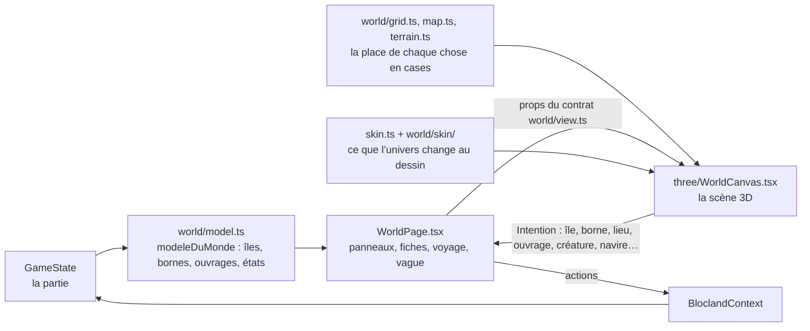
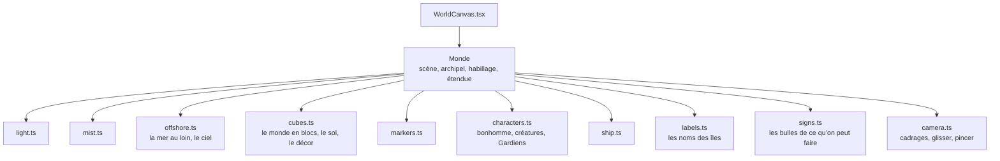
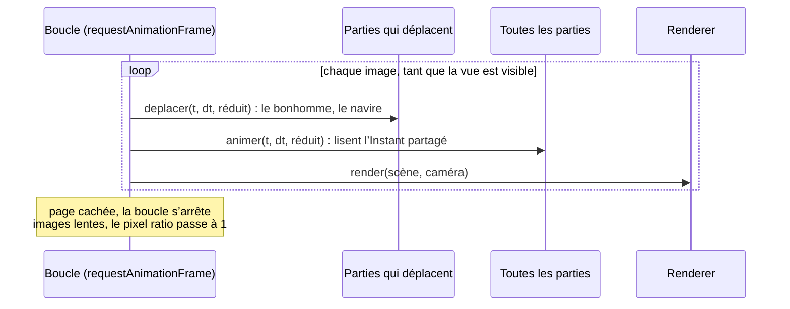
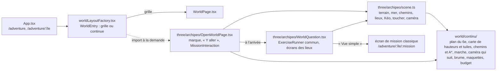

# Le monde

Le monde est la partie la plus lourde du code (`src/game/world/` et `src/game/three/`). Il est rangé pour qu’une même logique serve plusieurs dessins et plusieurs univers : le jeu dit **ce qui existe**, la grille dit **où**, la vue dit **comment le dessiner**. L’histoire de ce rangement est dans [Séparer le jeu du rendu](../conception/separation-jeu-rendu.md) ; le style attendu dans [le rendu](../rendu/style.md).

## Du jeu au dessin

- `world/model.ts` lit la partie et rend le modèle d’un archipel en identifiants, sans une seule case : les îles, leurs bornes et leur état, les ouvrages, le voyage en cours. Il décide aussi ce que fait un toucher (jouer une borne, ouvrir l’île d’un ouvrage, aller vers une île, voyager).
- La grille (`world/map.ts` la forme des îles, depuis GD-12 prise dans le catalogue de `world/formes.ts`, une distance signée par forme, coupée à sa boîte autour du cœur, plus profonde du côté de son trait, `world/terrain.ts` le monde en cubes, un métier par fichier dans `world/terrain/`, `world/paths.ts` la marche, `world/harbor.ts` le quai) place tout en cases du monde ; `world/grid.ts` en est l’entrée (`grilleDe`).
- La place des lieux dans leur région (GD-9) : `world/placement.ts` garde la pose de chaque lieu (son origine dans le monde et un quart de tour, `placeIslands` ; sans pose, la carte de départ de `map.ts`) et la géométrie d’un quart de tour. Chaque lieu tire son dessin (côte, relief, décor, place du Gardien, lacs, cascades, marges, et les amorces de ses ouvrages que le décor laisse libres, `amorcesDuDessin`) une fois pour toutes dans son repère (`IslandDef.repere`, sa place sur la carte de départ) : posé ailleurs, il garde exactement son dessin ; tourné, tout tourne d’un bloc avec lui (cubes, emprise, bornes, portes, Gardien, créature, et la vue du lieu, `viewYaw` + quarts × 90°). `world/footprint.ts` donne le cadre fixe de chaque région, l’emprise d’un lieu (sa terre, ses grandes constructions, le quai) et les écarts ; `world/routing.ts` trace les liaisons (droites ou en L à un seul coude sur l’eau, d’une arrivée sur la côte, au pas de la grille du monde, à une autre ; 96 cases au plus ; une arrivée n’est possible que sur une côte libre d’où le bonhomme gagne le cœur du lieu à pied) et dit si une place est possible (`spotPossible`) ; `world/savedLayout.ts` lit le champ facultatif `world.layout` de la sauvegarde (sa forme ; qu’il tienne sur la grille, `posesOfLayout` ; les places de Gardien d’avant GD-11 ignorées). `world/appliedLayout.ts` pose cette disposition sur le monde (`applyLayout` : les lieux à leur place, les liaisons à reposer hors du dessin, les arrivées choisies données au traceur), appelé par `BloclandContext` à la lecture de la partie et à chaque changement de `world.layout` ; son numéro (`disposition`, `layoutVersion`) refait la scène 3D et les cadrages qui lisent la place des lieux, et chaque cache de la disposition (`layoutCache`) se vide. Les grandes constructions au large suivent leur lieu (`monumentIslet`). Le cœur du mode « Aménager » : `world/arrange.ts` les actions pures sur le monde d’une partie (déplacer un lieu à une place libre, le calage sur la plus proche d’un point touché, la suivante dans une direction, tourner un lieu, sauf ceux qui ne tournent pas, `placeTurns`, une borne dans la bande de devant, une arrivée ; les liaisons qui ne tiennent plus deviennent « à reposer », `relinkBetween` les repose ; `backToStartingMap`), `world/arrangeSession.ts` « Remettre comme avant » et ↶ (un instantané à l’entrée, une pile des poses), `world/placeSentence.ts` la place d’un lieu en signes (`placeSigns` : le voisin, l’une des huit directions et sa flèche, l’écart en cases) et en mots (« au nord de la Forêt des sons, à 2 cases »), comme on la voit sur la Carte : le nord en haut, l’est à droite de l’écran, du côté des x du monde qui descendent (les flèches du mode, `DIRECTION_STEP`, suivent le même sens ; `three/arrangeDirections.test.ts` le vérifie sur la projection de la caméra de la Carte). Les mots du mode et du menu nomment une liaison avec le mot de l’univers (« ouvrage », `world/linkWord.ts`). Les bornes déplacées se dessinent à leur place (`placeStations` de `placement.ts`, `chosenStation`) : la bande réservée suit, le décor qui évite les bornes lit leur vraie place (`questStations` ; la place de départ, `startingStations`). Une île posée sur des écueils les cache, avec une case d’eau de marge (`visibleReefs` de `terrain/sea.ts`), sans changer la mer tirée ni la carte de départ. L’écran du mode : `world/arrangeMode.ts` (le choix et ses gestes, les phrases), `world/arrangeView.ts` (ce que montre le choix, en cases du monde), `world/arrangeHandles.ts` (les poignées, les flèches et « Tourner », sur l’eau autour du choix ; leur dessin, `three/arrangeHandles.ts`), `world/arrangeGesture.ts` (le temps du geste), `three/arrange.ts` (leur dessin ; les types de ce qu’elle reçoit, `ArrangeView` et `ArrangeGesture`, sont dans le contrat des vues, `world/view.ts`), `Arranging.tsx` (l’état du mode), `ArrangeBar.tsx` (l’écran) et `ArrangeList.tsx` (la vue simple, aussi dans le panneau « Aménager la carte » au téléphone en grand texte). Pendant le mode, la vue renvoie deux intentions de plus : `mer` (le point touché sur l’eau) et `ouvrage` avec son point (l’arrivée la plus proche).
- Les liaisons posées (GD-9) : `world/linkGeometry.ts` est la couche de grille qui donne leur géométrie aux règles (`provideLinkGeometry`, inversion de dépendance : `world/archipelago.ts` ne connaît ni la carte ni le traceur). Il tient les liaisons posées de la partie (`poserLesLiaisons`, appelé par `BloclandContext` et par `worldCubes`), trace celles d’une région dans leur ordre (`linkRoute`), dit la nature d’une liaison (`linkKind` : sentier, pont jusqu’à 36 cases, bac au-delà) et les voisins d’un lieu (`neighboursOf`, ce qu’un pont relierait : la vue d’un lieu les cadre avec lui). Le monde (`world/terrain/links.ts`) dessine les liaisons posées, plus le fantôme de celle qui ouvre chaque lieu fermé ; une liaison posée que le traceur ne refait pas prend le tracé qu’elle aurait seule (`traceDeRepli`), à défaut son tracé d’origine. `src/main.tsx` et `src/setupTests.ts` importent ce module au démarrage : sans lui, les règles n’ont pas de géométrie.
- La réunion de deux lieux (GD-9, point 10) : `world/join.ts` calcule, sans Three.js, la forme de la construction qui réunit deux lieux posés au plus près (`joinShape` : le côté commun, au moins 4 cases ; les cases sur l’eau entre leurs côtes, jusqu’à 2 cases dans une baie ; les marches, trois au plus) et son plan (`joinPlan`, une `PlanDef` de zone `join`, `join.<lieu>.<lieu>`, dont les clés restent dans le repère de la paire : la paire bouge et tourne sans rien perdre). `appliedJoins` lit les paires de la disposition appliquée (`placeJoins`, `world/placement.ts`) ; `world/arrange.ts` réunit (`joinIslands`), bouge et tourne la paire d’un bloc (`groupAt`) ; le traceur (`routing.ts`) tient les liaisons au large de la zone de la réunion ; `world/terrain/joins.ts` en tire les cubes (digue d’herbe, ou jetée de pierre dans Archipéo), touchables comme un monument (`place` `monument:join.…`) ; `avatarRoute` passe dessus. À l’écran, `Joins.tsx` (panneau, page, ligne dans le panneau du lieu) et `useJoinBuilder` (`useMonumentBuilder.ts`, la pose case par case partagée avec les monuments).
- `world/view.ts` est le contrat entre `WorldPage` et une vue : les props qu’une vue reçoit, les intentions qu’elle renvoie (`world/layout.ts`). `WorldPage` ne connaît que ce contrat.
- La vue ne décide rien : elle dessine ce qu’on lui passe et dit ce que l’élève a touché, par une `Intention` que `WorldPage` traite dans un seul `switch`.

## La scène 3D

`three/WorldCanvas.tsx` crée une scène par archipel, refaite quand l’archipel ou « Réduire les animations » change. La scène est faite de **parties**, chacune dans son fichier, qui suivent le même contrat (`three/scenePart.ts`) : se construire à partir du `Monde`, s’animer à chaque image, se libérer.

- Les parties partagent un `Instant` (où en sont la marche et le voyage à cette image) et les `Derniers` props de la vue : la scène n’est pas refaite quand les props changent, les parties les relisent.
- Le calcul des formes est pur et testé dans `world/` (`landMesh.ts` le sol en facettes, `construction.ts` les bâtiments, chacun avec ses réglages, ses couleurs et son éclairage rangés à côté, dans `landMesh/` et `construction/`, `decorMesh.ts` le décor, `sea.ts`, `fauna.ts`, `characters/`) ; `three/` ne fait que les donner à Three.js.
- Chaque géométrie, matériau et texture est libéré quand la scène est refaite (`dispose`).

## Les univers

Les deux univers jouent le même jeu. Ce qui change au dessin passe par un objet `Habillage` (`game/skin.ts`, une donnée par univers dans `world/skin/`) : le ciel, la brume, le sol, les personnages, les étiquettes, les bulles. Ce qui change aux mots passe par `src/universes/` (`useTextes()`). Le code ne teste presque jamais le nom de l’univers : il lit une ligne de l’habillage ou un texte.

## Le monde continu (prototype, derrière un drapeau)

Le monde ouvert d’Archipéo, piste B « chemins aimantés » (choix du mainteneur, 14 octobre 2026), se prototype au 6e, à côté du monde en grille, sans le toucher. Il ne vient qu’avec l’adresse `?monde=ouvert` (avant le `#`), dans l’univers Archipéo et à l’archipel du 6e ; sans elle, rien ne change, et Blocland ne le voit jamais. Rien de neuf dans la sauvegarde : la progression des missions reste commune.

- `worldLayoutFactory.tsx` (la fabrique) choisit la disposition de la page du monde : `worldLayoutFor` rend la grille partout sauf avec le drapeau, le rendu d’Archipéo, l’archipel du 6e et une adresse qui est la sienne (le monde, ou une île du 6e) ; la Carte, l’École et les autres panneaux du village restent ceux de la grille. C’est le seul fichier qui mène au monde continu, et seulement par `import()` : la vue et son code pur sont dans un morceau à part, chargé à la première ouverture. `world/continu/isolation.test.ts` le vérifie, avec `world/layers.test.ts` (`world/continu` est une couche pure).
- `world/continu/` est pur, sans Three.js ni React, et ne lit que lui-même : `plan6e.ts` le plan des lieux du 6e en données (relevé en pixels sur le plan confirmé le 13 octobre 2026, puis converti : la côte en anneau, le lagon et sa passe, l’îlot du Phare, la falaise nord, la rivière, le haut pays de l’est ; les quatre lieux du prototype, le Phare, les Quais, les Filets et les Écluses, avec leur nouveau nom et l’île d’aujourd’hui dont ils reprennent la mission ; le réseau des chemins et ses nœuds ; les couleurs du 6e ; depuis la piste 1, lot 1, l’île cinq fois plus grande autour de Kéo, `PLAN_SCALE` 2,8 pixels du plan par unité, environ 120 pas de Kéo du Phare aux Quais, `KEO_STEP` 0,8 unité pour un demi-mètre, les lieux gardant leur taille, posés au bord de leur rivage, leur porte à quelques pas d’eux, et le bassin des Quais, `DOCK`, l’eau devant laquelle la barque s’amarre pendant une question) ; `terrain.ts` la carte de hauteurs (calculée une fois) et ses tuiles carrées de facettes en aplats (sable, herbe, roche, haut de falaise ; ce qui est sous l’eau n’est pas dessiné), à deux niveaux de détail (`tileFacets` : chaque case de près, une sur trois de loin, une jupe sous le pourtour qui bouche la fente entre les deux ; `tileTriangleCounts` les compte sans rien construire), et leurs deux anneaux autour de Kéo (`tileRings` : de près à 22 unités, de loin jusqu’au bout de la brume, rien derrière la caméra), et `heightOnMesh`, la hauteur exacte du sol dessiné de près où se posent les pieds ; `sea.ts` l’image de l’eau, tirée par le code (le lagon clair qui fond vers le large) ; `facets.ts` les triangles en aplats et quelques volumes (pavé, prisme, toit) ; `places.ts` les maquettes des lieux, des volumes dessinés par le code derrière `modelOfPlace(id)`, l’emplacement où les modèles TRELLIS se glisseront ; `paths.ts` le point du réseau le plus proche d’un toucher (`snapToNetwork`), le plus court trajet (A*, `findRoute`), la place de Kéo à l’ouverture du monde (`startOf` : sur le chemin qui part de la porte du lieu, à 9 unités de son centre) et le dessin des chemins (sentiers, digue et pontons en bois sur l’eau) ; `walk.ts` la marche de Kéo à vitesse constante (`WALK_SPEED`, 4 unités par seconde, la seule constante ; `WALK_CADENCE`, la cadence de ses jambes qui en découle, un pas de `KEO_STEP` par demi-cycle, donnée à `corpsDuBonhomme` ; arrivée immédiate avec « Réduire les animations », ou « Passer le trajet ») ; `camera.ts` la caméra qui suit Kéo (piste 1, lot 1 : `followPose`, de trois quarts, à 4,3 m de haut et 6 m derrière lui, toujours tournée vers le nord, sans roulis ; un champ de 56° où Kéo tient environ un sixième de la hauteur de l’écran, son milieu à 62 % du haut, au-dessus de « Y aller », l’horizon en haut de l’image ; `followStep`, une zone morte de 0,8 unité puis un rattrapage doux, d’un bloc avec « Réduire les animations » ou après un saut ; `occlusionLift` et `liftStep`, la caméra qui monte juste assez quand le relief passe entre elle et Kéo ; `WORLD_FOG`, la brume de 40 à 115 unités, écartée pendant une question ; `markOffset`, la marque au-dessus du sommet d’un lieu), et l’angle de la caméra d’une question (`CAMERA_PITCH`, `CAMERA_FOV`) ; `veil.ts` la brume sur les lieux pas encore ouverts, un banc bas, large et plat de trois dômes aplatis, transparent par sommet (dense en bas, effacé vers le haut et nul au pourtour), sous le repère du lieu ; `tiles.ts` la réserve des tuiles pour la vue (de loin, toutes gardées ; de près, les 24 plus récentes, et jamais plus d’une faite par image : celles qui manquent attendent dans une file, leur version de loin tenant leur place) ; `mission.ts` la prochaine mission des quatre lieux, tous ouverts dès que leur mission existe, même fermée dans la grille (`missionOfPlace` ; celle de la prochaine destination du jeu, sinon la première encore à jouer dans l’ordre du plan), la place de sa marque à l’écran ou de sa flèche au bord, la distance au lieu en un, deux ou trois points (`distanceSign`, jamais en texte), les lieux sous la brume (`veiledPlaces` : ceux dont la mission n’a pas encore été jouée, sauf le prochain), et l’interface `MissionInteraction` (`open(placeId, missionId)`) ; `questions.ts` ce que chaque lieu fait des items de sa mission (lot 4, règle du jumeau « à l’essai », [Plusieurs univers](../univers/univers.md), § 4.2) : le Phare garde les mots de la Chasse au son, portés par des cloches, en deux manches de six (`bellRounds`) ; les Filets prennent les items du lieu écrits dans le Markdown de l’île (« ## Au lieu · Archipéo », rangés par `npm run contenu` dans `placeItems.json`, que seul le monde ouvert lit), chacun avec la clé de son jumeau ; les Écluses et les Quais gardent l’item du générateur et n’en changent que la phrase (`quaiScene`, la ligne de calcul de référence dessous) et la consigne (`placeInstruction`) ; les pièces durables d’un lieu se tirent des étoiles gardées (`piecesOf`) ; `questionScene.ts` la place de la question à l’écran (`questionLayout` : chaque réponse est une étiquette de 48 px au moins et l’objet qui la porte, d’au moins sa hauteur, touchables ensemble (`hit`), écartées de 12 px ; sur tablette, les objets dans le tiers du milieu, leur étiquette au-dessus ; sur un écran de moins de 500 px de haut, les étiquettes en rangée en bas, les objets juste au-dessus ; la colonne à gauche, 38 % de la largeur sur un écran bas, élargie à 46 puis 54 % quand la phrase n’y tient pas (`widen`, mesuré avant l’affichage, gardé pour la mission), au-delà en pleine largeur sous la barre du haut (`WIDEN_FULL`), et si elle n’y tient toujours pas, ou si un mot de réponse ne tient pas entier dans son étiquette (les cloches en grand texte ; on ne répond alors que dans « Vue simple », jamais de mot coupé ni d’étiquettes sur deux rangées), « Vue simple » proposé d’emblée, la voix gardée, sans réduire le texte (`WIDEN_OFFER` ; mesures avant l’affichage, `three/archipeo/fit.ts`), jamais sur une réponse ; la règle de l’item à droite de la colonne sur un écran bas ; au Phare, le carillon : les cloches plus petites, leur mot dessous, la fenêtre de la scène descendue jusqu’à leur pied pour que la tour se dresse au-dessus ; la fenêtre de la scène sous la barre de « Vue simple » et de la pause), la caméra fixe de la question (`questionPose` : la scène de l’item au milieu de sa fenêtre, l’image décalée sans tourner la caméra), les objets des réponses (un carillon de cloches de bronze clair au pied du Phare, dans l’axe de la tour, des paniers, des leviers à pommeau rouge, des caisses à plaque, sur un ponton), la scène d’un item (la pêche sur le filet, le sas en bandes et son trait de niveau, l’échelle et ses crans, les caisses en palettes de dix, serrées au premier plan sur un quai à leur taille, la grue et la barque ; les repères 0, 1, 2 en panneaux de la page) et sa réaction (de 1,4 s : la pêche va au panier et s’y voit, la barque passe le sas, les caisses partent à la barque ou en arrivent et y restent, les bonnes cloches s’allument ; un état fixe avec « Réduire les animations »), les pièces durables (`placePieces`) et le dernier palier, le Veilleur au Phare, sa lanterne allumée (`veilleurPiece`, une silhouette d’attente tant que son modèle n’existe pas, quand chaque lieu a ses deux pièces, `veilleurAwake`) ; `budget.ts` le coût du monde continu, poste par poste.
- `three/archipeo/` est la vue, chargée à la demande : `scene.ts` crée la scène (le terrain en deux maillages, l’anneau de près et l’anneau de loin, dont les tableaux sont faits une fois et où l’on recopie les tuiles quand Kéo s’éloigne de trois unités, avec la boîte englobante de leurs tuiles ; une tuile de près faite au plus par image, `tiles.ts` ; un plan d’eau, les chemins, un maillage par lieu, ceux qui sont au-delà de la brume cachés, sauf le lieu de la prochaine mission, seul hors de la brume (un matériau sans brouillard) ; la brume des lieux pas encore ouverts, un maillage transparent sans lumière, levée quand Kéo arrive à 26 unités du lieu, en un fondu de 0,8 s dans un second maillage, d’un bloc avec « Réduire les animations » ; un ciel de la couleur de la brume ; Kéo avec sa marche existante, `corpsDuBonhomme` de `three/paintedCharacters.ts`, un peu plus grand, et un anneau clair à ses pieds ; l’anticrénelage, le rapport de pixels plafonné à 2 et ramené à 1 si l’appareil peine, comme le monde en grille), lit le toucher (un lieu touché y envoie Kéo, ailleurs il rejoint le point du chemin le plus proche), fait marcher Kéo, le suit avec la caméra et donne à chaque image la place de la marque ; `OpenWorldPage.tsx` pose l’interface : la marque de la prochaine mission (le nom du lieu sur fond uni, sans icône tant qu’aucune icône de lieu n’existe ; un nom long passe à la ligne), une flèche au bord quand le lieu est hors champ, la distance en points pleins dessous (`data-loin`), et dite dans le libellé de la marque, « tout près », « pas loin » ou « loin », refait seulement quand le palier change, toujours hors de Réglages et de « Y aller » (`keepClear`, les dimensions relues par un `ResizeObserver`, jamais à chaque image), « Y aller » toujours en bas au milieu, qui saute toujours le trajet (`goTo(lieu, true)` : Kéo est devant le lieu d’un coup, la caméra le suit d’un bloc ; on marche en touchant le monde, « Passer le trajet » pendant la marche ; grisé, sa raison écrite au-dessus), Réglages dans le coin ; à l’arrivée devant un lieu, la mission s’y joue : `WorldQuestion.tsx` choisit l’exercice comme l’écran classique (`pickExercise`, `loadExercise`) et le confie au lanceur commun, `ExerciseRunner`, avec un `RunnerStage` (le découpage en écrans du lieu, l’écran du lieu, sa consigne, « Revenir au Phare » au lieu des liens vers l’île, « Vue simple », et le bilan du lieu, `WorldDone.tsx` : les étoiles, une rangée de pastilles « icône + nombre », le détail de l’écran classique derrière « Détail », un seul bouton « Continuer » toujours en vue ; les célébrations attendent la fin de la question et de son bilan, `useHoldCelebrations`) : les items, la graine, le deuxième essai, la correction, les étoiles et le barème restent ceux du code commun. Les écrans des lieux (`BellScreen`, `PlaceChoiceScreen`) écrivent la phrase (après « Bravo », le mot juste entre dans le trou), la ligne de calcul et la règle de l’item (`Aid`, comme `ChoiceItem` ; aux Filets, la carte réduite à la ligne « règle » du Markdown, entière dans « Vue simple ») dans une colonne sur fond uni, posent chaque réponse en bouton qui couvre l’étiquette et son objet (les touches 1 à 9 et Entrée marchent comme ailleurs) ; sur un écran bas, la consigne est lue en entier une fois avant « Commencer », puis devient une icône ronde qui la lit (« Lire la consigne », distincte du carré « Lire la phrase »), l’indice une ampoule de 48 px (leur mot dessous en grand texte), les étapes une ligne fine ; la consigne s’efface dès qu’on a répondu ; la voix se coupe entre deux items ; la taille est relue par un `ResizeObserver`, une fois par image au plus, et demandent à la scène d’en montrer l’item (`OpenWorld.question`) ; la scène coupe sur la caméra fixe de la question, efface Kéo le temps de la question, pose la scène de l’item et les objets des réponses (un maillage) et joue la réaction (un maillage, une coupe franche avec « Réduire les animations ») ; les pièces durables des quatre lieux sont un maillage, la Roue des Écluses un autre (`OpenWorld.setPieces`, immobile avec « Réduire les animations »). `missionScreen.ts` branche `MissionInteraction` sur l’écran classique (`/adventure/:île/:mission`) : c’est « Vue simple ».
- La scénette (piste 1, lot 2, le Phare) : `world/continu/scenette.ts` (pur) donne la scénette d’un lieu (`scenetteOf` : le rôle de l’habitant en tête du panneau, sans prénom, la place vide de sa phrase d’accueil, et le placement des objets-réponses, `rangee`, où viendra « à leur place » si le mainteneur le choisit), sa place à l’écran (`scenetteLayout`, sur la colonne de `questionLayout` : A sur tablette, la consigne en haut, la scène au milieu, la rangée des réponses en bas, « Valider » en bas à droite ; B sur un écran bas, la colonne à gauche, la scène à droite, la rangée en bas à droite ou sur toute la largeur si les mots n’y tiennent pas ; le champ `scenette` de `QuestionLayout`), la caméra de la galerie (`scenettePose`, Kéo à gauche et l’habitant à droite dans la scène, le décalage de l’image comme une question), le décor de près (`scenetteDecor` : la galerie, sa rambarde, la gardienne), le plan des cloches (`bellPlane`), la main qui tient la corde (`habitantHand`), la place de Kéo (`scenetteKeo`) et la vitre de la lanterne (`lanternGlass`) ; `questionScene.ts` pend les cloches à leur poutre (`answerObjects` avec les choisies et la corde) ; `camera.ts` lève le regard près du Phare (`lookUp`, `lookUpStep`, `LOOK_UP` : la caméra peut descendre un peu, jamais reculer) et pose la marque du Phare à côté de sa lanterne (`markBeside`) ; `FacetBuilder.beam` tend un pavé entre deux points. Dans la vue, `scene.ts` fait le décor à l’arrivée et le libère au départ (un maillage, du matériau du terrain), descend la caméra en 0,9 s (coupe franche avec « Réduire les animations »), cache les cloches le temps de la descente, pose les cloches sous leurs réponses sur un plan vertical devant la rambarde, allume la lampe à la fin (`scenetteEnd` : la vitre dessinée par le maillage de la réaction, alors caché, avec un matériau sans lumière, aucun appel de plus) et donne à chaque image la place des cadenas des lieux sous la brume (`onLocks`) ; `WorldQuestion.tsx` choisit la disposition, met le rôle en tête (`RunnerStage.head`, rendu par `ExerciseRunner` avant la consigne), pose « Valider » en bas à droite sur tablette, retire d’abord l’image devant les mots puis propose « Vue simple » si un mot est coupé, ouvre « Vue simple » sur place (la même question en liste, les cloches choisies gardées, « Valider » sous la liste dans une bande qui reste au bas du panneau quand il défile, une ombre en bas ou en haut tant qu’il reste à lire, `data-suite` ; sur un écran bas, le panneau prend toute la hauteur, la consigne repliée en une ligne avec le rôle et sa voix, coupée après un mot entier, dépliée par « Lire la suite » ou un toucher sur la ligne (une icône seule au plus grand texte, où elle s’ouvre dépliée au premier item puis se replie à l’item suivant), pour que la première rangée de cloches se voie dès l’ouverture, et la bande d’un bouton de 48 px) et « Scène », à la même place, y ramène (les cloches gardées ; « Vue simple » reste choisie après « Rejouer ») ; il garde la scène à la fin ; `OpenWorldPage.tsx` pose les cadenas sans passer par React.
- La scénette des Quais et la Carte des lieux ouverts (piste 1, lot 3) : `scenette.ts` donne aux Quais leur scénette (« Le docker », sans prénom ni réplique ; le docker immobile en quelques volumes, `docker` : gilet vert lagon, tête sable, casquette jaune lanterne, un bras posé sur une caisse, le crochet de levage en main ; `scenetteHabitant`), la place de chaque lieu (`SITES` : le sol où se tiennent Kéo et l’habitant, leur écart, ce que la caméra cadre et son angle ; aux Quais, la bande de devant du quai, au pied de la grue), la colonne à gauche sur tous les écrans aux Quais (`column`, B même sur tablette, sauf au plus grand texte, où A garde des lignes lisibles ; au plus grand texte, `grand` met le panneau de A sous la barre de « Vue simple », sur toute la largeur), la rangée des nombres à droite de la colonne dès qu’ils y tiennent (`words` : seules les cloches ont des mots larges), et ce qui distingue les lieux dans la vue (`answersHang`, `scenetteHidesPlace` : la maquette des Quais cachée pendant la scénette, une seule grue ; `scenetteSuccess` : la lampe du Phare) ; `questionScene.ts` dessine le quai de la scénette (`quai` : le quai qui s’allonge avec les caisses, la barque amarrée contre la bande de devant, `quayBoat`, reconnaissable à sa proue courte en pointe, son étrave qui monte et sa lanterne, ses bancs aux deux bouts, une place libre côté proue, la proue toujours dans le cadre ; la grue au bout est, `craneHook`), les caisses-réponses en rangée (`answerObjects` : une caisse tentée et fausse bascule sur son arête, la bonne, partie au crochet, s’efface de la rangée, `gone`) la réaction (la bonne caisse monte au crochet de la grue et y reste, figée avec « Réduire les animations »), la réussite de la mission (`quaySuccess` : la caisse posée dans la barque, la vitre allumée de la lanterne de proue) et la pièce durable des Quais (dès la première, la barque chargée, sa lanterne allumée, amarrée au bord de quai) ; `plan6e.ts` donne au bassin des Quais un tour irrégulier et son bord droit (`DOCK_EDGE`), que `paths.ts` borde d’un mur de pierre, d’un chaperon et de trois bittes (`dockEdge`, dans le maillage des chemins). `map.ts` (pur) tient la Carte : l’île entière à l’ouverture (`mapStart`, `fitDistance`, les quatre coins de l’île à l’écran, en perspective, par dichotomie), glissée (`panMap`) et pincée autour du point sous les doigts (`zoomMap`) dans ses limites (`clampMap` : de 100 unités à l’île entière, le point regardé dans l’île), la pose de la caméra (`mapPose`, 64° sous l’horizon, nord en haut) et la place des étiquettes à l’écran (`layoutMapLabels` : Kéo et les cadenas d’abord, puis les noms des lieux ouverts à la place libre la plus proche, puis ceux des lieux fermés, tus s’ils gênent, jamais l’un sur l’autre ni sur les boutons, Kéo réduit à sa pastille si c’est trop serré). Dans la vue, `scene.ts` ouvre la Carte (`map(lieux ouverts)`, jamais pendant une question) : toutes les tuiles de loin dans l’anneau de loin (faites au repos dès l’arrivée dans le monde, `requestIdleCallback` ou un court délai sur Safari : la première ouverture ne fait que les recopier, 2 à 3 ms mesurées), celui de près vidé, la brume du lointain repoussée au-delà de l’île (sans refaire les shaders), tous les lieux visibles, la brume des lieux fermés gardée ; elle ne redessine que si sa vue, la taille, la brume ou ce qu’elle montre change ; un doigt glisse, deux pincent, la molette zoome ; un toucher à moins de 56 px d’un lieu le choisit (`onMapPick`) ; après chaque image, la place de chaque lieu et de Kéo à l’écran va à la page (`onMapPlaces`). À la réussite aux Quais, `scenetteEnd` descend la caisse du crochet dans la barque (0,8 s), la range dans le décor de près, puis allume la lanterne de proue avec le maillage de la réaction (0,7 s), sans appel de plus ; la pièce durable des Quais est cachée pendant la scénette (la barque chargée y est amarrée). `OpenWorldPage.tsx` tient la Carte dans son état (pas dans l’adresse : `/adventure/map` mène à la Carte du monde en grille) : le même bouton « Carte » que dans le reste du jeu, dans la barre du bas, à gauche (« Y aller » tient le milieu) ; son bouton, en bas à gauche, dit « Carte » puis « Retour » ; les étiquettes sont posées par `MapLabels.tsx` (Kéo et « Toi », un bouton par lieu ouvert, le cadenas et le nom atténué d’un lieu fermé, « Fermé pour l’instant » au toucher d’un lieu fermé ; leurs tailles et les boutons à éviter relus au changement de taille seulement) ; un lieu choisi ferme la Carte, y dépose Kéo d’un coup (la coupe franche de « Y aller ») et rend le focus au bouton ; Échap la ferme. `WorldQuestion.tsx` élargit la consigne d’un lieu à toute la largeur le temps de la lire au premier item d’un écran bas, puis « Commencer » rend la colonne à la scène ; au plus grand texte, une scénette dont le panneau déborderait s’ouvre d’elle-même en « Vue simple », une fois ; sur un écran bas, quand la rangée est à droite de la colonne (`rangee-a-cote`), le résultat et le bilan restent dans la colonne.
- Le budget du prototype, compté sans Three.js (`openWorldCost`) : environ 20 315 triangles et 17 appels, avec le sol en deux appels (le pire anneau de près, 7 044 triangles, et le pire anneau de loin, 3 736, en tout point du réseau des chemins, `groundCost`), la brume des quatre lieux (2 appels pendant le fondu d’un banc qui se lève, 1 512 triangles), la question au pire (2 appels, 1 738 triangles, les six cloches pendues et balancées), la scénette la plus chargée (le décor de près, 1 appel, et la vitre de la lampe, dessinée par le maillage de la réaction, 926 triangles au Phare ; le docker, 366, aux Quais) et toutes les pièces durables, le Veilleur et la barque chargée des Quais compris (2 appels, 680 triangles), dans l’enveloppe estimée au cadrage, non relevée (45 000 triangles, 18 appels, `OPEN_WORLD_BUDGET`, gardée par un test). Dans le navigateur (`info()`, 1024 × 768), la vue qui suit Kéo dessine 8 à 9 appels et 9 300 à 12 900 triangles, une question 6 à 7 appels, la scénette du Phare 9 appels et 13 397 triangles, son bilan avec la lampe et les pièces 10 appels et 12 165 triangles ; la scénette des Quais 8 appels et 12 300 à 13 100 triangles, 9 pendant la caisse qui monte, son bilan, la barque chargée et la lanterne allumée, 9 appels et 12 913 triangles ; la Carte, comptée à part (`mapCost`, 13 appels et 20 440 triangles au pire), dessine 10 appels et 19 310 triangles à l’ouverture, 9 zoomée ; sa première ouverture prend 2 à 3 ms dans le navigateur des captures (les tuiles déjà faites au repos). Les images par seconde se mesurent sur la tablette avec `?mesures`, qui affiche aussi le compteur dans le monde continu.

## Le budget de dessin

`world/budget.ts` fixe le budget d’un archipel tout construit (`renderBudgetOf` : 60 000 triangles et 40 appels pour les tablettes, relevés le 6 octobre 2026 aux Premiers Rivages, `RENDER_BUDGET_6E`, à 63 400 triangles pour les îles d’histoire-géographie de HG-2 puis à 72 800 pour les trois îles de sciences de SC-2 et à 75 750 pour les personnages importés du 6e, de près sur l’île que la caméra regarde, et à 62 900 dans les trois autres archipels, `RENDER_BUDGET_AUTRES`, pour les six de HG-3, puis à 74 900 pour les neuf îles de sciences de SC-3 et à 75 000 pour les quêtes de la 5e (GD-10), aux enveloppes « autres » mesurées, puis à 78 700 pour les formes des îles de GD-12, puis à 86 000 pour le Fournil des partages et la Grotte des légendes (mainteneur, 9 octobre 2026), puis à 81 500 aux Premiers Rivages et 91 700 ailleurs pour les monuments importés d’Archipéo (la construction comptée au pire de leurs chantiers, que `npm run rendu:budget` mesure avec les modèles lus sur le disque ; proposé au mainteneur), puis à 85 250 et 94 700 pour les bâtiments des plans importés (décision du mainteneur, 10 octobre 2026 : de près 3 000 triangles sur l’île où est l’élève, de loin environ 200 ailleurs ; la construction comptée au pire, `constructionAuPire` et `batimentsAuPire`, prévue pour les 58 bâtiments même sans modèle), puis à 94 950 ailleurs avec les personnages importés de la 4e, puis à 92 610 et 96 430 pour la Nef en modèles peints (GD-15, « Relever », mainteneur, 11 octobre 2026 : le poste du navire passe à 1 900 triangles), puis à 97 455 ailleurs pour Kéo ; depuis leurs objets dessinés, chaque archipel a son plafond, ce plafond partagé plus la hausse de ses enveloppes : `RENDER_BUDGET_5E` (102 860, 11 octobre 2026), `RENDER_BUDGET_4E` et `RENDER_BUDGET_3E` (12 octobre 2026), `RENDER_BUDGET_AUTRES` retiré ; une enveloppe propre à un de ces trois archipels s’écrit dans `parArchipel`, que lit `enveloppeDe` : la mer des trois, le sol et le décor des Collines du Large et des Îles du Ciel, la construction des Collines du Large ; depuis l’EMC et le latin-grec de 4e et de 3e, le sol, les créatures et les Gardiens des Monts de Feu et des Îles du Ciel, aux mesures, proposés au mainteneur) et compte, sans Three.js, les triangles et les appels de dessin de chaque poste (sol, mer, décor, constructions, personnages…). Un test garde la somme sous le budget ; pour Blocland, le plafond du monde en blocs (`PLAFOND_DU_MONDE_EN_BLOCS`, 88 000 triangles et 240 appels depuis GD-9, 100 000 et 256 depuis le 6 octobre 2026 pour les deux îles d’histoire-géographie du 6e, ramenés à 180 appels le même jour pour les trois îles de sciences, après la fonte des couleurs des personnages, #372, puis à 120 le 7 octobre 2026 par la piste 2 du budget, une seule texture pour les blocs et les faces voisines fondues, #380 ; les six des 5e, 4e et 3e, HG-3, y tiennent : 79 280 triangles et 156 appels au pire, aux Anciens Ateliers ; avec les neuf îles de sciences de SC-3 aussi : 99 162 triangles et 171 appels au pire, aux Anciens Ateliers) tient aussi au pire d’une région aménagée (`worstCaseOfRegion` : une réunion par paire de lieux au plus, les autres liaisons au plus long ou en raccourci, la somme bornée par un graphe planaire, 3n − 6 ; `joinTriangles` compte la plus large réunion possible de la région ; et le dessin d’un choix du mode « Aménager », `arrangeViewCost`) ; `npm run rendu:mesures` mesure la scène réelle dans Chromium, `?mesures` l’affiche dans l’application, et `?mesures=auto` fait seul le tour des vues sur une partie toute construite, en mémoire, puis donne un tableau à copier. Un changement de code qui ne doit rien changer à l’image garde ces nombres à l’identique.
