# GD-22, lot 12 du 5e : l'Auberge

Captures en 1024 × 768 sauf mention, sur le commit fa6bb4aa (branche `claude/project-thread-90jhri`). Méthode : `vite` en local, horloge pilotée et hasard fixe (`scripts/prise-de-vue.mjs` : `piloterLHorloge`, `hasardFixe`, `figeable`, `capturer`), Archipéo, `?monde=ouvert`, LV2 espagnol. État de sauvegarde préparé : le voyage vers le 5e fait et la terre des Frondaisons ouverte (ses liaisons écrites par `ensureLands`, comme le fait la page), les autres terres fermées, Kéo au 5e ; l'Auberge après 0, 1, 2, 3, 4 et 5 missions es-* (leurs parties posées, 3 + 1 + 1, et la trace de chaque mission jouée). Kéo est envoyé à l'Auberge par `goTo('auberge', true)` (ce que fait « Y aller »), puis la fiche est fermée. Pour les vues de face, de dos et de trois-quarts, la caméra est posée à la main (`view`) : de face depuis le sud, un peu en hauteur, Kéo devant la porte ; de dos depuis le bout du ponton, vers le nord-ouest ; de trois-quarts depuis l'ouest. La caméra de marche ne change pas.

## La planche validée par le mainteneur
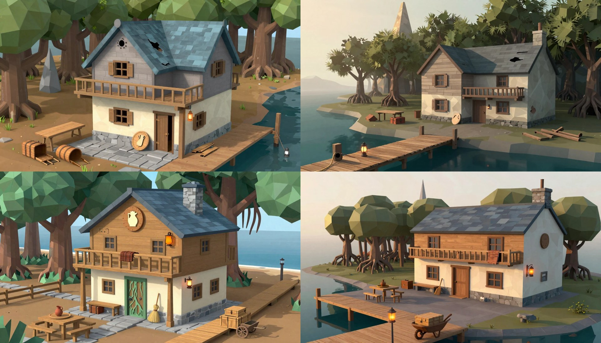

## Le cap de « Y aller » (la ruine)
Après « Y aller », la fiche fermée : Kéo devant le parvis, la maison entière à droite du milieu (la pointe du toit touche presque le bord haut), la table fendue et les malles à gauche, la lanterne de l'aubergiste sur sa perche, l'enseigne couchée, le départ du ponton cassé au bord droit. Le Hameau se voit au fond à droite. On ne voit pas l'aiguille de la Montée : ni au bord gauche, ni ailleurs dans l'image.
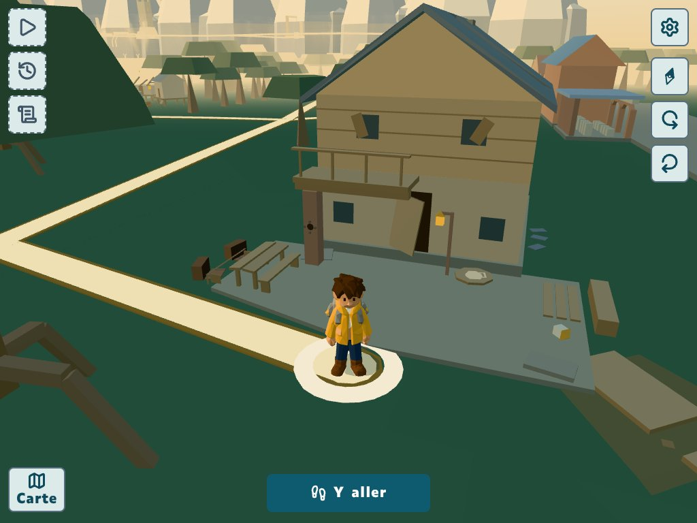

## De face, depuis le sud : en ruine, après le corps 1, 2 et 3 sur 3, après le haut, restauré (après les abords)
- En ruine : le pan est du toit crevé, la moitié est du balcon tombée, la porte qui pend, deux volets de travers, l'enseigne couchée, la table fendue et les malles ouvertes, la seule lanterne de l'aubergiste allumée, la lanterne éteinte couchée au pied du ponton (petit cube pâle à droite).

- Corps 1 sur 3 : le socle et le parvis à joints nets, la table dressée et ses bancs, le banc de pierre ; la valise sur le banc, à gauche de la porte.
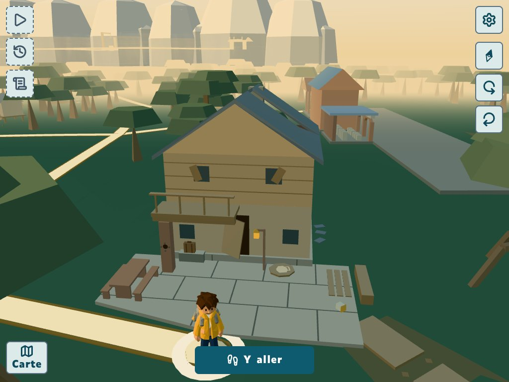
- Corps 2 sur 3 : le rez, la porte neuve et son chambranle vert-de-gris, les deux poteaux et le plancher du balcon, qui se lit comme un auvent ; le plateau et le pichet sur la table.

- Corps 3 sur 3 : l'étage en planches neuves, le garde-corps à barreaux droits, les volets à plat ; la couverture pliée sur la main courante, côté ouest. Le toit reste celui de la ruine.
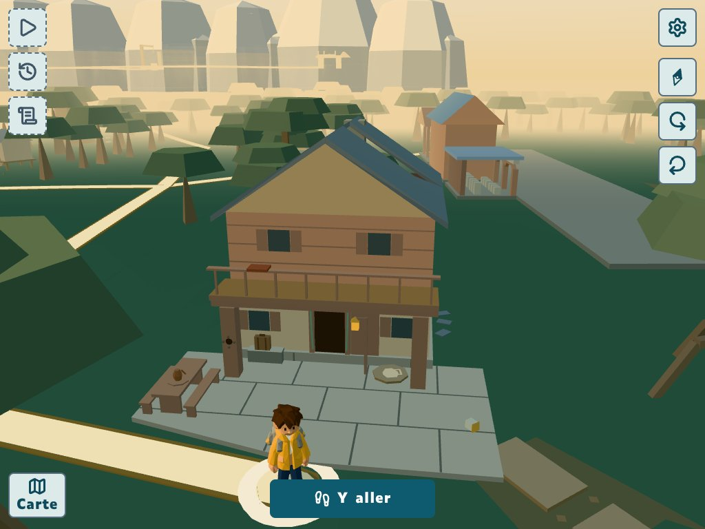
- Après le haut : le toit bleu et la cheminée, l'enseigne au pichet, la lanterne du pignon allumée (deux lanternes) ; le balai debout contre le mur, entre le banc et la porte.
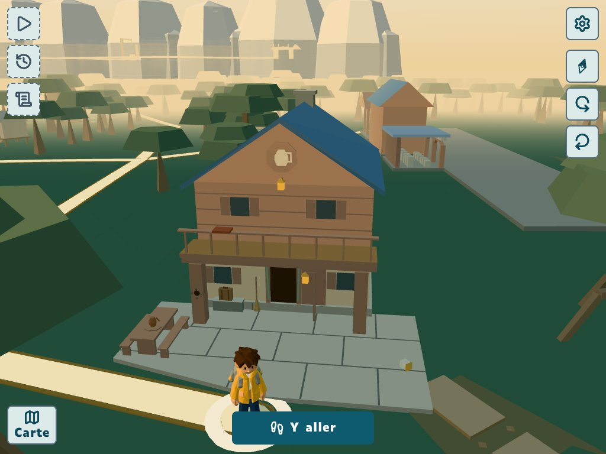
- Restauré : le chemin de dalles et sa barrière arrivent de la gauche, la brouette chargée de deux malles et la lanterne basse du ponton à droite : trois lanternes en tout, pas une de plus. L'étiquette « La Montée » apparaît au bord gauche (une flèche vers un lieu hors du cadre), pas l'aiguille elle-même.
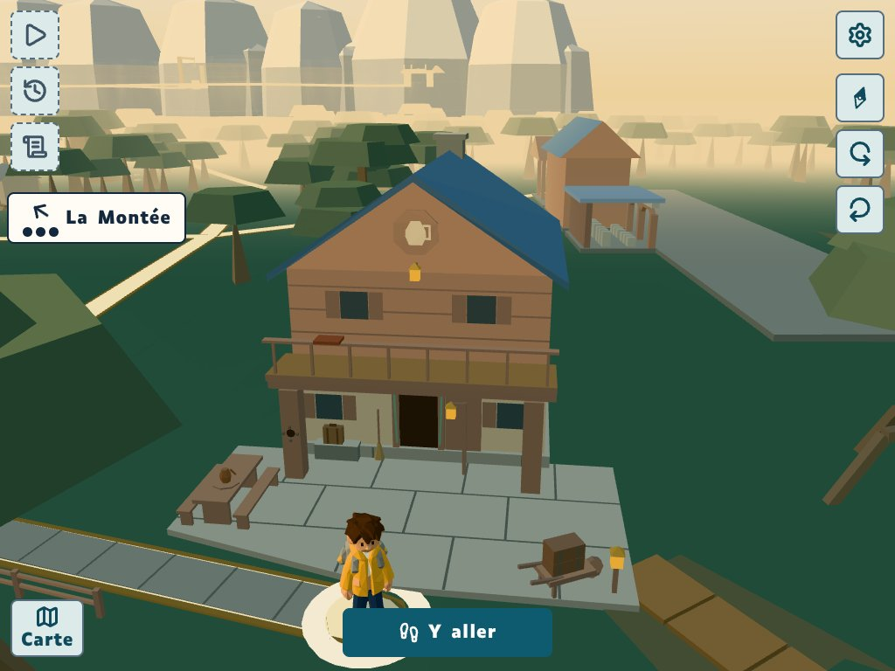

## De dos, depuis le bout du ponton (vers le nord-ouest) : en ruine, restauré ; restauré de trois-quarts (ouest)
- En ruine : le ponton troué au premier plan, la maison et son pan crevé, Kéo à gauche sur le chemin ; l'aiguille de la Montée se voit, fine et pâle, au-dessus de la forêt à gauche du toit.
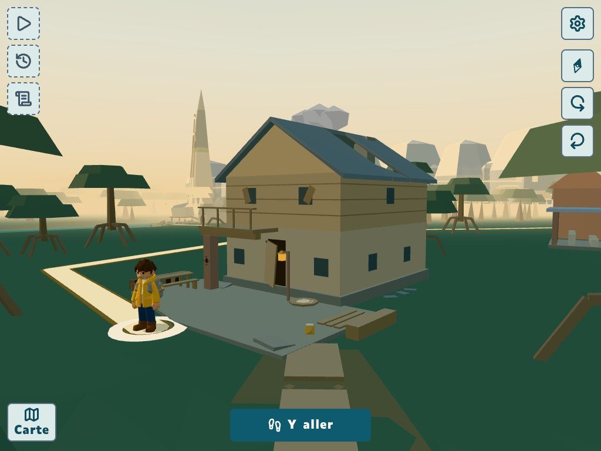
- Restauré : le ponton neuf, la brouette et la lanterne basse du ponton devant, le parvis, l'enseigne et la lanterne du pignon ; l'aiguille de la Montée au fond, avec son étiquette.
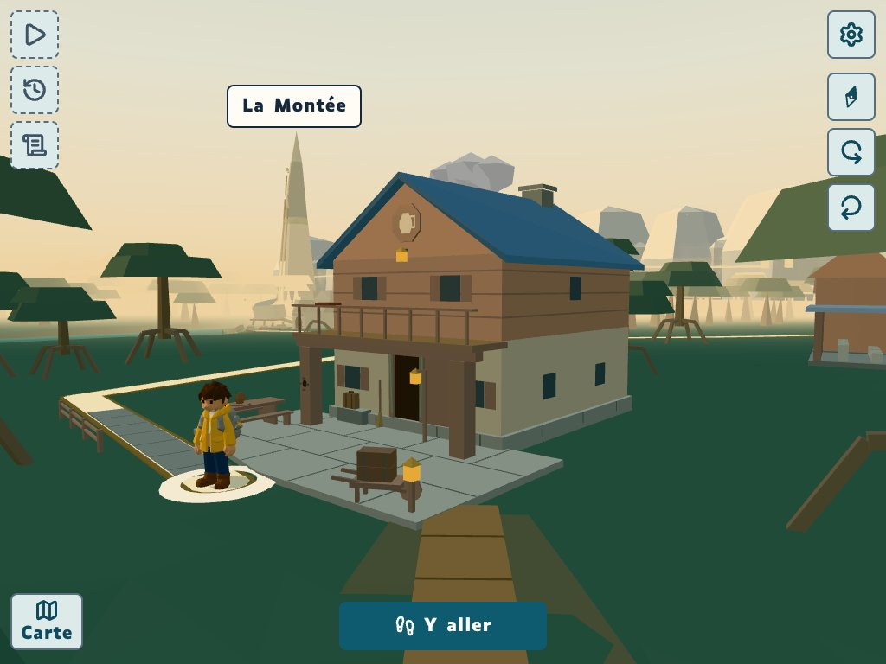
- De trois-quarts : le flanc ouest d'enduit et de planches, deux fenêtres sans croisillons, la cheminée au bout nord du faîte, la table et son pichet, la valise. Le ponton et sa brouette sont au fond à droite, Kéo au bord droit ; la mer se voit à droite.
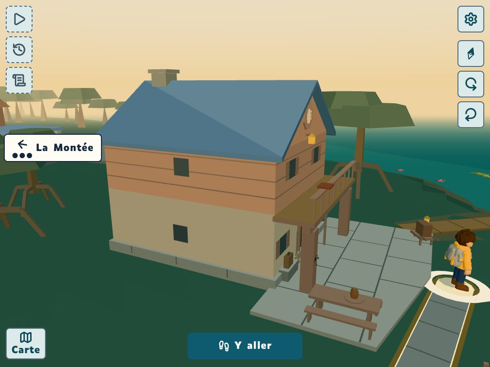

## La scénette de l'aubergiste, la question aux malles ; téléphone 390 × 844, OpenDyslexic 32
Prises après une mission jouée, sur la deuxième (« Números ») : l'Auberge n'a encore que son socle et son parvis. L'aubergiste à droite de la porte, près de sa lanterne ; les trois malles bombées sur leur planche sur tréteaux, une par réponse. En 390 × 844, le panneau couvre toute la scène ; la deuxième image est prise après le bouton « Scène ». L'item tiré n'est pas le même d'une prise à l'autre (« sesenta », « dos », « setenta »).
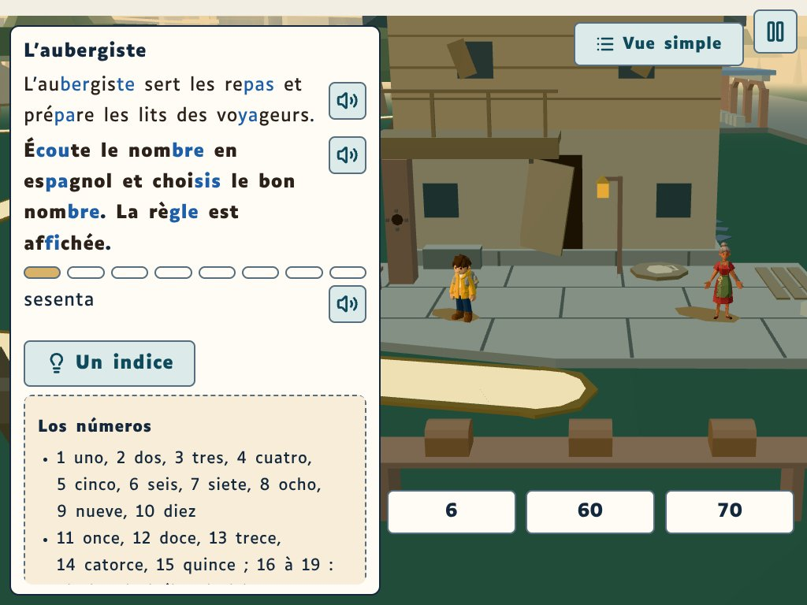
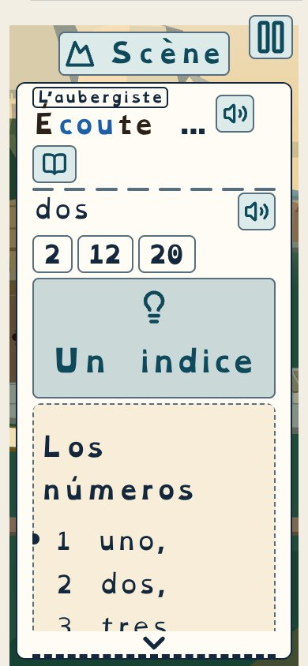
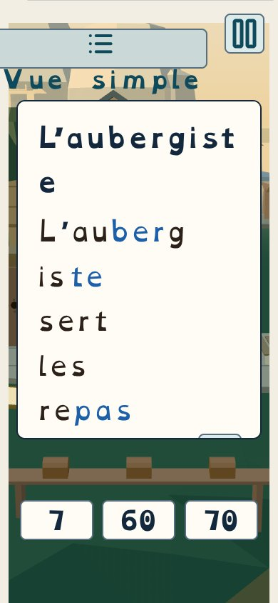

## La Carte du 5e : l'Auberge en ruine (lieu suggéré), restaurée (✓)
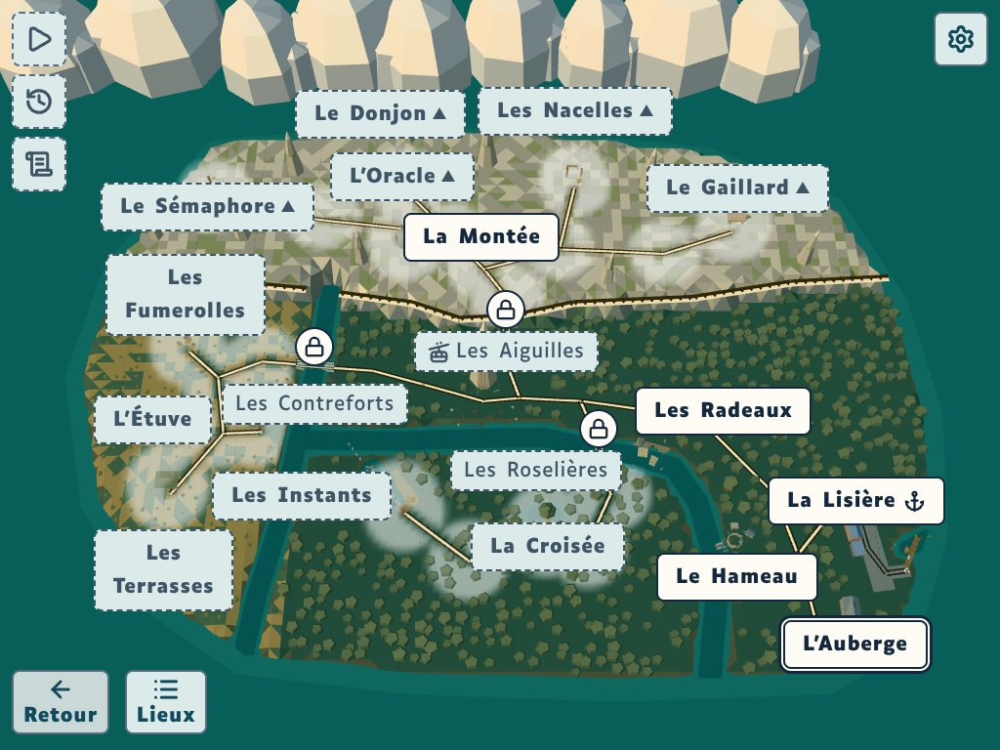

## La nuit : pas de capture
Le monde ouvert du 5e n'a toujours pas de nuit : l'heure de la page ne change pas sa lumière (aucun réglage de nuit dans la scène du monde ouvert). On ne compte donc les trois lanternes que de jour, sur 04 et 05 : il y en a trois, à leur place.

## Ce qui ne va pas, ou reste à juger
1. **Le signe du poteau ouest** : le trou noir et ses quatre goujons, posés en haut, en bas, à gauche et à droite, forment un viseur (une croix autour d'un rond), surtout de près (01, 02, 06). À soumettre au référent dys.
2. **Un visage au pignon ?** Sur 03 et 04, on trouve sur le même axe l'enseigne, la lanterne du pignon dessous, puis les deux fenêtres de l'étage et leurs volets de chaque côté : l'ensemble peut se lire comme un visage, sans que ce soit net. C'est à vérifier, comme le demande l'intention.
3. **Le pichet de l'enseigne** : un corps rond et pâle avec l'anse carrée à droite. Il ressemble à une chope et peut faire penser à un « D ». À vérifier.
4. **Kéo cache la valise dans la scénette** (06, 1024 × 768) : sa tête passe devant le banc de pierre, et la valise ne se voit pas. Il ne cache aucune trace dans les vues 01 à 05. L'aubergiste n'en cache aucune.
5. **L'aiguille de la Montée** manque dans « Y aller » (01-cap) et dans les vues de face : seule son étiquette apparaît au bord gauche une fois le lieu restauré. On la voit dans les vues de dos.
6. **Au téléphone, en OpenDyslexic 32** (général, sans doute pas propre au lot) : l'étiquette « L'aubergiste » recouvre l'accent du « É » de « Écoute » ; après « Scène », le panneau du récit couvre encore presque toute la scène, « L'aubergiste » se coupe en milieu de mot (« L'aubergist / e », « L'auberg / iste ») et le texte « Vue simple » sort de son bouton.
7. **Sur la Carte**, l'étiquette « L'Auberge » couvre le lieu : on ne voit de la maison qu'un point de toit bleu au-dessus d'elle.
8. **Le bouton « Y aller »** couvre le bas de Kéo et le départ du ponton dans les vues de face. C'est l'interface habituelle, rien de propre au lot.
9. **L'aubergiste n'est pas dans le monde** hors de la scénette : au 5e, elle n'apparaît qu'à la question (habitants et scénettes complètes : au 6e seulement). Ce n'est pas un défaut de ces captures.
10. Rien de croisé à la barrière, au garde-corps ni sur les fenêtres. Aucune lettre ni aucun chiffre dans la 3D.
