# GD-22, lot 12 du 5e : l'Auberge, après la retouche 1

Captures en 1024 × 768 sauf mention, sur le commit 904913d6 (branche `claude/project-thread-90jhri`, remise sur preview après les Terrasses). La méthode et la sauvegarde sont celles du premier passage (`../captures/comparaison.md`) : `vite` en local, horloge pilotée et hasard fixe, Archipéo, `?monde=ouvert`, LV2 espagnol, la terre des Frondaisons ouverte par `ensureLands` (4 liaisons, la LV2 ouverte : rien à ajouter pour ce que preview a apporté). Les caméras posées à la main sont les mêmes qu'au premier passage, pour comparer. Trois vues sont nouvelles : les deux vues zoomées et la vue de côté du ponton (en ruine et restauré). L'item tiré change d'une prise à l'autre.

## Le cap de « Y aller » (la ruine)
Le cap est revenu au nord : la maison est au milieu du cadre, entière, du socle au faîte (le faîte touche presque le bord haut). On voit le départ du ponton cassé au bord droit et la table fendue avec les malles à gauche. Le Hameau est au fond, derrière le toit. Avant, la maison était à droite du milieu. Pas de cheminée sur la ruine. Pas de brouette non plus : elle vient avec les abords.
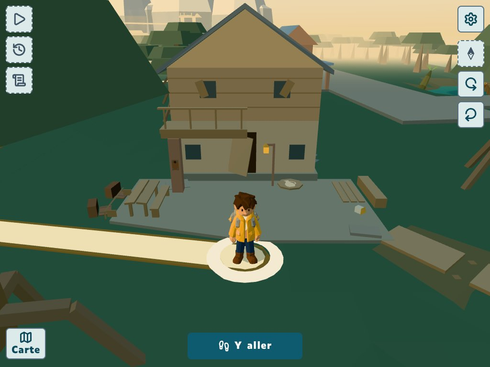

## De face : en ruine, après le corps 3 sur 3, restauré
- **En ruine** : la même chose qu'avant. L'étage usé est un peu plus sombre que le rez (beige brun sur beige clair), sans trancher. Le signe du poteau ouest n'est plus qu'un petit rectangle sombre à hauteur d'épaule ; de loin, on ne voit plus de viseur.
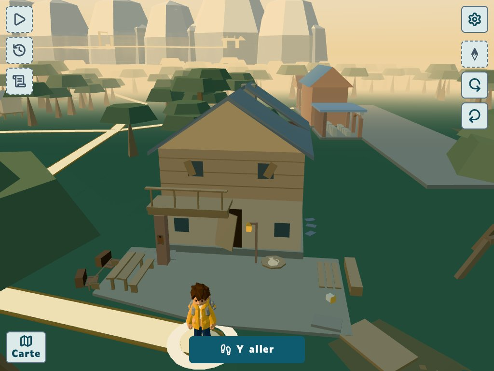
- **Corps 3 sur 3** : la valise est passée à l'ouest. Elle est juste à droite du poteau ouest, sur le banc, et non plus près de la porte. La couverture, sur la main courante, est d'un brun rouge plus clair que le bois.
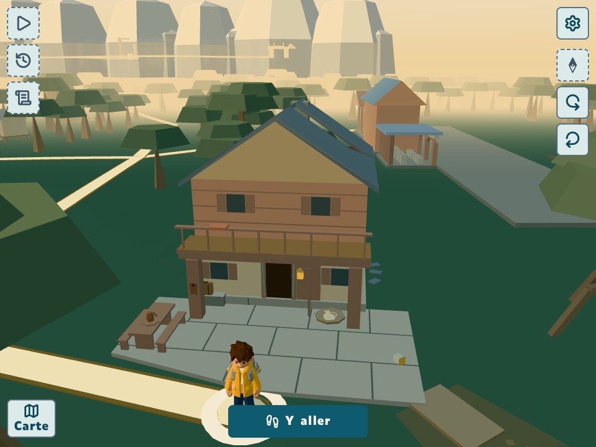
- **Restauré** : la lanterne du pignon est maintenant à l'angle ouest, sous la rive du toit, et non plus sous l'enseigne. L'enseigne montre une cruche (col, lèvre, panse, anse à droite), et non plus une chope. Le balai est entre le banc et la porte ; la brouette et la lanterne basse sont à droite. Il y a toujours trois lanternes.
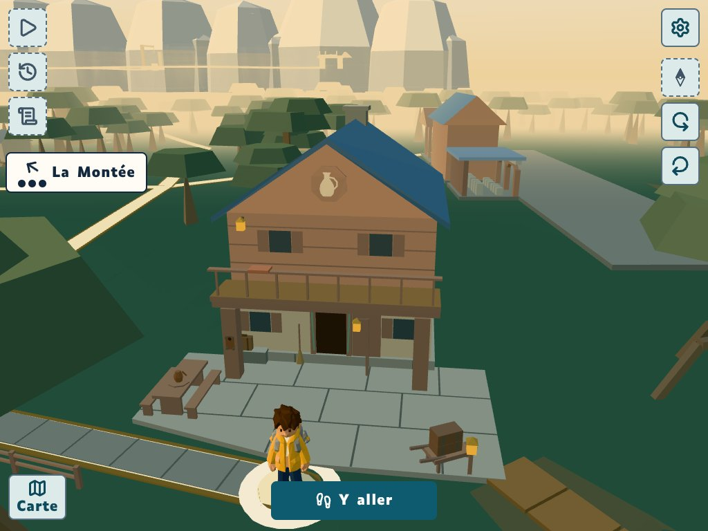

## De dos (même caméra qu'avant), de trois-quarts, et le ponton de côté (vue nouvelle)
- **De dos, en ruine et restauré** : la même vue qu'avant. Le ponton étant plus long, la caméra du premier passage se trouve maintenant au-dessus de son dernier tiers. La partie sur l'eau est donc sous la caméra et derrière elle : **de cette vue, on ne voit pas l'eau** sous le tablier ni de chaque côté. Il faudra une caméra de dos reculée, ou la vue de côté ci-dessous.
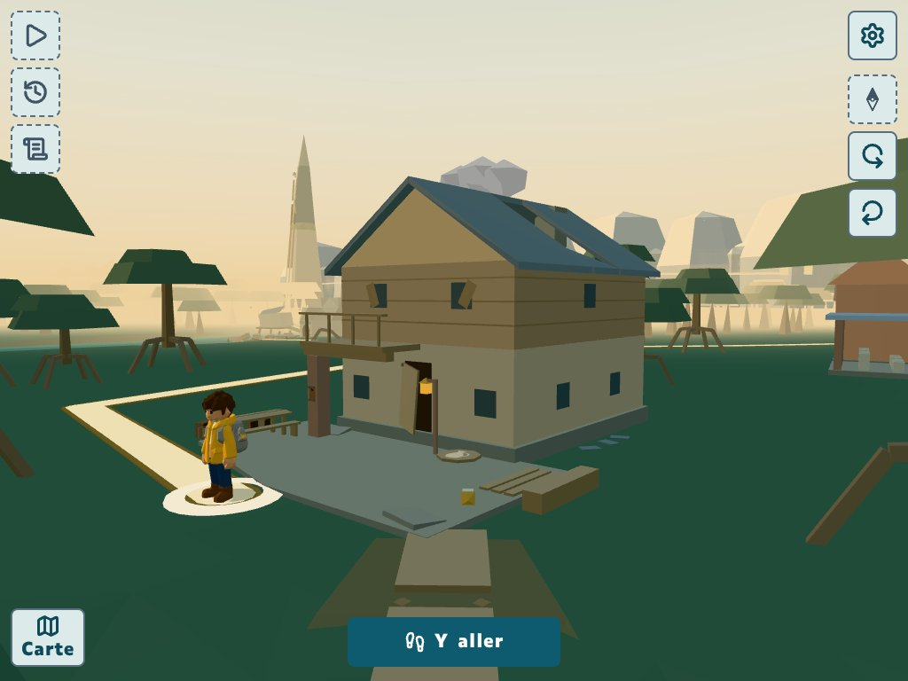
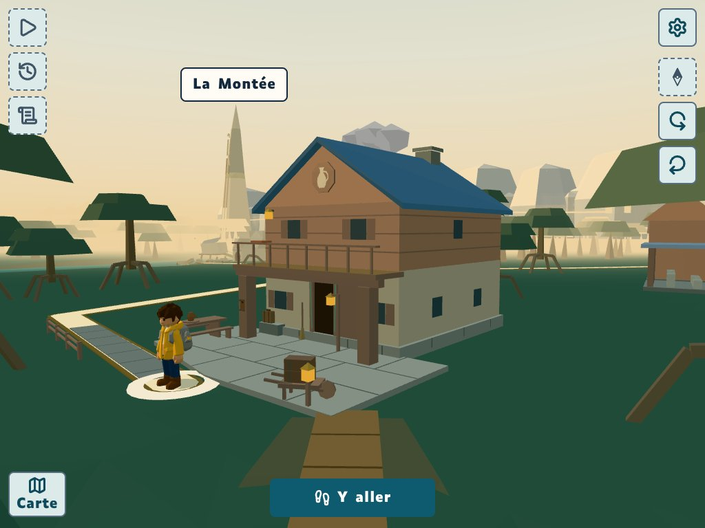
- **De trois-quarts (ouest)** : la lanterne du pignon est à l'angle ouest, la cruche de profil sur le pignon. Le ponton, au fond à droite, part vers l'eau bleu-vert.
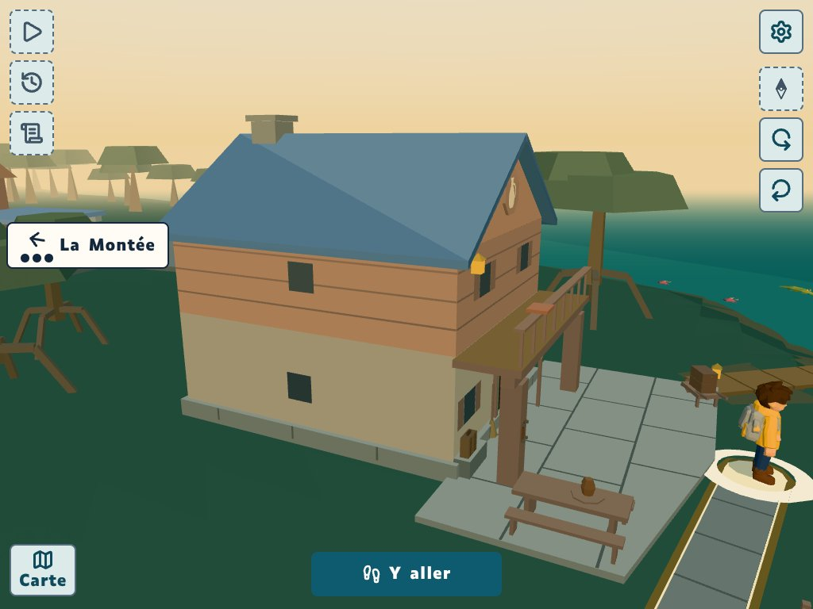
- **Le ponton de côté, depuis l'est (vue nouvelle)** : environ trois planches et le poteau du bout sont au-dessus de l'eau. En ruine, le bout du tablier plonge dans l'eau. Entre le parvis et l'eau, on voit la bande de vase olive. La caméra est basse, derrière la butte de la rive : Kéo, caché par le terrain, est dessiné en silhouette pâle.
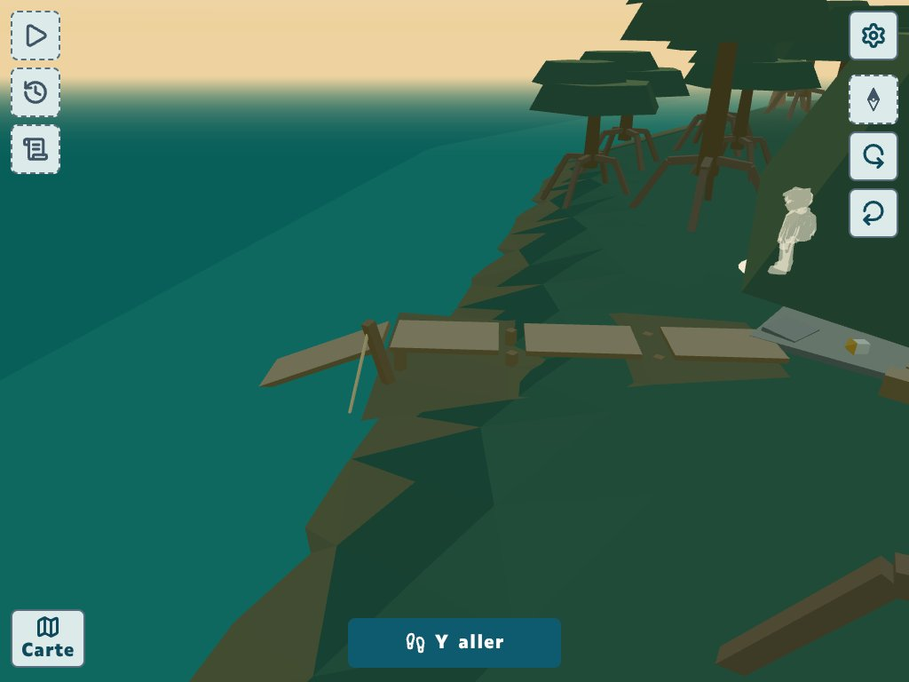
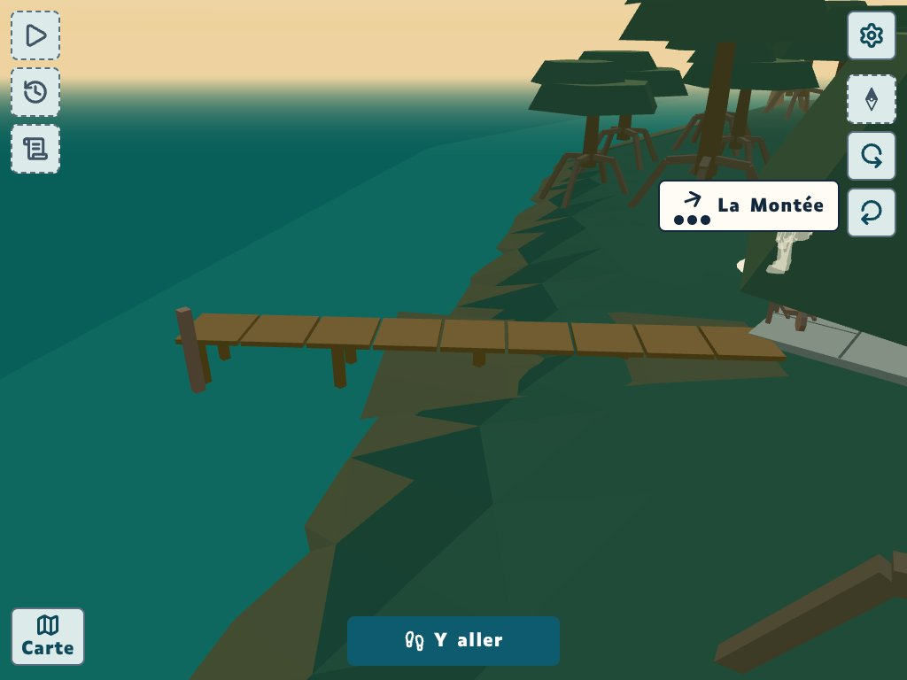

## Les vues zoomées (nouvelles)
- **L'enseigne et le pignon restauré, de près** : la cruche est pâle, sur un octogone à peine plus foncé que le pignon. Elle a un col étroit, une lèvre évasée, une panse ronde, et une anse à droite qui ne dépasse pas le col. On n'y lit ni « d » ni « D ». Deux réserves :
  - l'anse fait un angle franc en haut, alors que la retouche demande un arc arrondi sans angle droit ;
  - la panse est plus bombée à droite qu'à gauche.

  La lanterne est à l'angle ouest, sous la rive. Les deux fenêtres de l'étage ont leurs volets. La couverture est sur la main courante.
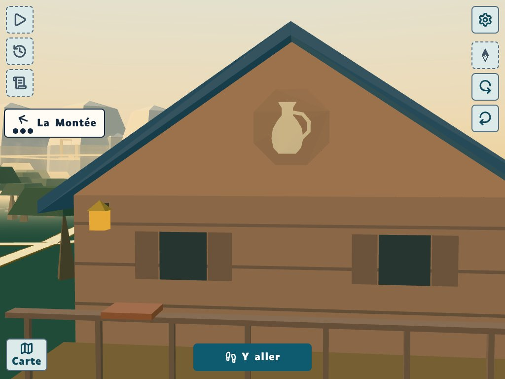
- **Le signe de la cloche, sur le poteau ouest, de près** : l'empreinte est un rectangle debout d'un brun plus chaud que le poteau. Le trou rond sombre est dans son tiers haut, et il y a un goujon de fer à chaque coin. Ce n'est ni un viseur, ni une croix, ni la face 5 d'un dé. Une réserve : les deux goujons du haut et le trou entre eux sont sur une même ligne, ce qui peut évoquer deux yeux et une bouche, faiblement. La valise se voit derrière le poteau, à droite.
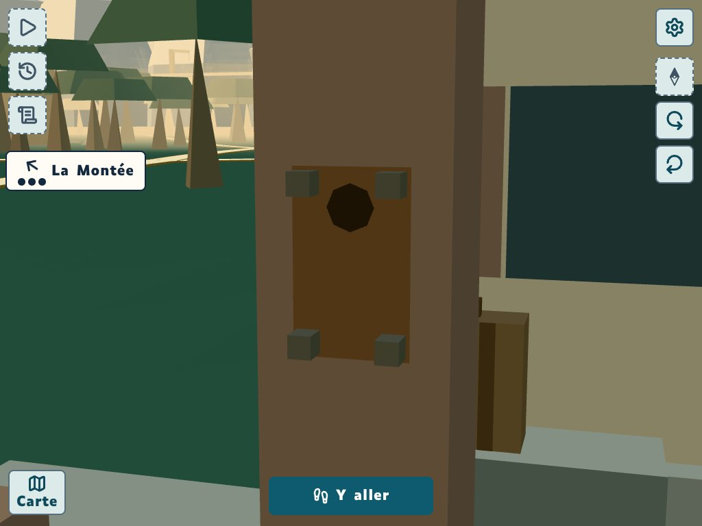

## La scénette de l'aubergiste
- **1024 × 768, panneau ouvert** (après une mission) : la même image qu'avant. Kéo est à gauche de la porte, l'aubergiste à droite, les trois malles sur leur planche. **Ni la valise ni le banc de pierre ne se voient** : le panneau couvre tout ce qui est à l'ouest du poteau. On ne voit pas non plus les abords (racine, rocher) : la racine est sous le panneau, et le rocher (à dx +6) est hors du cadre à droite.
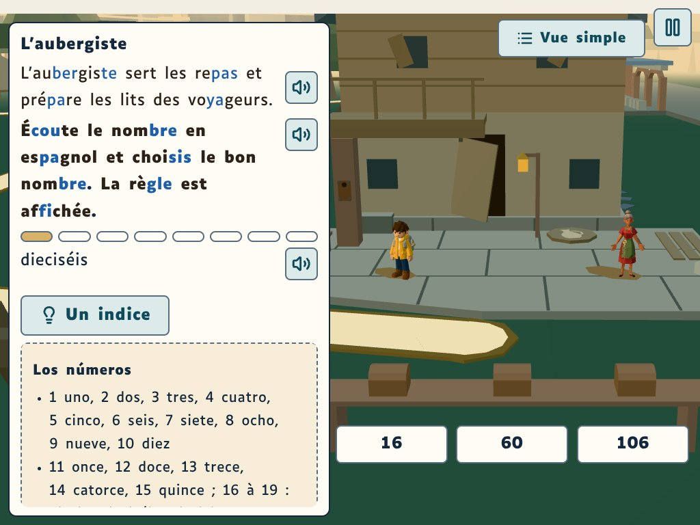
- **1024 × 768, après « Vue simple » puis « Scène »** : sur tablette, il n'y a de bouton « Scène » qu'en « Vue simple ». Revenue à la scène, la colonne reprend la même place et la même taille : **le panneau ne se replie pas** à 1024 × 768. L'image est la même que la précédente.
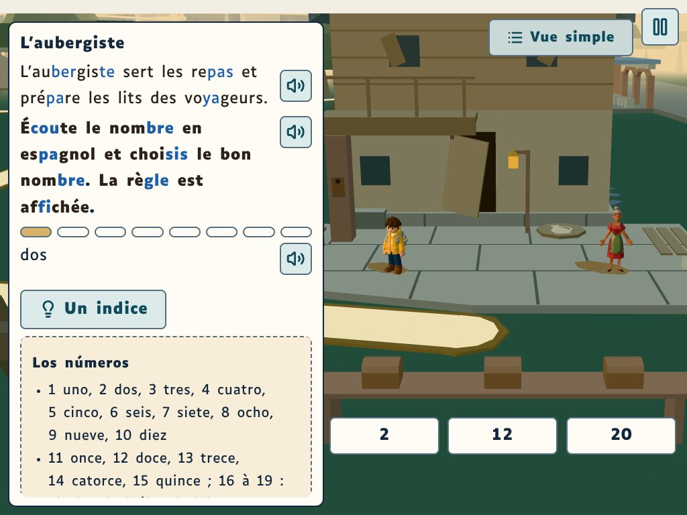
- **390 × 844, OpenDyslexic 32, après « Scène »** : la même image qu'au premier passage. Le panneau couvre presque toute la scène, « L'aubergiste » est coupé (« L'aubergist / e », « L'auberg / iste ») et « Vue simple » déborde de son bouton. Ces défauts sont connus, hors de la retouche.
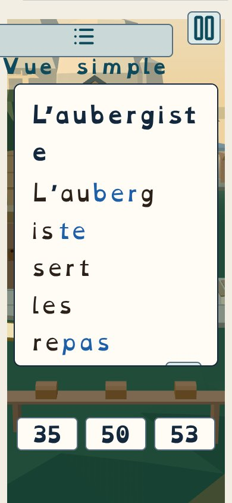
- **Une réponse touchée, 1024 × 768** : « 60 » est choisi, une réponse fausse. Le bouton est marqué (fond beige, chiffre brun), la malle du milieu est soulevée, et la bulle « Presque ! » avec son indice s'affiche au-dessus de la scène, sur l'étage.
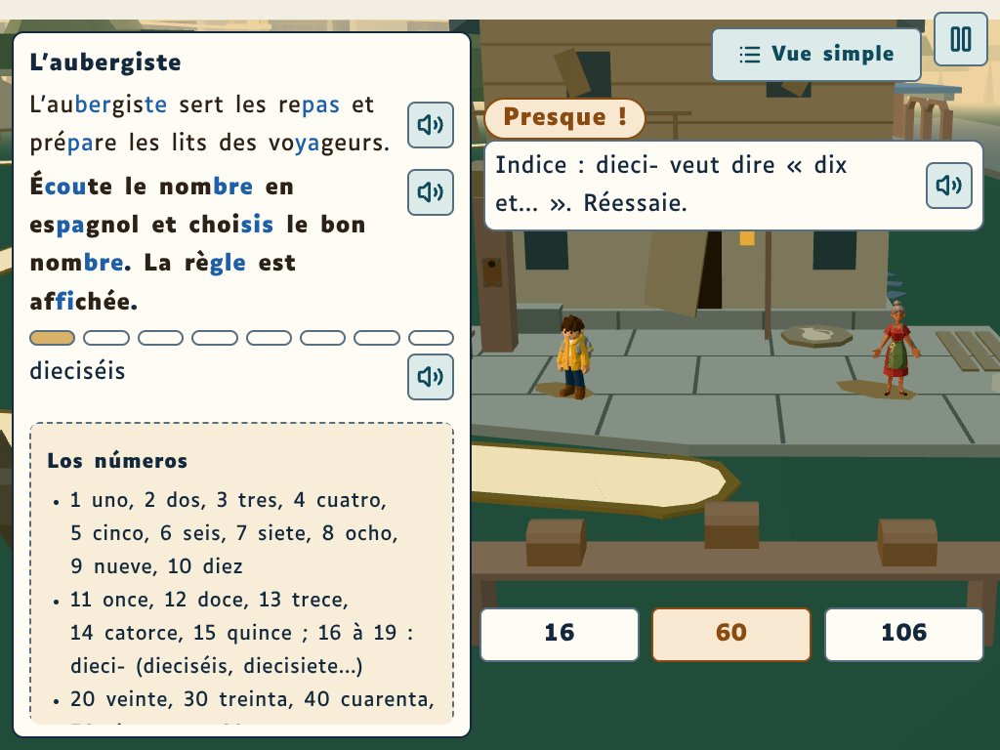
- **Une réponse touchée, 390 × 844** (police par défaut, puis « Scène ») : « 14 » est choisi, la bonne réponse. Le bouton est vert, mais la malle du milieu ne se lit presque pas soulevée à cette taille. La colonne du récit est étroite et coupée à droite (« Bien compté » tronqué, un bouton à moitié caché), et « L'aubergist / e » est coupé en haut. La maison, Kéo et l'aubergiste se voient, petits, au-dessus de l'eau.
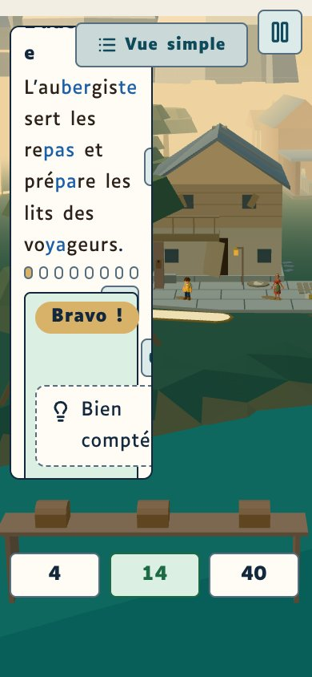
- **Restaurée, les cinq missions faites** : **aucune des cinq traces ne se voit** pendant la scénette. Ce n'est pas que Kéo ou l'aubergiste les cachent : l'Auberge ne déclare pas `keepsTracesInScenette`, donc les traces s'effacent le temps de la scénette (`scenetteHidesPieces`, `src/game/world/continu/scenette.ts`). Le balai, présent sur 04, manque entre le banc et la porte ; la couverture manque sur la main courante. Le plateau et la valise seraient de toute façon sous le panneau, et la brouette hors du cadre à droite. La valise elle-même est juste derrière le poteau ouest (x −3,1 pour un poteau en x −3,15) : vue du sud, la caméra de la scénette la trouverait cachée par le poteau.
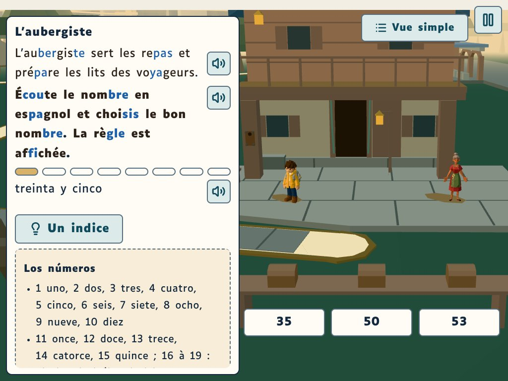

## Ce qui ne va pas, ou reste à juger
1. **La valise ne se voit pas dans la scénette**, ni à 1024 × 768 ni au téléphone (point 6 de la retouche non atteint). D'abord, les traces s'effacent pendant la scénette de l'Auberge. Ensuite, même gardée, la valise est presque à l'aplomb du poteau ouest et sous le panneau à 1024 × 768.
2. **Les cinq traces sont absentes de la scénette restaurée** (06-scenette-restaure), pour la même raison. Ce n'est ni Kéo ni l'aubergiste.
3. **Les abords de la scénette ne se voient pas** à 1024 × 768 : la racine est sous le panneau, le rocher hors du cadre à droite (point 7 non visible).
4. **De dos, le ponton ne se lit pas sur l'eau** avec la caméra du premier passage, qui est maintenant au-dessus de son bout. De côté (05-*-ponton), le dernier tiers est bien sur l'eau et le ponton en ruine y plonge.
5. **La cruche** : elle se lit comme une cruche, sans « d » ni « D ». Mais l'anse a un angle franc en haut, et la panse n'est pas symétrique.
6. **Le signe de la cloche** : ni viseur ni dé. De près, l'alignement goujon, trou, goujon en haut peut faire un léger visage. Au référent dys de juger.
7. **Le visage au pignon** : affaibli. La lanterne n'est plus sous l'enseigne, et l'enseigne est haute, loin des deux fenêtres. Il reste deux fenêtres à volets symétriques sous un rond, comme tout pignon.
8. **Au téléphone, en police par défaut**, après une réponse : la colonne est coupée à droite. Point général, à ajouter aux suites connues du panneau au téléphone.
9. Rien de coupé dans les vues de face et dans « Y aller » : la maison est entière. Rien de croisé. Aucune lettre ni aucun chiffre dans la 3D.
