# Monde ouvert d'Archipéo, l'île du 5e en grandes masses (GD-22, lot 2)

Rendu Archipéo, Chromium en rendu logiciel. Monde : commit dc0fac31 (inchangé depuis) ; Carte : commit c508ecc8.

## Le monde

| | |
| --- | --- |
| 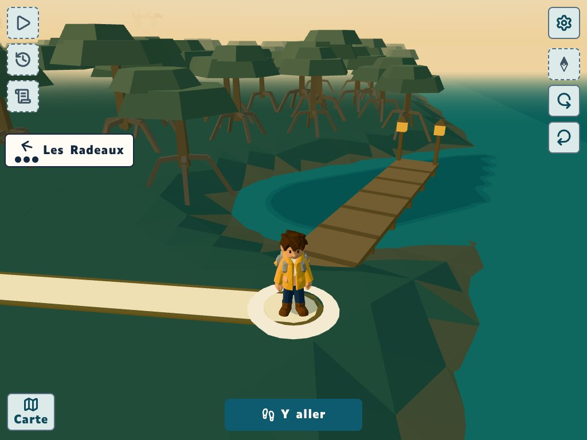 Départ au ponton de la Lisière | 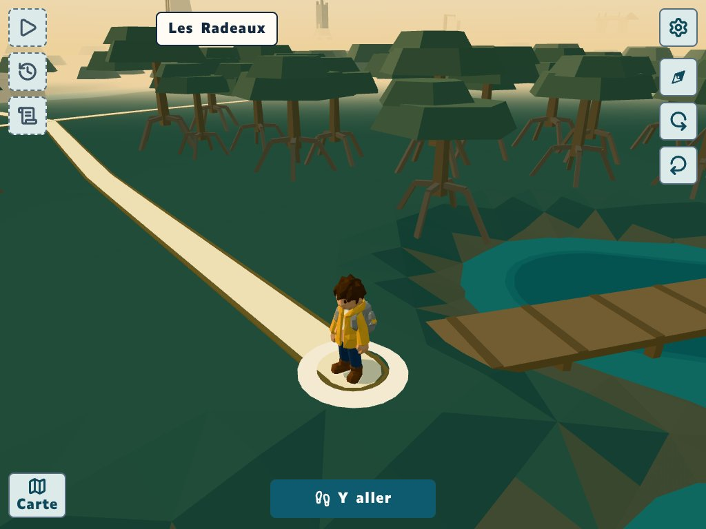 La Montée vue de la Lisière |
| 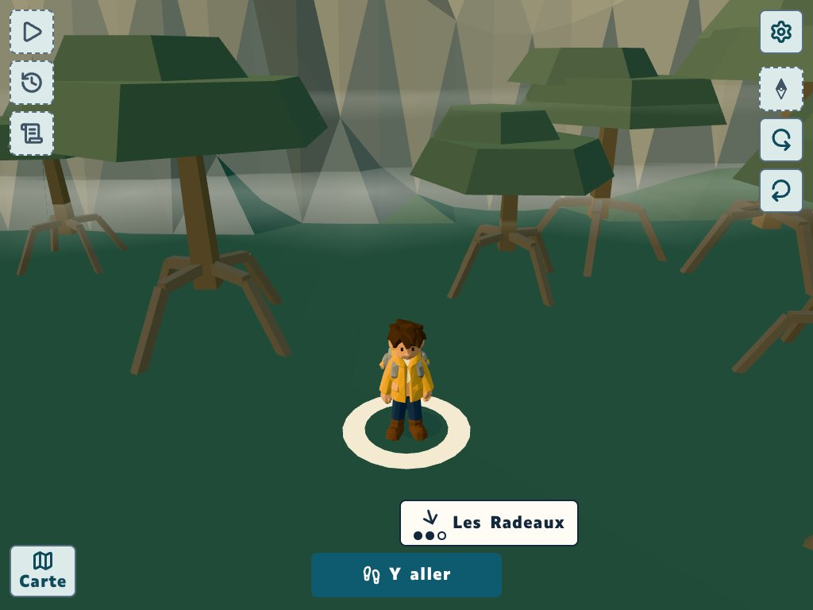 Le plateau vu d'en bas, la falaise | 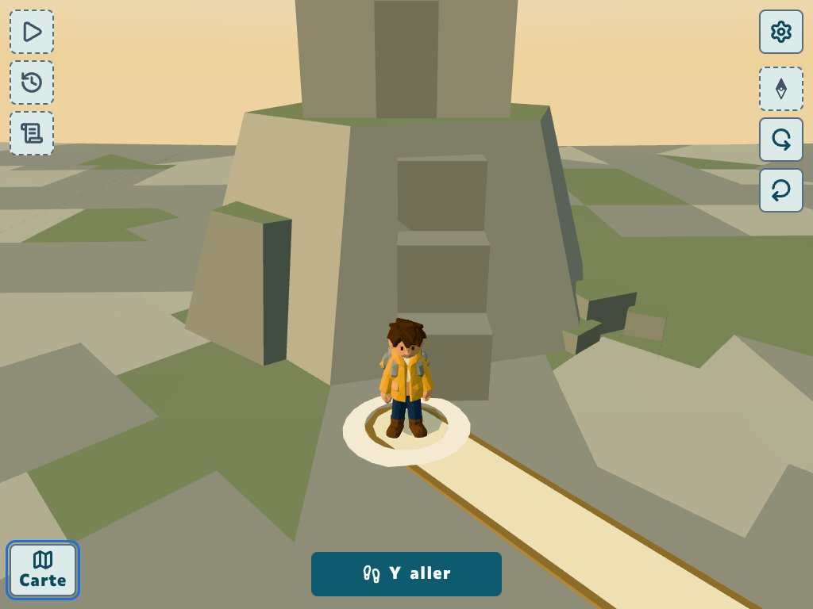 Kéo sur le plateau, le Donjon |
| 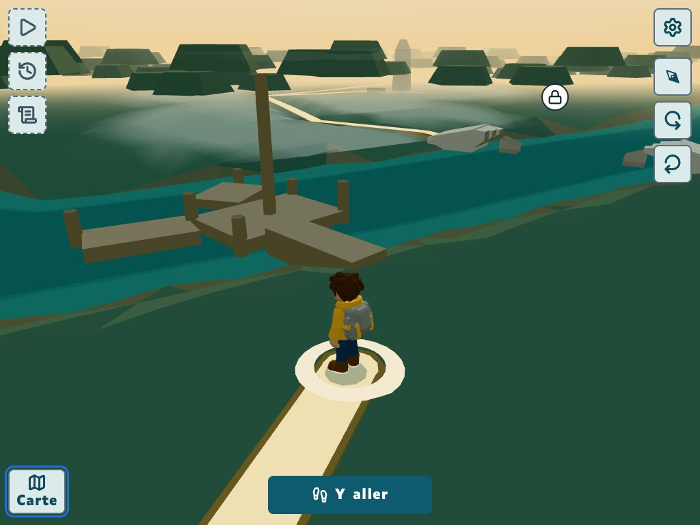 Les Roselières, terre fermée, dans la brume | |

## La Carte

| | |
| --- | --- |
| 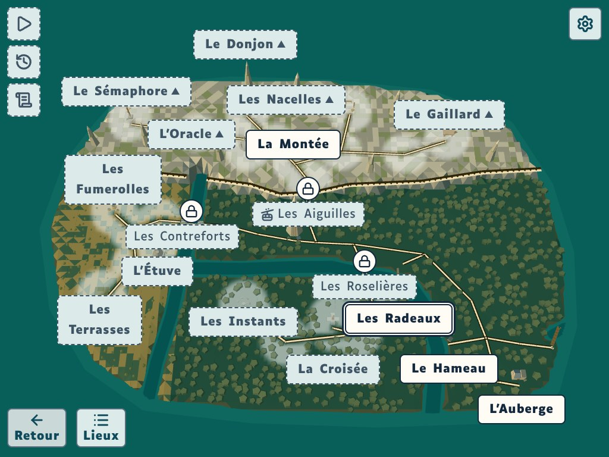 Tablette, prochain lieu (les Radeaux) au double contour | 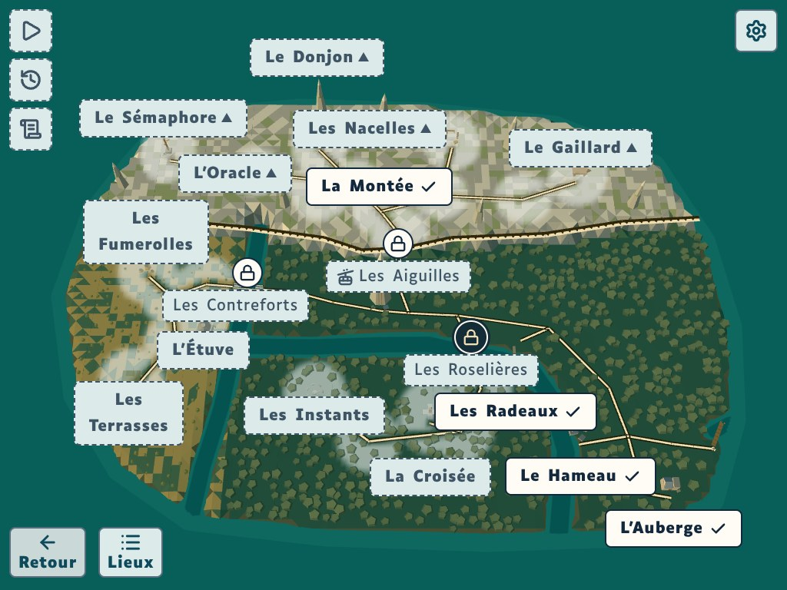 Frondaisons jouées : le cadenas des Roselières suggéré |
| 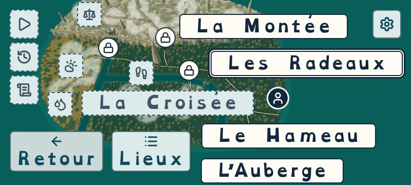 Téléphone couché, plus grand texte, 5e | 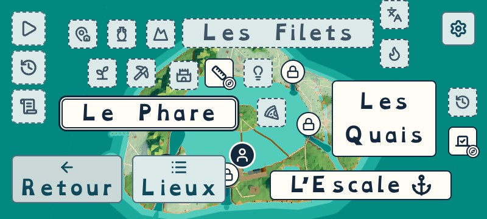 Le même au 6e |

## La falaise et les chemins (zoom ×3, avant en haut, après en bas)

| Falaise et chemin du plateau | Falaise au chenal de l'ouest |
| --- | --- |
| 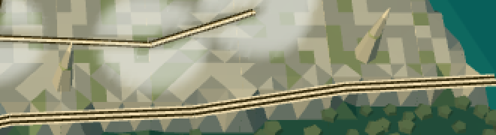 | 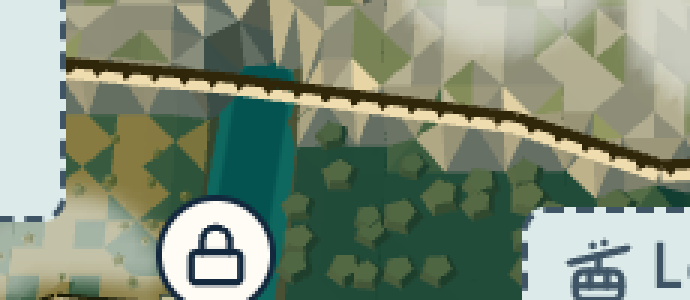 |
| 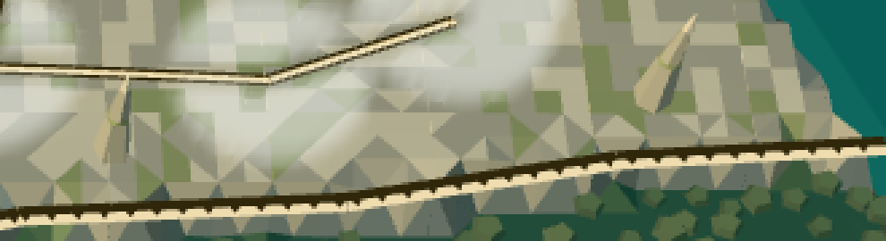 | 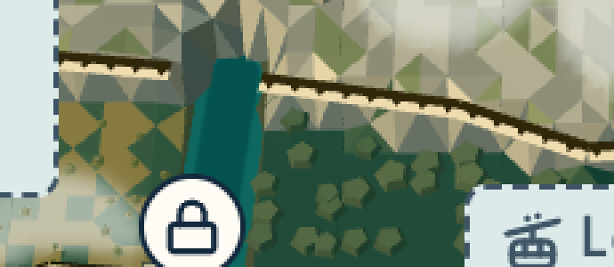 |
