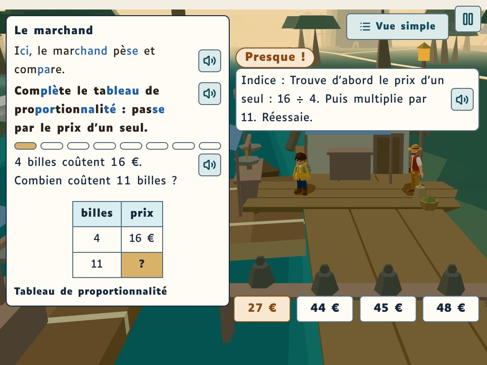
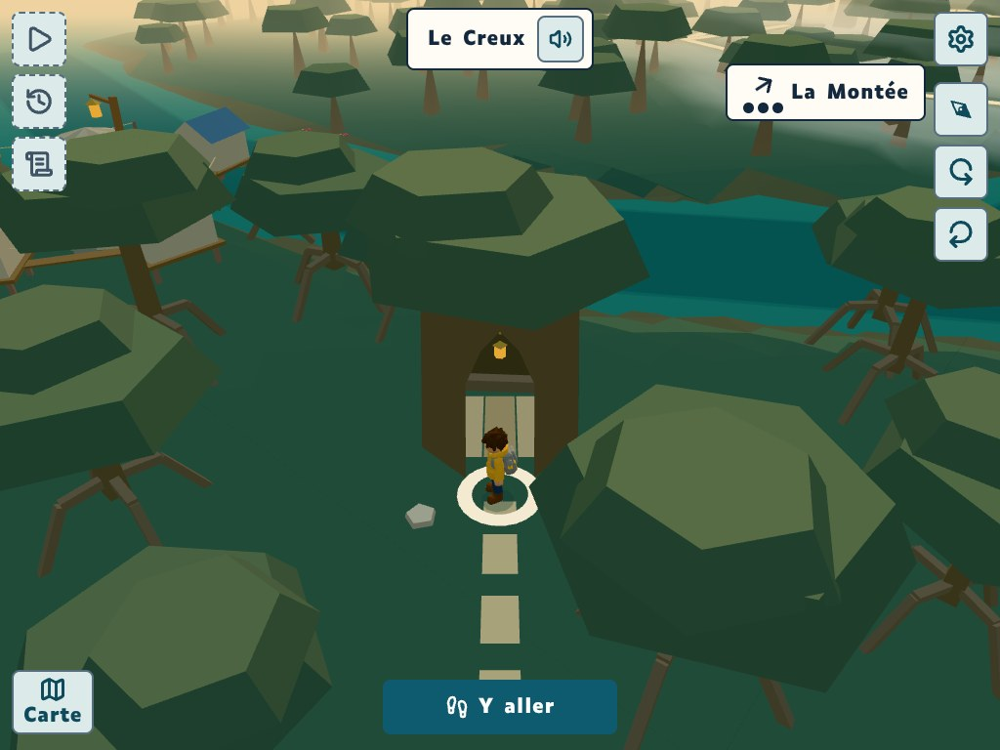
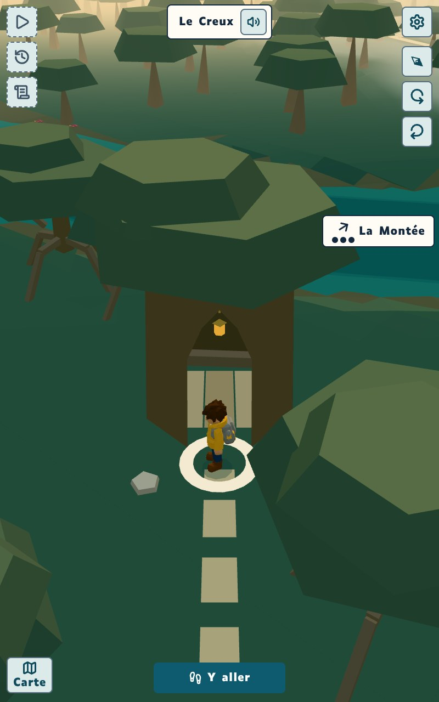

# GD-22, lot 6 du 5e : les Radeaux et le Creux (retouche 2)

Captures 1024 × 768 sauf mention, sur le commit 2b2a7233, « retouche 2 » (branche `claude/project-thread-1w41fl`), qui remplace la série de la retouche 1 (3c9ada19), `vite` en local, horloge pilotée et hasard fixe (`scripts/prise-de-vue.mjs`). État de sauvegarde préparé : le Hameau restauré, les Radeaux après 0, 1, 3, 4 et 5 missions (`poserLesParties`, inchangé depuis la retouche 1). Caméra posée à la main (`view`) pour les vues de la porte, de dos et de trois-quarts, et pour le Creux vu du chemin ; la caméra de marche ne change pas. Mêmes vues, mêmes cadrages que la retouche 1, et trois images de plus : la scénette avec un poids choisi (06), l'arrivée au Creux avec son nom écrit, en 1024 × 768 et en 800 × 1280 (07).

## Ce que la retouche 2 change, vu dans les images
- Scénette : chaque poids se tient droit et centré au-dessus de son étiquette ; le poids choisi se soulève au-dessus de la planche, sans passer sous son étiquette (06).
- La réplique du marchand : « Ici, le marchand pèse et compare. » (06).
- La marque « La Montée » passe à gauche de Réglages : entière aux Radeaux (04, où elle était coupée en « La Mon ») et à l'arrivée au Creux (07).
- De dos, le portique a des poteaux et des bras plus fins ; la fourche reste à sa hauteur (05).
- Dans la ruine, plus de triangle pâle sur un piquet devant Kéo : la planche tombée est à plat sur le sol, sans poteau dressé (01 à 03 ; elle part avec les abords à la restauration, 04).
- Le reste ne bouge pas (écarts de 0,04 à 0,7 % de pixels, sauf ce qui précède et l'arrivée au Creux, 2,3 %, où seule la marque change de place).

## La planche validée par le mainteneur

## Le cap de « Y aller » (la ruine)
Après « Y aller », la caméra regarde maintenant le lieu depuis sa porte (au nord-est) : le quai, puis les radeaux, puis la rive d'en face. Prise sans toucher la caméra, comme l'élève qui arrive.

## Vu de la porte : en ruine, après le corps 1 sur 3, après le corps 3 sur 3, après le haut, restauré

## Restauré : de dos (vers l'ouest-nord-ouest, la Montée) et trois-quarts

## La scénette du marchand, la question aux poids ; téléphone 390 × 844, OpenDyslexic 32
Les questions de la scénette ne sont pas tirées dans le même ordre d'une prise à l'autre : le texte de la question change d'une image à l'autre, la scène non. En 390 × 844, OpenDyslexic 32, la réplique coupe « marchand » en « marchan / d » et laisse le point final seul sur sa ligne (à juger par le référent dys).

## La scénette, un poids choisi
Une réponse touchée (ici fausse, « Presque ! ») : son poids se soulève, centré au-dessus de l'étiquette, sans passer dessous. Prise une seconde après le toucher.

## Le Creux : vu du chemin, puis l'arrivée (Kéo sur le seuil, la caméra qui monte)
À l'arrivée, la caméra qui monte se tourne d'elle-même vers l'arche, derrière Kéo sur le seuil. La première image est prise avec le cap de la marche depuis le chemin, la deuxième après quatre tours de la caméra avant d'arriver : les deux finissent sur le même regard.

## L'arrivée au Creux, son nom écrit ; 800 × 1280
Le même chemin que « l'arrivée », prise 3,8 s après l'arrivée sur le seuil : « Le Creux » est encore écrit en haut (il l'est 4 s), la caméra est au repos (moins de 0,02 % de pixels d'écart avec la prise à 5 s, hors du nom). En 800 × 1280, la marque « La Montée » se range sous la colonne de la caméra, au bord droit, entière.

## La Carte du 5e : les Radeaux en ruine, restaurés
Le nom « Les Radeaux » reste au nord de son point ; les trois radeaux, au sud sur le chenal, restent à découvert (petits à cette échelle).

## La nuit : pas de capture
Le monde ouvert du 5e n'a pas encore de nuit (l'heure de la page ne change rien à sa lumière) : la ruine et sa lanterne seule, les Radeaux restaurés et leurs trois lanternes se jugeront au lot du jour et de la nuit.
