# GD-22, lot 7 du 5e : la Croisée

Captures 1024 × 768 sauf mention, sur le commit d5b7d637 (branche `claude/project-thread-mn7z4o`), `vite` en local, horloge pilotée et hasard fixe (`scripts/prise-de-vue.mjs`). État de sauvegarde préparé : les autres lieux restaurés, la Croisée après 0, 1, 3, 4 et 5 missions (`poserLesParties`), chaque partie avec sa trace. Kéo posé à la porte de la Croisée (« Y aller »). Caméra de marche pour les vues de la porte ; caméra posée à la main (`view`) pour les vues de près, de trois-quarts et de dos (la caméra de marche ne change pas). Pour les vues du lieu restauré, une mission des Instants est laissée à faire : sans elle, « Aucune mission à faire ici pour l’instant » couvrait le bas de la vue ; la marque « Les Instants » apparaît à la place.

## La planche validée par le mainteneur
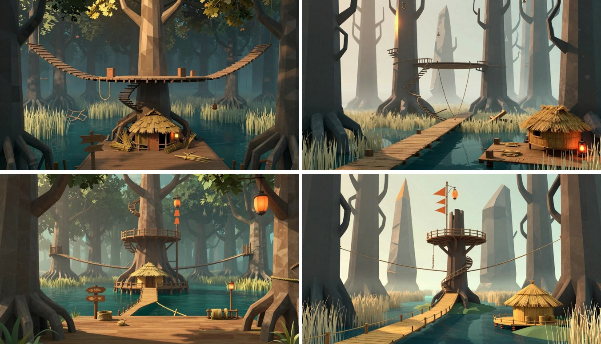

## Vu de la porte : en ruine, restaurée
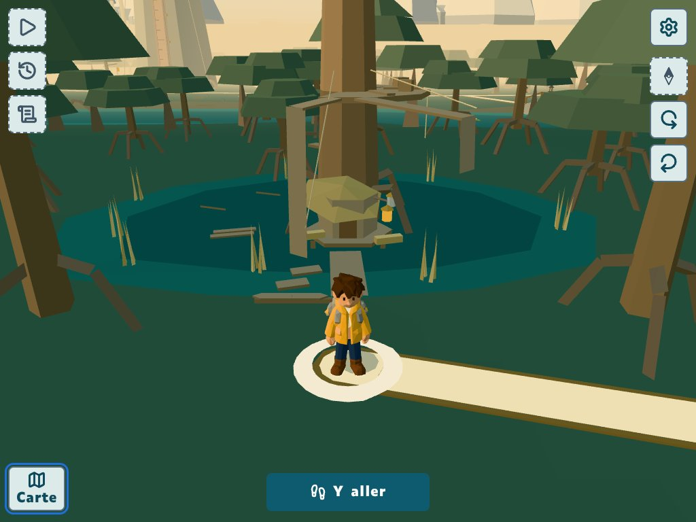
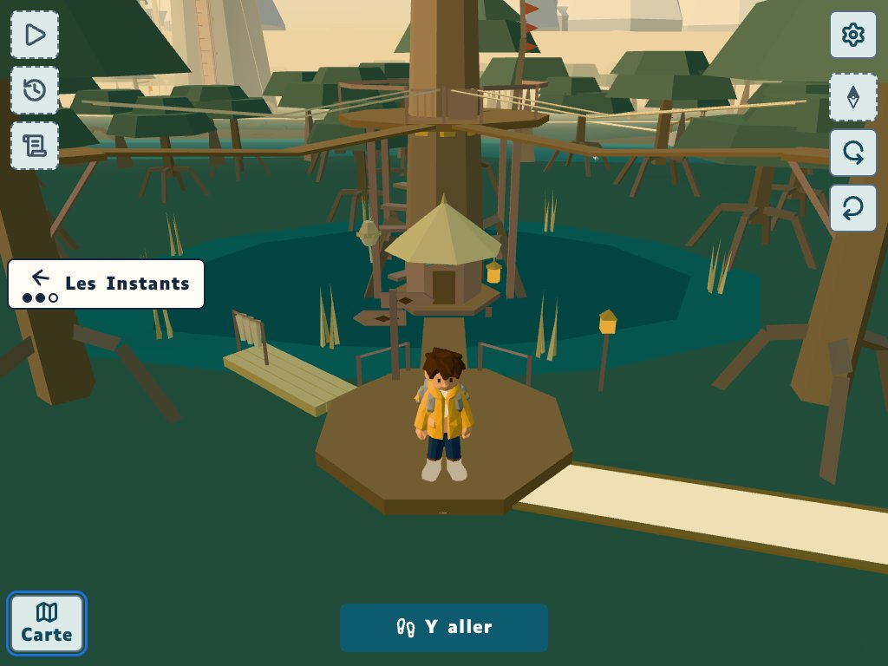

## De près : la ruine, après le corps 1 sur 3, après le corps 3 sur 3, après le haut, restaurée
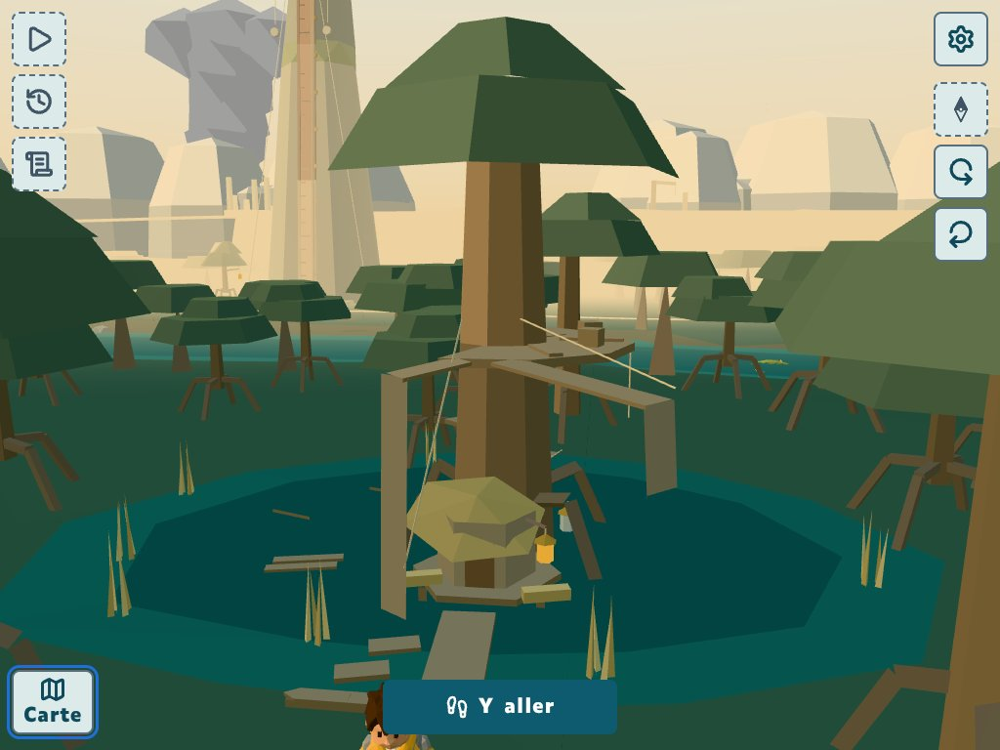
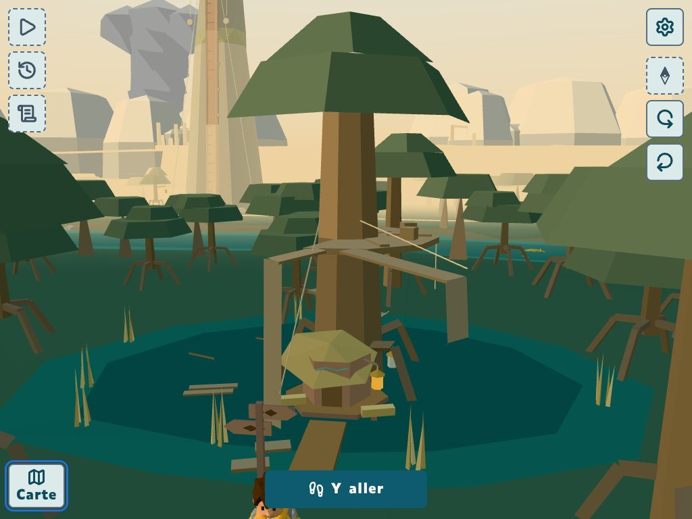
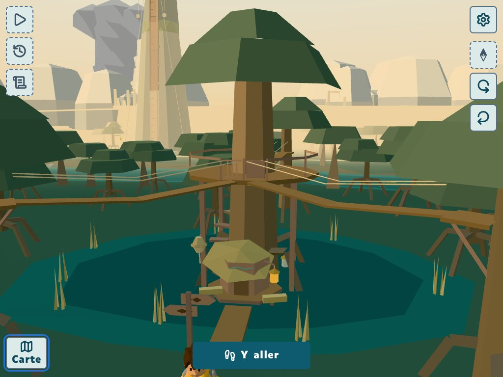
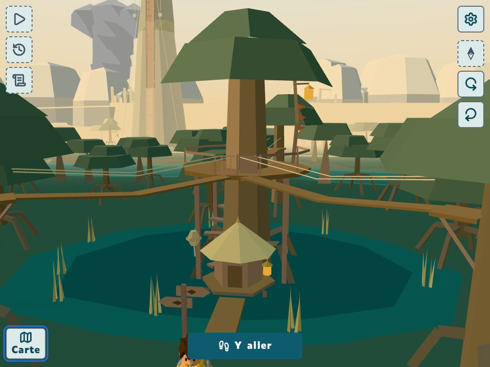
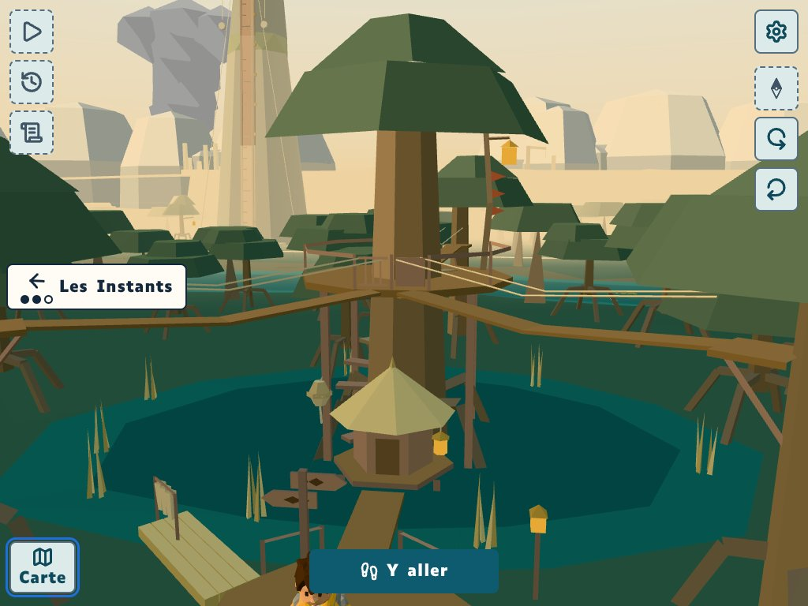

## Restaurée : trois-quarts (depuis l'est-sud-est) et de dos (depuis le nord-est)
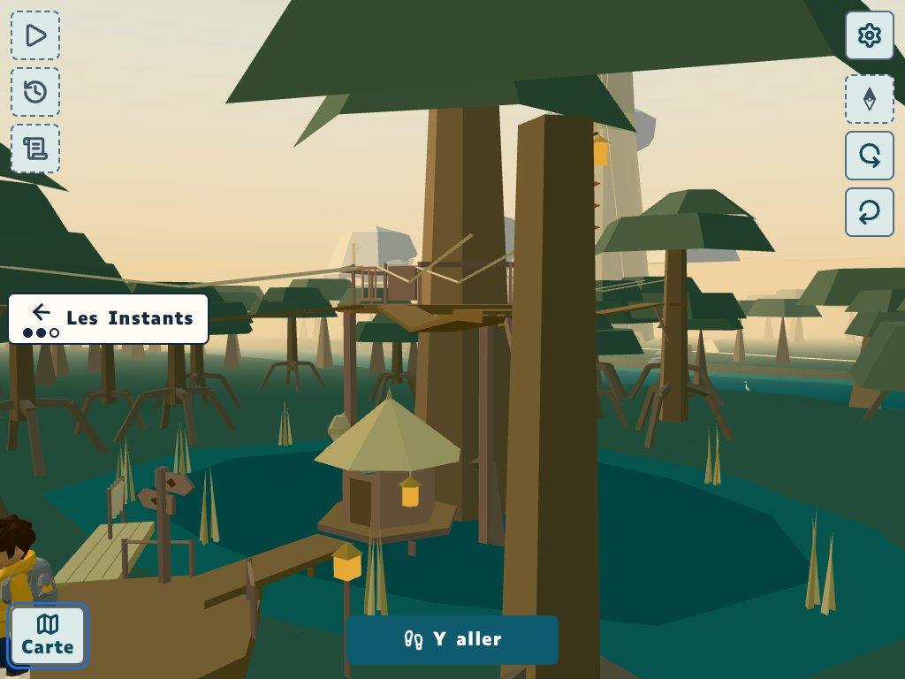
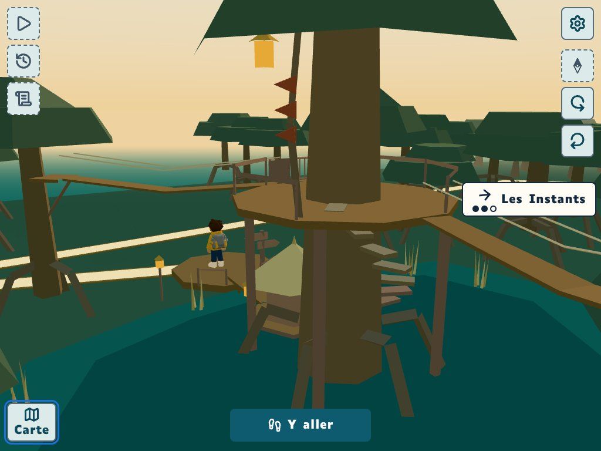

## La scénette de la cordière, la question ces / ses ; téléphone 390 × 844, OpenDyslexic 32
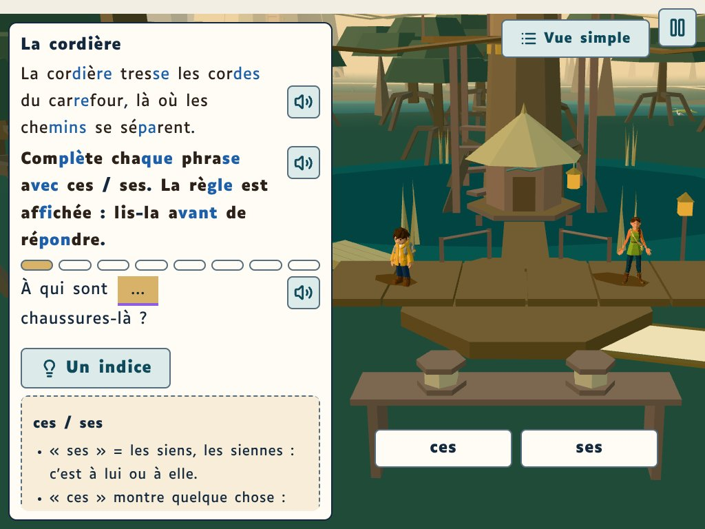
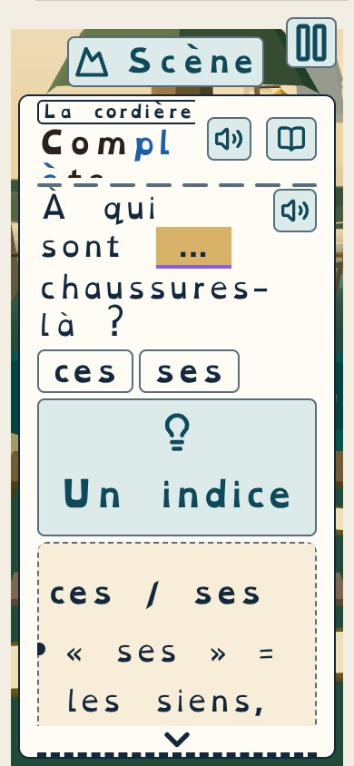

## La nuit : pas de capture
Le monde ouvert du 5e n'a pas encore de nuit (l'heure de la page ne change rien à sa lumière) : la lanterne de la cordière se jugera au lot du jour et de la nuit.

## La Carte du 5e : la Croisée restaurée
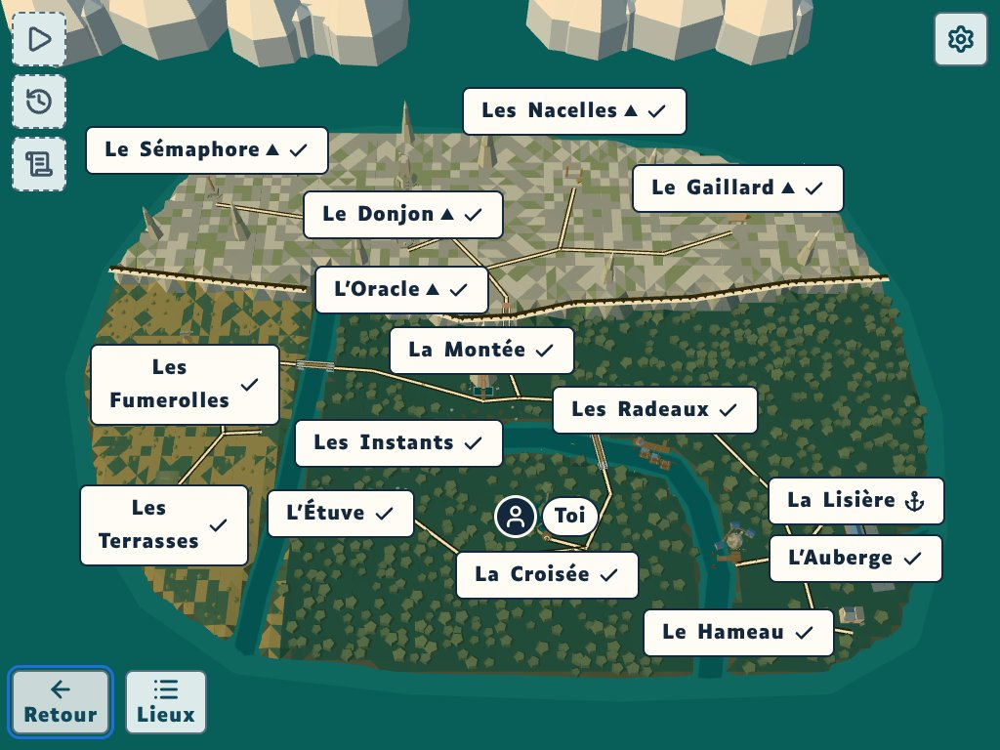
