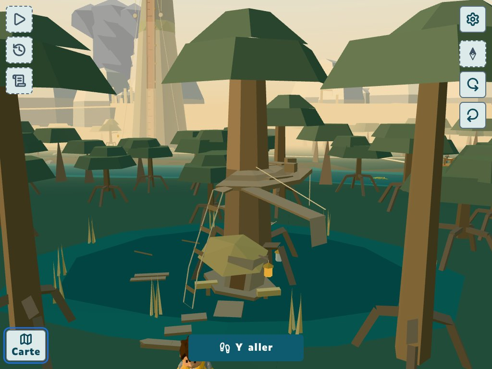
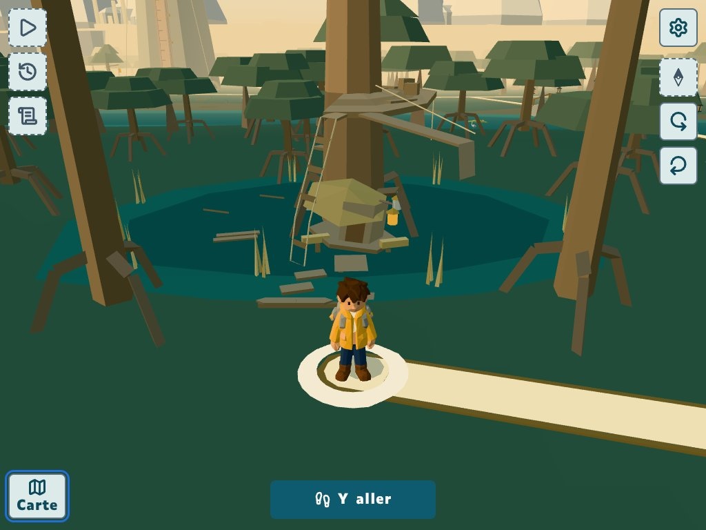
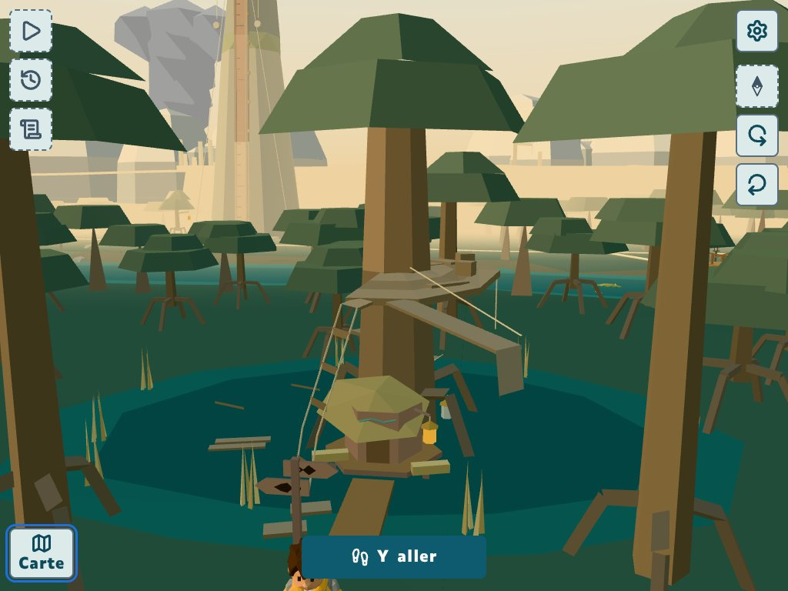
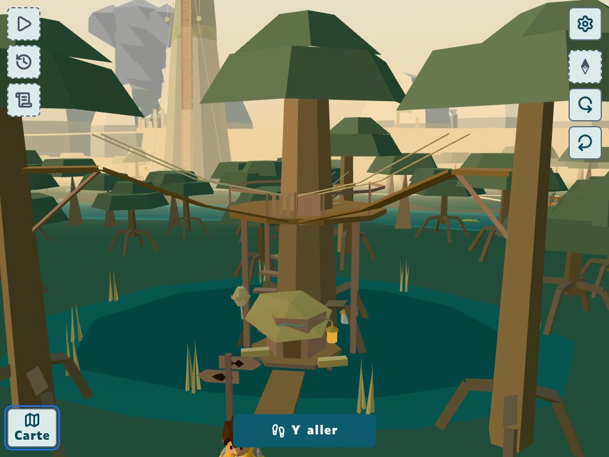
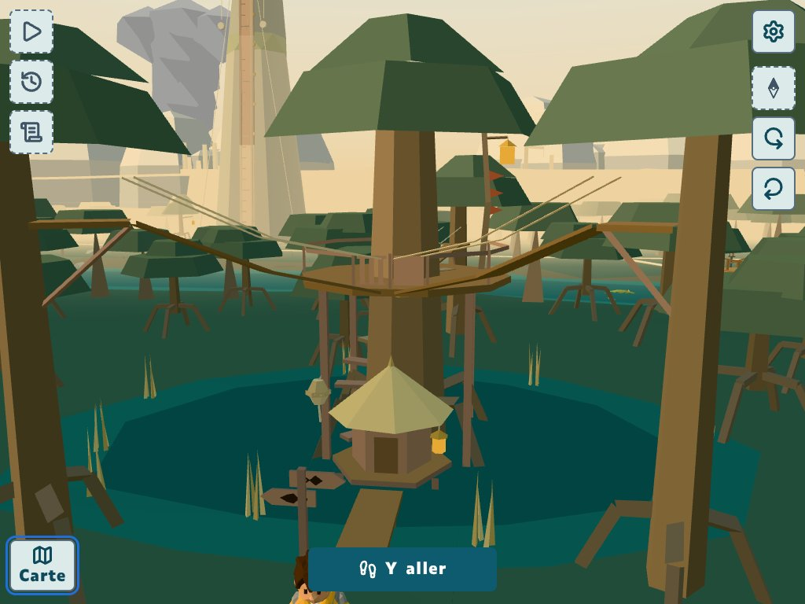
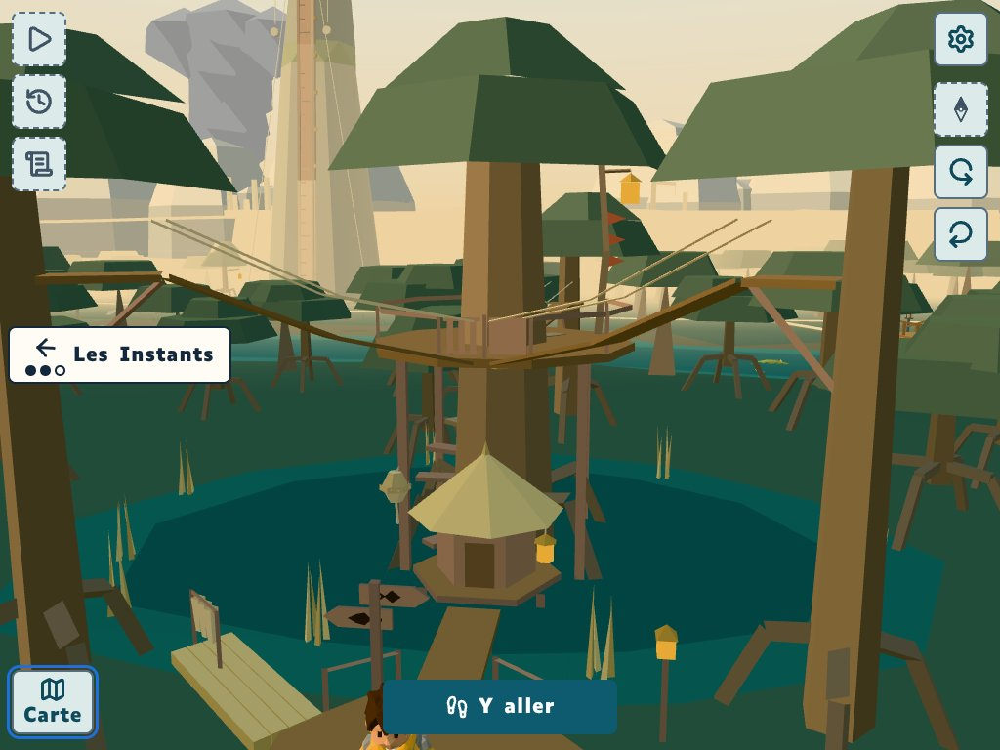
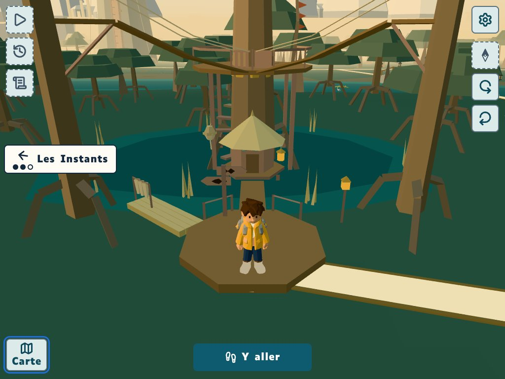
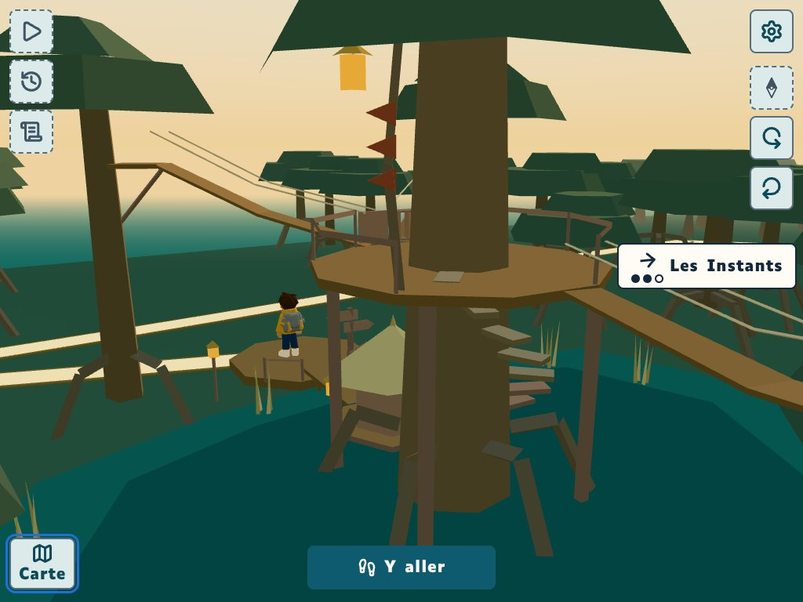
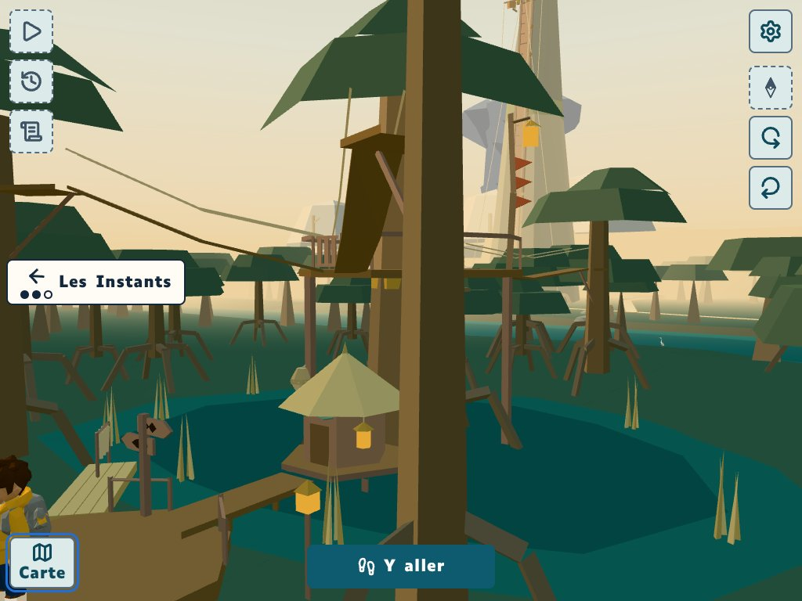
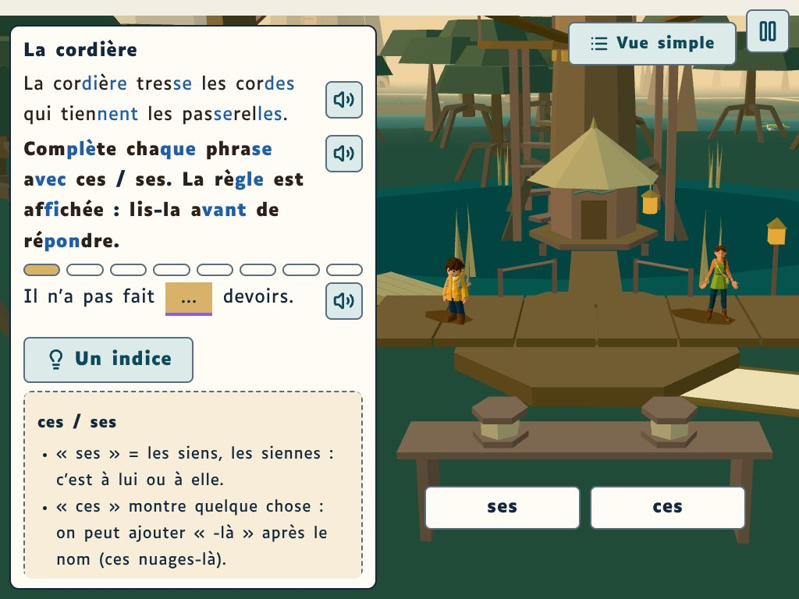

# GD-22, lot 7 du 5e : la Croisée, retouche 1 (commit 9207119c)

Mêmes cadrages que la première passe (caméra de marche pour les vues de la porte, caméra posée à la main pour les autres). La fourche en Y (45°, paliers qui montent de 2), la ruine sans portique, la cabane penchée et le pont coupé, les pictogrammes et les portillons.

## 01-ruine-de-pres

## 01-ruine-vu-de-la-porte

## 02-apres-le-corps-1-sur-3

## 02-apres-le-corps-3-sur-3

## 03-apres-le-haut

## 04-restaure-de-pres

## 04-restaure-vu-de-la-porte

## 05-restaure-de-dos

## 05-restaure-trois-quarts

## 06-scenette-cordiere

